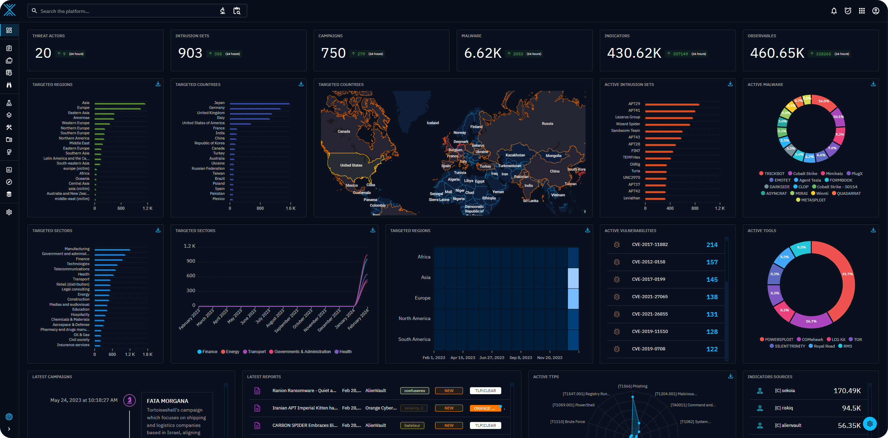

  
  
  
  
  
  
  

> **Community workshop:** Join us as Taylor Walton (of SOCFortress) walks through his working SOC stack: OpenCTI → OpenAEV → Wazuh → Velociraptor. Taylor will be joined by OpenCTI's product owner to cover what's coming next for OpenCTI and OpenAEV.
>
> [Register](https://events.filigran.io/register/e751635a-9aec-49f5-801c-40cfded49c87?utm_medium=community&utm_source=github) · Dec 10 at 10 AM New York City time
>
> Join us on the
> [Filigran Community Slack](https://community.filigran.io/?utm_medium=community&utm_source=github).

## Introduction

OpenCTI is an open source platform allowing organizations to manage their cyber threat intelligence knowledge and observables. It has been created in order to structure, store, organize and visualize technical and non-technical information about cyber threats.

The structuration of the data is performed using a knowledge schema based on the [STIX2 standards](https://oasis-open.github.io/cti-documentation/). It has been designed as a modern web application including a [GraphQL API](https://graphql.org) and a UX-oriented frontend. Also, OpenCTI can be integrated with other tools and applications such as [MISP](https://github.com/MISP/MISP), [TheHive](https://github.com/TheHive-Project/TheHive), [MITRE ATT&CK](https://github.com/mitre/cti), etc.

## Objective

The goal is to create a comprehensive tool allowing users to capitalize technical (such as TTPs and observables) and non-technical information (such as suggested attribution, victimology etc.) while linking each piece of information to its primary source (a report, a MISP event, etc.), with features such as links between each information, first and last seen dates, levels of confidence, etc. The tool is able to use the [MITRE ATT&CK framework](https://attack.mitre.org) (through a [dedicated connector](https://github.com/OpenCTI-Platform/connectors)) to help structure the data. The user can also choose to implement their own datasets.

Once data has been capitalized and processed by the analysts within OpenCTI, new relations may be inferred from existing ones to facilitate the understanding and the representation of this information. This allows the user to extract and leverage meaningful knowledge from the raw data.

OpenCTI not only allows [imports](https://docs.opencti.io/latest/usage/import-automated/) but also [exports of data](https://docs.opencti.io/latest/usage/feeds/) under different formats (CSV, STIX2 bundles, etc.). [Connectors](https://hub.filigran.io/cybersecurity-solutions/open-cti-integrations) are currently developed to accelerate interactions between the tool and other platforms.

## Editions of the platform

OpenCTI platform has 2 different editions: Community (CE) and Enterprise (EE). The purpose of the Enterprise Edition is to provide [additional and powerful features](https://filigran.io/offering/subscribe) which require specific investments in research and development. You can enable the Enterprise Edition directly in the settings of the platform.

* OpenCTI Community Edition, licensed under the [Apache 2, Version 2.0 license](LICENSE).
* OpenCTI Enterprise Edition, licensed under the [Enterprise Edition license](LICENSE).

To understand what OpenCTI Enterprise Edition brings in terms of features, just check the [Enterprise Editions page](https://filigran.io/offering/subscribe) on the Filigran website. You can also try this edition by enabling it in the settings of the platform.

## Documentation and demonstration

If you want to know more on OpenCTI, you can read the [documentation on the tool](https://docs.opencti.io). If you wish to discover how the OpenCTI platform is working, a [demonstration instance](https://demo.opencti.io) is available and open to everyone. This instance is reset every night and is based on reference data maintained by the OpenCTI developers.

## Releases download

The releases are available on the [Github releases page](https://github.com/OpenCTI-Platform/opencti/releases). You can also access the [rolling release package](https://releases.opencti.io) generated from the master branch of the repository.

## Installation

All you need to install the OpenCTI platform can be found in the [official documentation](https://docs.opencti.io). For installation, you can:

* [Use Docker](https://docs.opencti.io/latest/deployment/installation/#using-docker)
* [Install manually](https://docs.opencti.io/latest/deployment/installation/#install-manually)
* [Use Terraform (community)](https://docs.opencti.io/latest/deployment/installation/#terraform)
* [Use Helm charts (community)](https://docs.opencti.io/latest/deployment/installation/#helm-charts)

## Contributing

### Code of Conduct

OpenCTI has adopted a [Code of Conduct](CODE_OF_CONDUCT.md) that we expect project participants to adhere to. Please read the [full text](CODE_OF_CONDUCT.md) so that you can understand what actions will and will not be tolerated.

### Contributing Guide

Read our [contributing guide](CONTRIBUTING.md) to learn about our development process, how to propose bugfixes and improvements, and how to build and test your changes to OpenCTI.

### Beginner friendly issues

To help you get familiar with our contribution process, we have a list of [beginner friendly issues](https://github.com/OpenCTI-Platform/opencti/labels/beginner%20friendly%20issue) which are fairly easy to implement. This is a great place to get started.

### Development

If you want to actively help OpenCTI, we created a [dedicated documentation](https://docs.opencti.io/latest/development/environment_ubuntu/) about the deployment of a development environment and how to start the source code modification.

## Community

Star OpenCTI to follow it and to help other security teams find it.

<picture>
  <source media="(prefers-color-scheme: dark)" srcset="./.github/img/readme/stars-dark.svg">
  <source media="(prefers-color-scheme: light)" srcset="./.github/img/readme/stars-light.svg">
  
</picture>

- **Questions and discussion**: the Filigran [community Slack](https://community.filigran.io).
- **Bugs and feature requests**: [GitHub issues](https://github.com/OpenCTI-Platform/opencti/issues).
- **Learn**: free courses on [Filigran Academy](https://academy.filigran.io).

## Contributing

Read the [contributing guide](CONTRIBUTING.md) to set up a development environment and propose a change. OpenCTI has adopted a [Code of Conduct](CODE_OF_CONDUCT.md). First contribution: the [good first issues](https://github.com/OpenCTI-Platform/opencti/labels/good%20first%20issue).

## Security

Report vulnerabilities privately as described in [SECURITY.md](SECURITY.md), never in a public issue.

## License

OpenCTI is open source under the [Apache 2.0 license](LICENSE); the Enterprise Edition features are under the OpenCTI Enterprise Edition License, as stated in [LICENSE](LICENSE) and in each source file header.

## About Filigran

OpenCTI is designed and developed by [Filigran](https://filigran.io), the company behind the [XTM Platform](https://filigran.io) for Agentic CTEM.

<picture>
  <source media="(prefers-color-scheme: dark)" srcset="./.github/img/readme/filigran-dark.svg">
  <source media="(prefers-color-scheme: light)" srcset="./.github/img/readme/filigran-light.svg">
  
</picture>
