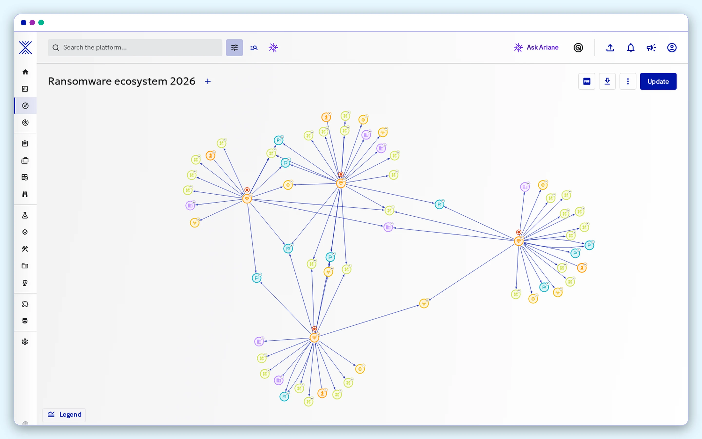
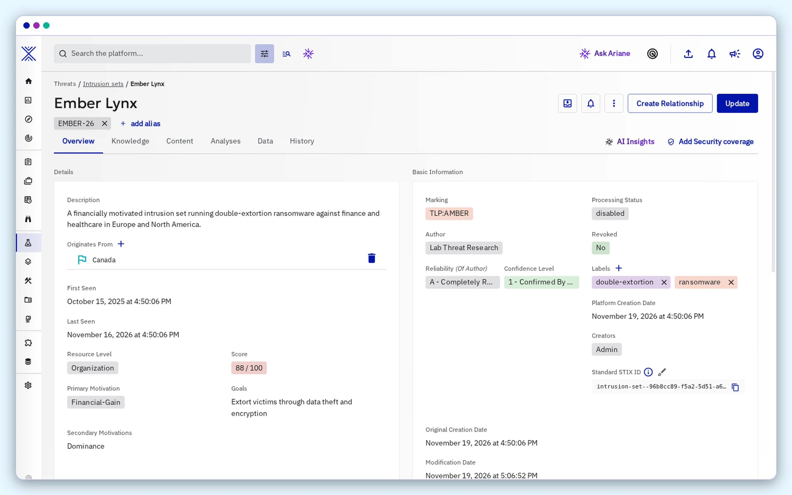
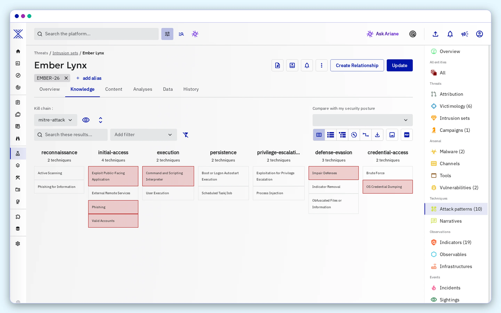
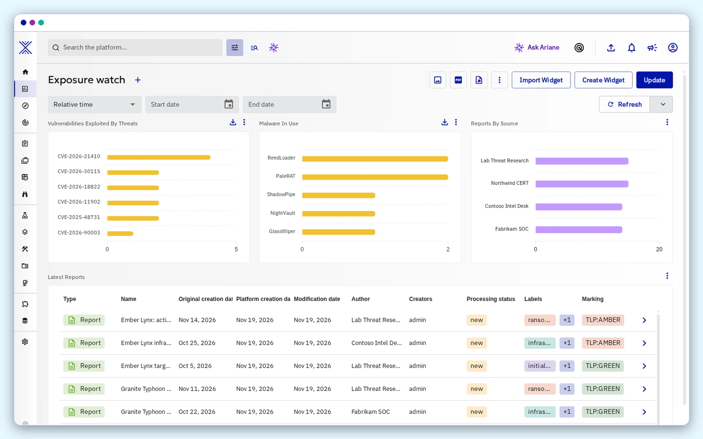
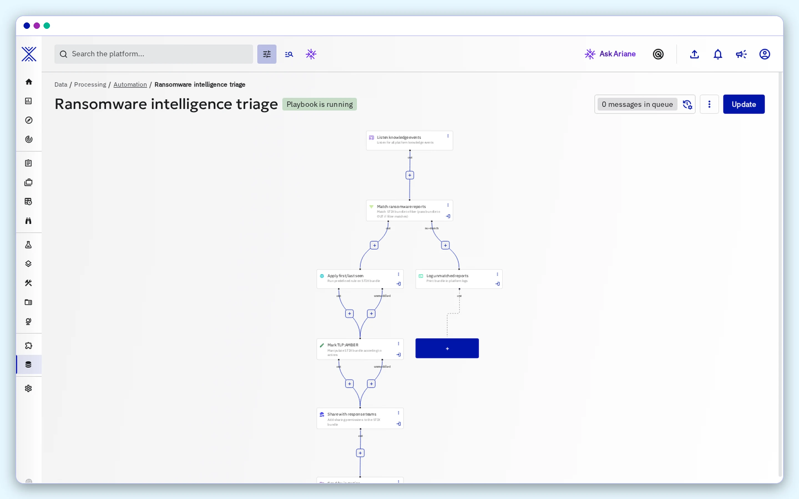
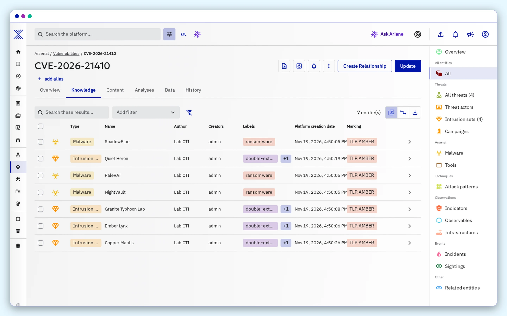
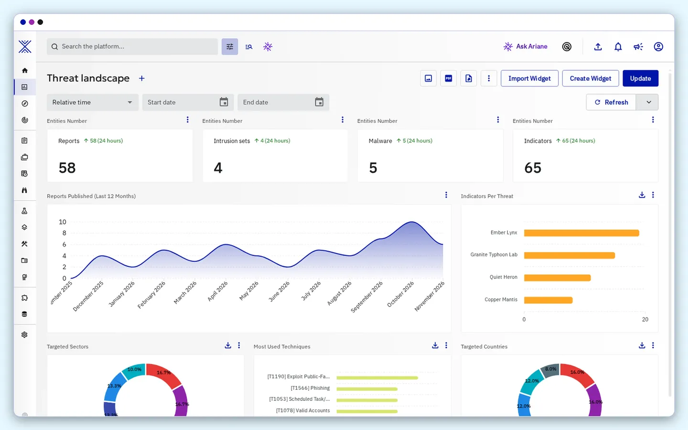
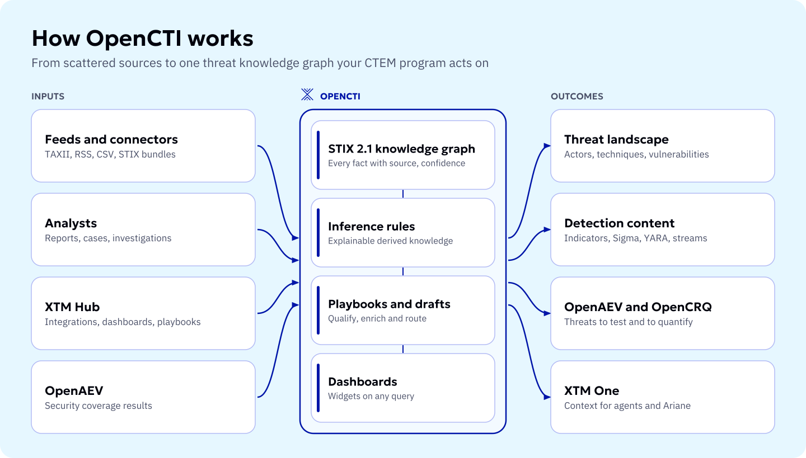
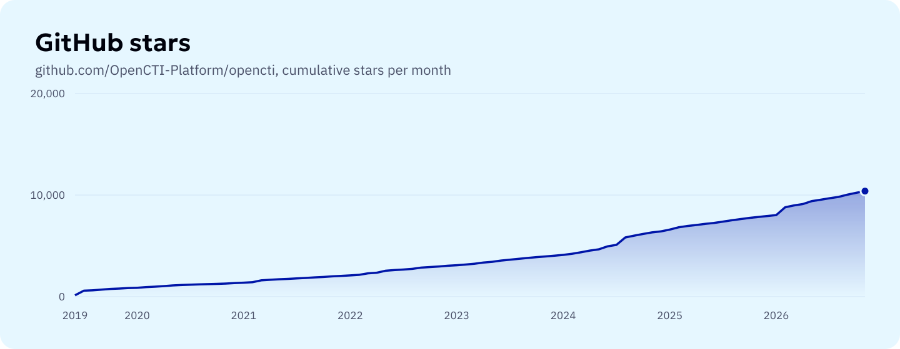

<a href="https://filigran.io/products/opencti"></a>

<p align="center">
  <a href="https://github.com/OpenCTI-Platform/opencti/stargazers"></a>
  <a href="https://github.com/OpenCTI-Platform/opencti/releases/latest"></a>
  <a href="https://hub.docker.com/r/opencti/platform"></a>
  <a href="LICENSE"></a>
  <a href="https://github.com/OpenCTI-Platform/opencti/actions/workflows/ci-main.yml"></a>
  <a href="https://docs.opencti.io"></a>
  <a href="https://community.filigran.io"></a>
</p>

> **Community workshop:** Join us as Taylor Walton (of SOCFortress) walks through his working SOC stack: OpenCTI → OpenAEV → Wazuh → Velociraptor. Taylor will be joined by OpenCTI's product owner to cover what's coming next for OpenCTI and OpenAEV.
>
> [Register](https://events.filigran.io/register/e751635a-9aec-49f5-801c-40cfded49c87?utm_medium=community&utm_source=github&utm_campaign=Dec-2026-Community-Workshop) · Dec 10 at 10 AM New York City time
>
> Join us on the
> [Filigran Community Slack](https://community.filigran.io/?utm_medium=community&utm_source=github).

<p align="center"><b>The open source threat intelligence platform at the heart of Continuous Threat Exposure Management.</b></p>

OpenCTI turns cyber threat intelligence into a living knowledge graph: who targets you, how they operate, which vulnerabilities and tools they rely on, and what your defenses already cover. It is the threat intelligence foundation of CTEM in the XTM Platform: know the adversary in OpenCTI, validate your exposure to it with [OpenAEV](https://github.com/OpenAEV-Platform/openaev), quantify the risk with [OpenCRQ](https://github.com/OpenCRQ-Platform/opencrq), and drive the whole loop with [XTM One](https://github.com/XTM-One-Platform/xtm-one).

<p align="center">If OpenCTI helps your security program, <a href="https://github.com/OpenCTI-Platform/opencti/stargazers">give it a star</a>: it is how the project grows.</p>

<picture>
  <source media="(prefers-color-scheme: dark)" srcset="./.github/img/readme/hero-dark.webp">
  <source media="(prefers-color-scheme: light)" srcset="./.github/img/readme/hero-light.webp">
  
</picture>

## Table of contents

- [Why OpenCTI](#why-opencti)
- [Capabilities](#capabilities)
- [Gallery](#gallery)
- [How it works](#how-it-works)
- [Part of the XTM Platform](#part-of-the-xtm-platform)
- [Use cases by security role](#use-cases-by-security-role)
- [Quick start](#quick-start)
- [Editions](#editions)
- [Integrations and ecosystem](#integrations-and-ecosystem)
- [Community](#community)
- [Contributing](#contributing)
- [Security](#security)
- [License](#license)
- [About Filigran](#about-filigran)

## Why OpenCTI

Exposure management starts with the threat. Before you can decide which exposure to fix first, you need to know which adversaries matter to your sector and region, which techniques they use and which vulnerabilities they exploit in the wild.

- **Structured, not scattered.** Every report, feed and analyst note lands in one STIX 2.1 knowledge graph, each fact linked to its source, its confidence and its first and last seen dates.
- **Actionable for CTEM.** Attack patterns, vulnerabilities and indicators carry straight into validation (OpenAEV), risk quantification (OpenCRQ), detection and the agents of XTM One.
- **Open by design.** An Apache 2.0 core, a GraphQL API, a Python client and a large catalog of connectors to the tools you already run.

## Capabilities

| CTEM stage | What OpenCTI gives your team |
|---|---|
| **Scoping** | Priority intelligence requirements, sectors, regions and the threats that target them, scored and surfaced so the program starts from the adversaries that matter. |
| **Discovery** | Threat actors, campaigns, malware, tools, techniques, vulnerabilities and indicators in one STIX 2.1 graph, fed by TAXII, RSS, CSV, JSON and hundreds of connectors. |
| **Prioritization** | Vulnerabilities ranked by the adversaries that exploit them, inference rules that derive targeting and attribution, decay rules that age indicators out. |
| **Validation** | The ATT&CK matrix of any threat and its security coverage, with the OpenAEV counterpart of every shared object and its simulation results written back. |
| **Mobilization** | Cases, playbooks, dashboards, STIX, CSV and PDF exports, live streams and TAXII collections that put the knowledge into the hands of every team. |

## Gallery

<table>
  <tr>
    <td width="50%" valign="top">
      <picture>
        <source media="(prefers-color-scheme: dark)" srcset="./.github/img/readme/g1-dark.webp">
        <source media="(prefers-color-scheme: light)" srcset="./.github/img/readme/g1-light.webp">
        
      </picture>
      <p><b>Knowledge graph.</b> Threats, techniques, targets and vulnerabilities, explorable in one investigation.</p>
    </td>
    <td width="50%" valign="top">
      <picture>
        <source media="(prefers-color-scheme: dark)" srcset="./.github/img/readme/g2-dark.webp">
        <source media="(prefers-color-scheme: light)" srcset="./.github/img/readme/g2-light.webp">
        
      </picture>
      <p><b>Threat actor.</b> Who the adversary is, what it targets and how it operates, on one page.</p>
    </td>
  </tr>
  <tr>
    <td width="50%" valign="top">
      <picture>
        <source media="(prefers-color-scheme: dark)" srcset="./.github/img/readme/g3-dark.webp">
        <source media="(prefers-color-scheme: light)" srcset="./.github/img/readme/g3-light.webp">
        
      </picture>
      <p><b>ATT&CK matrix.</b> The techniques of a threat on the MITRE ATT&CK matrix, with their coverage.</p>
    </td>
    <td width="50%" valign="top">
      <picture>
        <source media="(prefers-color-scheme: dark)" srcset="./.github/img/readme/g4-dark.webp">
        <source media="(prefers-color-scheme: light)" srcset="./.github/img/readme/g4-light.webp">
        
      </picture>
      <p><b>Dashboards.</b> Widgets on any query, variables and presets, shared publicly when needed.</p>
    </td>
  </tr>
  <tr>
    <td width="50%" valign="top">
      <picture>
        <source media="(prefers-color-scheme: dark)" srcset="./.github/img/readme/g5-dark.webp">
        <source media="(prefers-color-scheme: light)" srcset="./.github/img/readme/g5-light.webp">
        
      </picture>
      <p><b>Playbooks.</b> Qualify, enrich and route what you ingest in a visual editor.</p>
    </td>
    <td width="50%" valign="top">
      <picture>
        <source media="(prefers-color-scheme: dark)" srcset="./.github/img/readme/g6-dark.webp">
        <source media="(prefers-color-scheme: light)" srcset="./.github/img/readme/g6-light.webp">
        
      </picture>
      <p><b>Vulnerability context.</b> Which threats exploit a CVE and which malware carries it, before you patch.</p>
    </td>
  </tr>
</table>

**Walkthrough.** From a report to its knowledge graph, the threat behind it and its ATT&CK coverage, in 15 seconds.

<picture>
  <source media="(prefers-color-scheme: dark)" srcset="./.github/img/readme/walkthrough-dark.webp">
  <source media="(prefers-color-scheme: light)" srcset="./.github/img/readme/walkthrough-light.webp">
  
</picture>

## How it works

OpenCTI ingests feeds, reports and connector data into a STIX 2.1 knowledge graph stored in Elasticsearch or OpenSearch, with Redis, RabbitMQ and an S3-compatible store. Workers apply inference and decay rules, playbooks route the knowledge, and the GraphQL API, live streams and TAXII collections serve it to OpenAEV, OpenCRQ, XTM One and every integration.

<picture>
  <source media="(prefers-color-scheme: dark)" srcset="./.github/img/readme/flow-dark.svg">
  <source media="(prefers-color-scheme: light)" srcset="./.github/img/readme/flow-light.svg">
  
</picture>

## Part of the XTM Platform

OpenCTI is one of the five products of the [XTM Platform](https://filigran.io), the open platform for Agentic CTEM. Each product owns stages of the CTEM loop; XTM One runs the loop across them.

<picture>
  <source media="(prefers-color-scheme: dark)" srcset="./.github/img/readme/xtm-platform-ctem-dark.svg">
  <source media="(prefers-color-scheme: light)" srcset="./.github/img/readme/xtm-platform-ctem-light.svg">
  
</picture>

| | Product | Role in CTEM | Repository | Product page |
|---|---|---|---|---|
| <picture><source media="(prefers-color-scheme: dark)" srcset="./.github/img/readme/mark-xtm-one-dark.svg"></picture> | **XTM One** | Core and agentic layer: runs CTEM across the modules and gets the fix done | [XTM-One-Platform/xtm-one](https://github.com/XTM-One-Platform/xtm-one) | [filigran.io/products/xtm-one](https://filigran.io/products/xtm-one) |
| <picture><source media="(prefers-color-scheme: dark)" srcset="./.github/img/readme/mark-opencti-dark.svg"></picture> | **OpenCTI** | Scoping and Discovery: know the adversary and the threats that target you | [OpenCTI-Platform/opencti](https://github.com/OpenCTI-Platform/opencti) | [filigran.io/products/opencti](https://filigran.io/products/opencti) |
| <picture><source media="(prefers-color-scheme: dark)" srcset="./.github/img/readme/mark-opencrq-dark.svg"></picture> | **OpenCRQ** | Prioritization: turn exposure into financial risk | [OpenCRQ-Platform/opencrq](https://github.com/OpenCRQ-Platform/opencrq) | [filigran.io/products/opencrq](https://filigran.io/products/opencrq) |
| <picture><source media="(prefers-color-scheme: dark)" srcset="./.github/img/readme/mark-openaev-dark.svg"></picture> | **OpenAEV** | Validation: prove your defenses against real attacker techniques | [OpenAEV-Platform/openaev](https://github.com/OpenAEV-Platform/openaev) | [filigran.io/products/openaev](https://filigran.io/products/openaev) |
| <picture><source media="(prefers-color-scheme: dark)" srcset="./.github/img/readme/mark-xtm-hub-dark.svg"></picture> | **XTM Hub** | Tradecraft library and gateway: integrations, dashboards and scenarios for every product | [XTM-Hub/xtm-hub](https://github.com/XTM-Hub/xtm-hub) | [filigran.io/platforms/xtm-hub](https://filigran.io/platforms/xtm-hub/) |

## Use cases by security role

| Role | What OpenCTI does for it |
|---|---|
| **CTI** | One knowledge graph for every report, feed and note, with source, confidence and markings on every fact, and reports generated from a container, a threat or a victim. |
| **SOC** | Indicators and observables with their context, sightings, and live streams and TAXII collections to the SIEM and the EDR. |
| **Detection engineering** | Indicators translated between STIX, Sigma and YARA, and the ATT&CK coverage of every threat to decide what to detect next. |
| **Red and purple team** | The techniques of the adversaries that target you, sent to OpenAEV as scenarios and read back as security coverage. |
| **Vulnerability and exposure management** | Vulnerabilities linked to the threats and campaigns that exploit them, so the exploited ones come first. |
| **Risk and CISO** | Priority intelligence requirements, dashboards on the threat landscape and the intelligence OpenCRQ prices into expected loss. |

## Quick start

Requirements: Docker with Docker Compose.

```bash
git clone https://github.com/OpenCTI-Platform/docker.git opencti-docker && cd opencti-docker
cp .env.sample .env      # replace every changeme and ChangeMe value before the first start
docker compose up -d
```

Open http://localhost:8080 and sign in with the admin account of `.env`. The stack also starts XTM One next to OpenCTI.

- **Docker**: [`opencti/platform`](https://hub.docker.com/r/opencti/platform), one tag per [release](https://github.com/OpenCTI-Platform/opencti/releases).
- **Helm and Terraform**: [installation guide](https://docs.opencti.io/latest/deployment/installation/).
- **Demonstration**: [demo.opencti.io](https://demo.opencti.io), reset every night on reference data.

## Editions

| | Community Edition | Enterprise Edition |
|---|---|---|
| License | [Apache 2.0](LICENSE) | [OpenCTI Enterprise Edition License](LICENSE) |
| Knowledge graph, investigations, dashboards, connectors | Yes | Yes |
| Playbooks and priority intelligence requirements | | Yes |
| AI: reports, file to STIX, natural language search, Ariane | | Yes |

The [documentation](https://docs.opencti.io) marks every Enterprise Edition feature; to get a license, [contact Filigran](https://filigran.io/contact).

## Integrations and ecosystem

- **XTM Platform:** OpenAEV scenarios from OpenCTI threats and coverage written back, OpenCRQ reads the intelligence, XTM One powers Ariane and the agents.
- **[XTM Hub](https://hub.filigran.io/cybersecurity-solutions/open-cti-integrations):** the connector catalog, dashboards and feeds for OpenCTI.
- **Connectors:** import, enrichment and export connectors in [OpenCTI-Platform/connectors](https://github.com/OpenCTI-Platform/connectors).
- **Standards and APIs:** STIX 2.1, TAXII 2.1, the GraphQL API and the [Python client](https://github.com/OpenCTI-Platform/client-python).

## Community

Star OpenCTI to follow it and to help other security teams find it.

<picture>
  <source media="(prefers-color-scheme: dark)" srcset="./.github/img/readme/stars-dark.svg">
  <source media="(prefers-color-scheme: light)" srcset="./.github/img/readme/stars-light.svg">
  
</picture>

- **Questions and discussion**: the Filigran [community Slack](https://community.filigran.io).
- **Bugs and feature requests**: [GitHub issues](https://github.com/OpenCTI-Platform/opencti/issues).
- **Learn**: free courses on [Filigran Academy](https://academy.filigran.io).

## Contributing

Read the [contributing guide](CONTRIBUTING.md) to set up a development environment and propose a change. OpenCTI has adopted a [Code of Conduct](CODE_OF_CONDUCT.md). First contribution: the [good first issues](https://github.com/OpenCTI-Platform/opencti/labels/good%20first%20issue).

## Security

Report vulnerabilities privately as described in [SECURITY.md](SECURITY.md), never in a public issue.

## License

OpenCTI is open source under the [Apache 2.0 license](LICENSE); the Enterprise Edition features are under the OpenCTI Enterprise Edition License, as stated in [LICENSE](LICENSE) and in each source file header.

## About Filigran

OpenCTI is designed and developed by [Filigran](https://filigran.io), the company behind the [XTM Platform](https://filigran.io) for Agentic CTEM.

<picture>
  <source media="(prefers-color-scheme: dark)" srcset="./.github/img/readme/filigran-dark.svg">
  <source media="(prefers-color-scheme: light)" srcset="./.github/img/readme/filigran-light.svg">
  
</picture>
