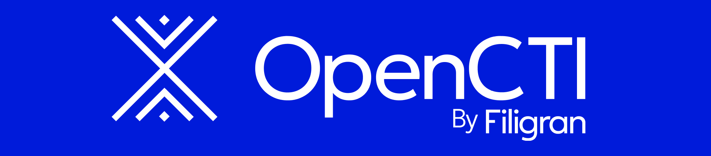
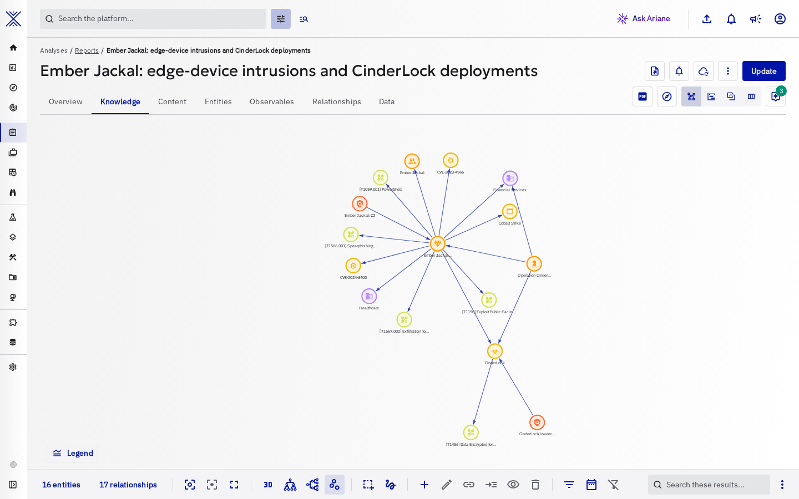
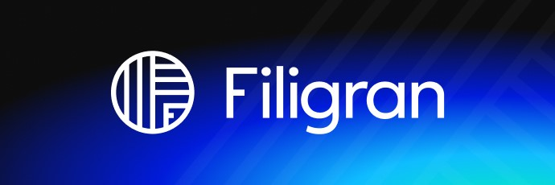

<h1 align="center">
  <a href="https://opencti.io"></a>
</h1>

<p align="center">
  <strong>The open source threat intelligence platform at the heart of Continuous Threat Exposure Management.</strong>
</p>

<p align="center">
  <a href="https://github.com/OpenCTI-Platform/opencti/stargazers"></a>
  <a href="https://github.com/OpenCTI-Platform/opencti/releases/latest"></a>
  <a href="https://hub.docker.com/r/opencti/platform"></a>
  <a href="LICENSE"></a>
  <a href="https://github.com/OpenCTI-Platform/opencti/actions/workflows/ci-main.yml"></a>
  <a href="https://docs.opencti.io"></a>
  <a href="https://community.filigran.io"></a>
</p>

OpenCTI turns cyber threat intelligence into a living knowledge graph: who targets you, how they operate, which vulnerabilities and tools they rely on, and what your defenses already cover. It is the threat intelligence foundation of CTEM in the XTM Platform by [Filigran](https://filigran.io): know the adversary in OpenCTI, validate your exposure to it with [OpenAEV](https://github.com/OpenAEV-Platform/openaev), quantify the risk with OpenCRQ, and drive the whole loop with XTM One.

If OpenCTI helps your team, **[star the repository](https://github.com/OpenCTI-Platform/opencti/stargazers)**: it is the simplest way to help the project reach more defenders.

<picture>
  <source media="(prefers-color-scheme: dark)" srcset="./.github/img/opencti-knowledge-graph-dark.png">
  <source media="(prefers-color-scheme: light)" srcset="./.github/img/opencti-knowledge-graph-light.png">
  
</picture>

## Table of contents

- [Why OpenCTI](#why-opencti)
- [Capabilities](#capabilities)
- [OpenCTI in the XTM Platform](#opencti-in-the-xtm-platform)
- [Editions](#editions)
- [Quick start](#quick-start)
- [Documentation and demonstration](#documentation-and-demonstration)
- [Contributing](#contributing)
- [Community](#community)
- [Security](#security)
- [About](#about)

## Why OpenCTI

Exposure management starts with the threat. Before you can decide which exposure to fix first, you need to know which adversaries matter to your sector and region, which techniques they use, and which vulnerabilities they exploit in the wild. OpenCTI gives security teams that picture in one place:

- **Structured, not scattered.** Every report, feed and analyst note lands in one STIX 2.1 knowledge graph, each fact linked to its source, its confidence and its first and last seen dates.
- **Actionable for CTEM.** Attack patterns, vulnerabilities and indicators carry straight into validation (OpenAEV), risk quantification (OpenCRQ) and detection.
- **Open by design.** Apache 2.0 core, a GraphQL API, a Python client and a large catalog of connectors to the tools you already run.

## Capabilities

**Knowledge graph and STIX 2.1.** Threat actors, intrusion sets, campaigns, malware, tools, attack patterns, vulnerabilities, indicators, observables, sectors, locations and their relationships, stored and exchanged in STIX 2.1, with markings, confidence levels and source attribution on every object.

**Investigation and analysis.** Reports, groupings and cases (incident response, requests for information, requests for takedown) with an interactive graph view of every container, investigations to pivot from an entity to everything around it, and the ATT&CK matrix of any threat.

**Inference rules.** A rule engine derives new knowledge from existing relationships (attribution, targeting, sightings, location, vulnerable software on a system) and keeps the inferred facts explainable and reversible.

**Ingestion and feeds.** Native TAXII, RSS, CSV and JSON feeds, TAXII collections to push to, STIX bundle import, and a connector framework for enrichment, import and export. The connector catalog is browsable in [XTM Hub](https://hub.filigran.io/cybersecurity-solutions/open-cti-integrations), the code lives in [OpenCTI-Platform/connectors](https://github.com/OpenCTI-Platform/connectors).

**Dashboards.** Custom dashboards with widgets on any query, dashboard variables and saved variable presets, time series broken down by field, and public dashboards to share a view outside the platform.

**Automation and drafts.** Playbooks to qualify, enrich and route new knowledge (Enterprise Edition), built in a visual editor with a deterministic layout and direct rewiring of every step, drafts to review an import or a change before it reaches the graph, decay rules that age indicators out on schedule.

**Priority intelligence requirements.** Define what your organization needs to know and let OpenCTI score and surface the threats that match (Enterprise Edition).

**AI (Enterprise Edition).** Generate reports from a container, a threat or a victim, summarize files, convert files to STIX, translate indicators between STIX, Sigma and YARA, search the graph in natural language, and, with XTM One connected, ask Ariane, the XTM One assistant, from any page.

**Exports and sharing.** STIX 2.1, CSV and PDF exports, live streams, TAXII collections and the GraphQL API for every integration.

## OpenCTI in the XTM Platform

OpenCTI is one of the XTM Platform products, each strong on its own and stronger together across the CTEM cycle:

| Product | Role in CTEM | With OpenCTI |
|---|---|---|
| **OpenCTI** | Scope and discover: know the threats that matter | The threat knowledge every other product consumes |
| **[OpenAEV](https://github.com/OpenAEV-Platform/openaev)** | Validate: test your defenses against those threats | Scenarios generated from OpenCTI threats and reports; security coverage results written back to OpenCTI; every object both products know (assets, attack patterns, vulnerabilities, threats, incidents) shows its OpenAEV counterpart, a one-click pivot and the actions to run next |
| **OpenCRQ** | Prioritize: quantify the risk in financial terms | Reads OpenCTI intelligence through its OpenCTI connection |
| **XTM One** | Mobilize: the agentic core across the platform | OpenCTI registers with XTM One, which powers Ariane and the AI agents across products |

## Editions

OpenCTI ships in two editions, both in this repository:

- **Community Edition (CE)**, licensed under the [Apache License, Version 2.0](LICENSE).
- **Enterprise Edition (EE)**, licensed under the [OpenCTI Enterprise Edition License](LICENSE). Files under this license carry a header that says so.

The Enterprise Edition adds the features marked above (AI, playbooks, priority intelligence requirements and more). The [documentation](https://docs.opencti.io) marks every Enterprise Edition feature; to get a license, [contact Filigran](https://filigran.io/contact).

## Quick start

The fastest way to run OpenCTI is Docker:

```bash
git clone https://github.com/OpenCTI-Platform/docker.git opencti-docker
cd opencti-docker
cp .env.sample .env   # replace every changeme and ChangeMe value before the first start
docker compose up -d
```

Then open http://localhost:8080. The stack also starts XTM One next to OpenCTI. Production deployments, clustering, manual installation, Terraform and Helm charts are covered in the [installation guide](https://docs.opencti.io/latest/deployment/installation/). Releases are on the [GitHub releases page](https://github.com/OpenCTI-Platform/opencti/releases), and a [rolling release](https://releases.opencti.io) is built from master.

## Documentation and demonstration

- **Documentation:** [docs.opencti.io](https://docs.opencti.io)
- **Demonstration instance:** [demo.opencti.io](https://demo.opencti.io), open to everyone and reset every night on reference data maintained by the OpenCTI developers.

## Contributing

- **Code of conduct:** read the [Code of Conduct](CODE_OF_CONDUCT.md) we expect every participant to follow.
- **Contributing guide:** the [contributing guide](CONTRIBUTING.md) covers the development process, how to propose bug fixes and improvements, and how to build and test your changes.
- **First issues:** the [beginner friendly issues](https://github.com/OpenCTI-Platform/opencti/labels/beginner%20friendly%20issue) are a good place to start.
- **Development environment:** see the [development documentation](https://docs.opencti.io/latest/development/environment_ubuntu/).

## Community

- **Bugs and feature requests:** [GitHub issues](https://github.com/OpenCTI-Platform/opencti/issues).
- **Discussion and support:** join the [Filigran community Slack](https://community.filigran.io/?utm_medium=community&utm_source=github) to ask questions, talk through a PR before you open it, or compare notes on connectors and deployments. You can also write to contact@filigran.io.
- **Stars:** if OpenCTI is useful to you, [a star](https://github.com/OpenCTI-Platform/opencti/stargazers) helps other defenders find it.

<a href="https://star-history.com/#OpenCTI-Platform/opencti&Date">
  
</a>

## Security

To report a vulnerability, follow the [security policy](SECURITY.md). Please do not open a public issue for a security problem.

## About

### Authors

OpenCTI is designed and developed by [Filigran](https://filigran.io).

<a href="https://filigran.io"></a>

### Usage telemetry

To improve the features and the performance of OpenCTI, the platform collects anonymous statistical data about its usage and health. It never collects threat intelligence knowledge or personal data. The [usage telemetry documentation](https://docs.opencti.io/latest/reference/usage-telemetry/) lists everything collected and how it is used.
