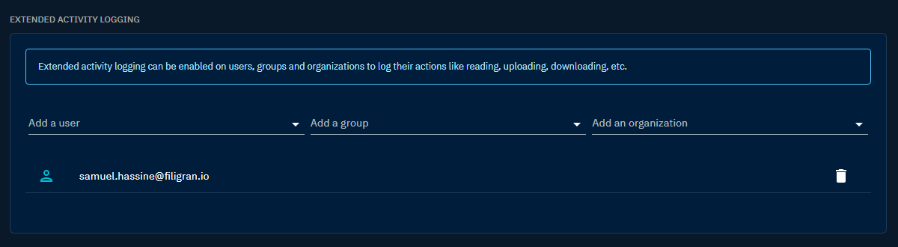

# Configuration

!!! tip "Enterprise edition"

    Activity unified interface and logging are available under the "OpenCTI Enterprise Edition" license.

    [Please read the dedicated page to have all information](../enterprise.md)

As explained in the [overview page](overview.md), all administration actions are listened by default. 
However, all knowledge are not listened by default due to performance impact on the platform. 

For this reason you need to explicitly activate extended listening on user / group or organization. You need the `Access security activity` capability to do so.

1. Go to `Settings > Activity > Configuration`.
2. In the `Extended activity logging` section, select the user, group or organization to listen to in the `Add a user`, `Add a group` or `Add an organization` field.
3. The selected item appears in the list below the fields. To stop listening to it, click the delete icon next to it.

Listening will start just after the configuration. Every past events will not be taken into account.