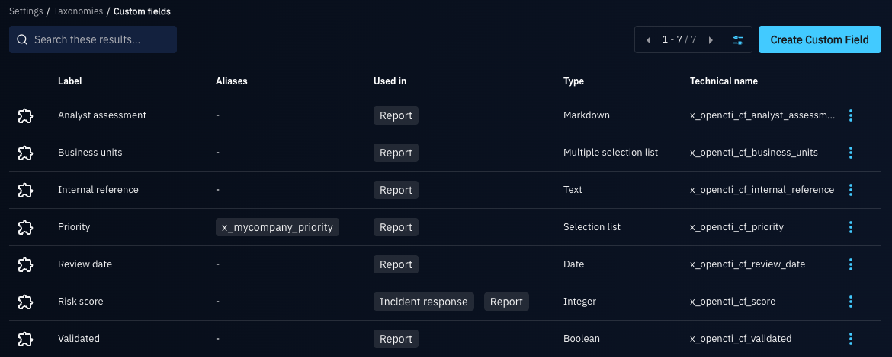
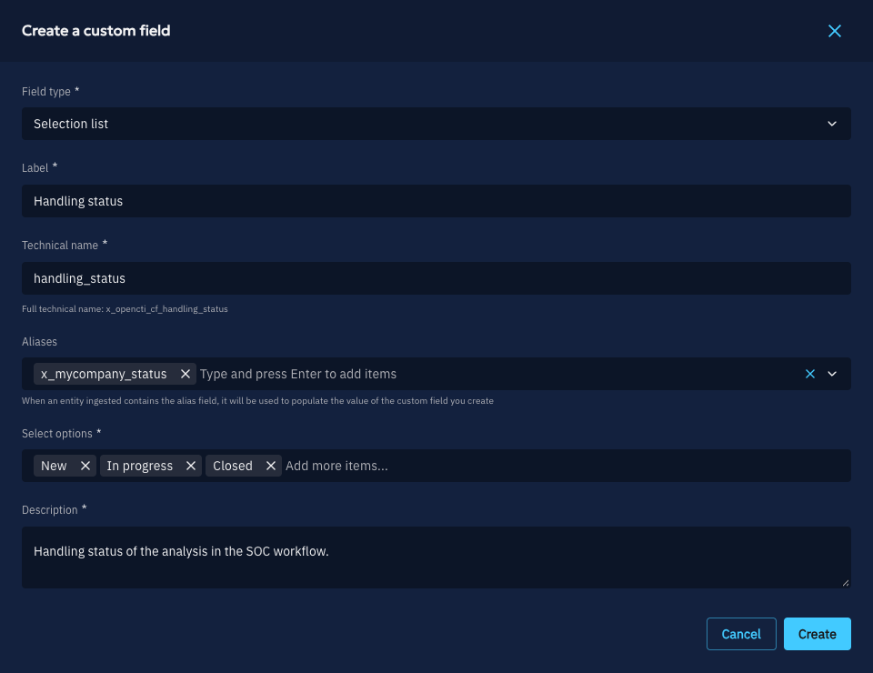
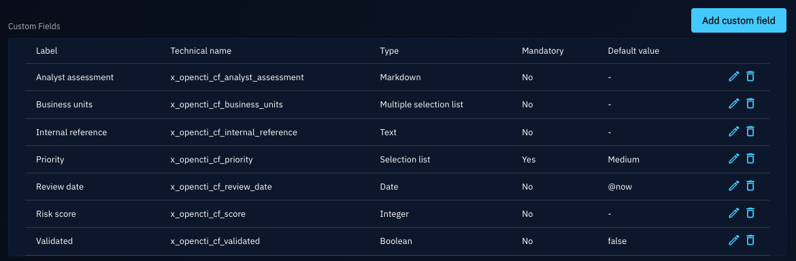
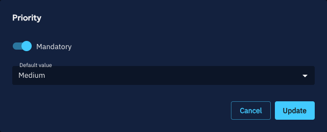
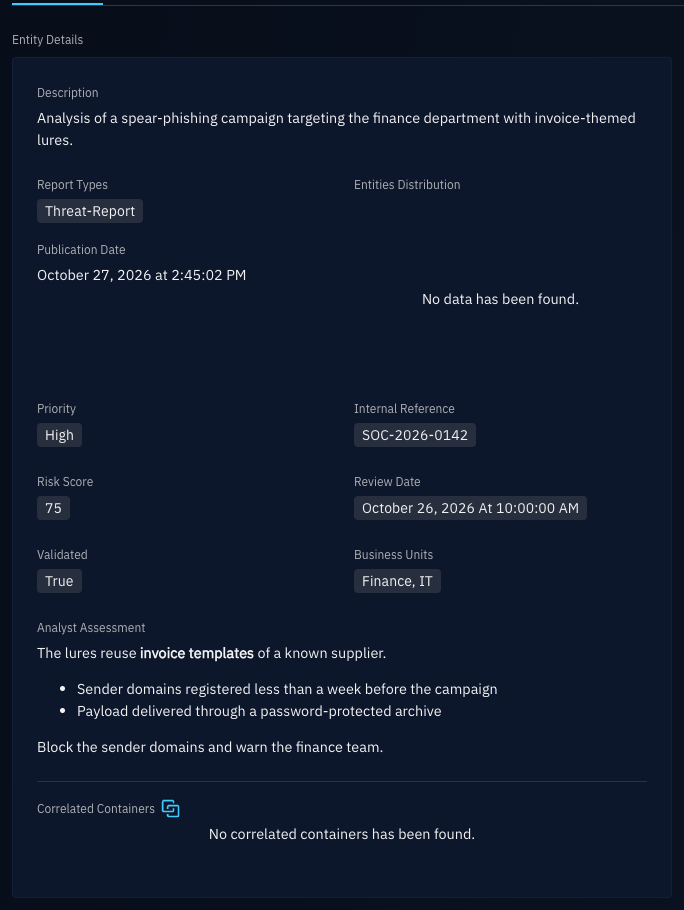

# Custom fields

!!! tip "Enterprise edition"

    Managing custom fields is available under the "OpenCTI Enterprise Edition" license. Read the [dedicated page](enterprise.md) for full details. The values of the existing custom fields stay usable without it (see [Without an Enterprise Edition license](#without-an-enterprise-edition-license)).

Custom fields let an administrator add their own attributes to the entities and relationships of the platform, such as a priority, an internal reference or a risk score, without waiting for them to exist in the data model.

Once attached to an entity type, a custom field behaves as a standard attribute: it is entered in the creation and edition forms, displayed in the entity details, filtered, used in dashboards and Fintel templates, set by playbooks and background tasks, imported and exported.

## Manage custom fields

Custom fields are managed in "Settings > Taxonomies > Custom fields", with the "Manage customization" capability.

### Create a custom field

A custom field is defined by:

- **Field type**: the type of its values, which cannot change afterwards:
    - **Text**: a single line of text.
    - **Markdown**: a text formatted in Markdown.
    - **Integer**: an integer, optionally bounded by a minimum and a maximum value.
    - **Boolean**: true or false.
    - **Date**: a date and time.
    - **Selection list**: one value among a list of options.
    - **Multiple selection list**: several values among a list of options.
- **Label**: the name displayed in the platform. It must be unique.
- **Technical name**: the name of the custom field in the data and in the API, starting with `x_opencti_cf_` followed by lowercase letters, numbers and underscores (for instance `x_opencti_cf_priority`). It is suggested from the label, must be unique and cannot change afterwards.
- **Aliases** (optional): names of properties matched to this custom field at ingestion (see [Aliases](#aliases)).
- **Description**: what the custom field is for. It is mandatory.

### Aliases

When an ingested entity (for instance from a connector or a STIX bundle) carries a property named after an alias, its value populates the custom field. Aliases let a source keep its own property names: the administrator decides, through the aliases, which property goes into which custom field.

An alias is a STIX custom property name: it must start with `x_` and contain only lowercase letters, numbers and underscores (for instance `x_mycompany_priority`). It must be unique among the technical names and aliases of all the custom fields.

Aliases are only used at ingestion: filters, exports and the API always use the technical name.

### Edit a custom field

The label, the aliases, the description, the options of a selection list and the bounds of an integer can be edited. However:

- an option of a selection list cannot be removed while an entity still holds it;
- the bounds of an integer cannot be tightened beyond a value already stored on an entity.

### Delete a custom field

Deleting a custom field removes its values from all the entities, through a background task. The filters using it (in lists, dashboards, streams, triggers or playbooks) keep working: they behave as a filter on a field that no entity has.

## Attach a custom field to an entity type

A custom field is used on the entity types it is attached to. In "Settings > Customization > Entity types", select an entity type, then in its "Attributes" tab, the "Custom fields" section lists the custom fields attached to it.

Click on "Add custom field" to attach a custom field to the entity type. For each attached custom field, define for this entity type:

- **Mandatory**: whether a value is required to create an entity of this type. It can be set when attaching the custom field. As for the standard attributes, users with the "Bypass mandatory attributes" capability are not constrained.
- **Default value** (optional): the value set when an entity is created without one, defined with the edit icon of the custom field. For a date, `@now` sets the creation date.

Detaching a custom field from an entity type (delete icon) removes its values from the entities of this type.

Custom fields attached to "Stix core relationship" apply to every relationship type. Sightings have their own entity type: to use a custom field on sightings, attach it to "Sighting".

## Use custom fields

### Entities

The custom fields attached to an entity type are entered in the creation and edition forms of its entities, and displayed in their details, with the other attributes.

Changes of a custom field value are tracked in the history of the entity, and shown in the review of a draft.

### Filters

A custom field can be used as a filter key wherever its entity type can be filtered: lists, dashboards, saved filters, streams, triggers and playbooks. It supports the same operators as a standard attribute of the same type.

### Widgets

Custom fields are available:

- as columns of the list widgets, when the widget is filtered on a single entity type;
- in the attribute widgets of the [Fintel templates](entities.md#fintel-templates) and of the custom views.

### Playbooks and background tasks

The "Manipulate knowledge" playbook component and the background tasks (the "Update" action on a selection of entities) can add, replace or remove a custom field value.

### Import

Custom field values are imported:

- from STIX bundles (connectors, file imports, synchronization between platforms), by technical name or alias, whether the property is at the root of the object or in one of its extensions;
- through the [CSV mappers](csv-mappers.md) and [JSON mappers](json-mappers.md), which can map a column or a path to a custom field;
- through forms.

A property matching no custom field attached to the entity type is ignored: the entity is created without it. A value that is invalid for the custom field (for instance an option that does not exist) is rejected, as for a standard attribute.

### Export

In STIX exports and streams, each custom field value is exported as a property named after the technical name of the custom field, in the OpenCTI extension of the object. A platform receiving it with the same custom field defined (or an alias matching it) imports its value.

## Without an Enterprise Edition license

Without an Enterprise Edition license, for instance when a license expires, the existing custom fields keep working: their values are still displayed, entered, filtered, imported and exported.

Managing them requires the Enterprise Edition license: creating, editing or deleting a custom field, and attaching it to or detaching it from an entity type. The only change still allowed is making a mandatory custom field optional on an entity type, so that the creation of its entities never stays blocked.
