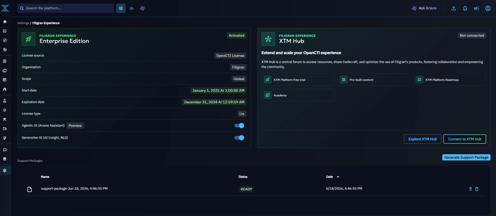

# XTM Hub

Welcome to the guide on connecting your OpenCTI product with the XTM Hub.

## Introduction

This document will guide you through the steps required to connect or disconnect your OpenCTI product with the XTM Hub.

## Connecting Your Product

The connection is managed from the **XTM Hub** card of the `Settings > Filigran Experience` page. The card shows whether your product is connected, and the "Connect to XTM Hub" button.

To connect your OpenCTI product to the XTM Hub, follow these steps:

1. **Access the Settings:**
    - Ensure you have the `Manage XTM Hub` capability (see the list of [capabilities in the user page](users.md)).
    - Navigate to `Settings > Filigran Experience`.

2. **Initiate Connection:**
    - Click on the "Connect to XTM Hub" button.
    - A new tab will open with your XTM Hub account.

3. **Log In:**
    - Log in with your account credentials.
    - Choose the organization where you want to connect your OpenCTI product.

4. **Complete Connection:**
    - Once the connection is complete, you will be redirected back to your OpenCTI product.
    - The XTM Hub administrators will be informed that an OpenCTI product is connected.

### View your product's metrics (SaaS customers)

This feature is only available to SaaS customers. Once you have completed connection and after a few minutes of connection, if you are a SaaS customer with a product handled by Filigran, you will see a button "See my OpenCTI metrics". It will redirect you to XTM Hub, on your product's page, to have more information about usage and health. 

## Disconnecting Your Product

To disconnect your product, follow these steps:

1. **Eligibility:**
    - If your product is already connected, you will have the option to disconnect it.

2. **Disconnecting Process:**
    - This action will remove the link between your OpenCTI product and the XTM Hub, thus disabling access to the XTM Hub features.
    - Go to `Settings > Filigran Experience` and click on the "Disconnect from XTM Hub" button.

3. **Reconnection:**
    - Don't worry; it’s possible to reconnect your product at any time.
    - The product will be automatically connected on the same organization.

## Connectivity Check

Your OpenCTI product will regularly check if the connection with the XTM Hub is still active:

- **Continuous Monitoring:**
    - Connectivity is automatically monitored to ensure it is functioning properly.

- **Notification:**
    - The OpenCTI administrators will be informed if a connectivity check fails.