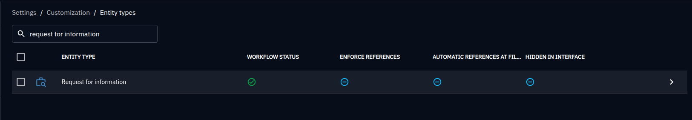
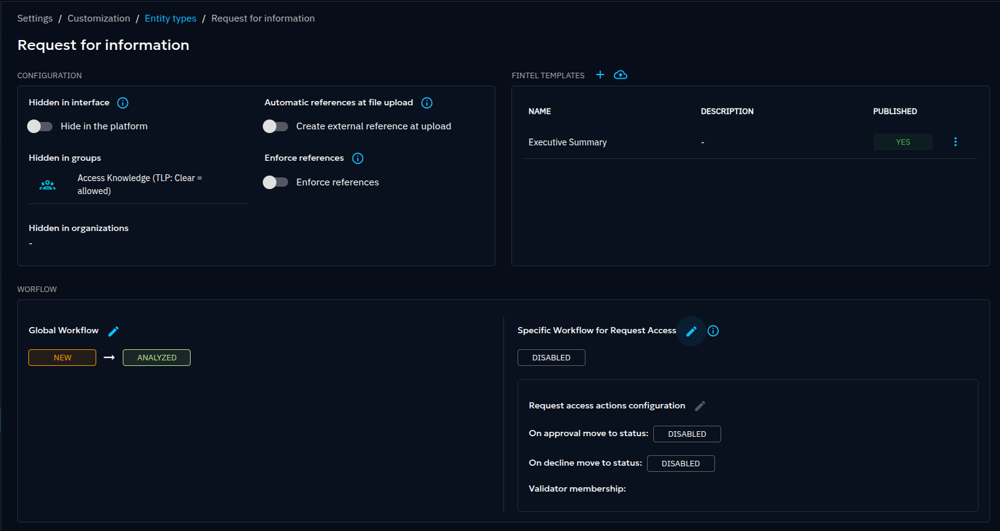
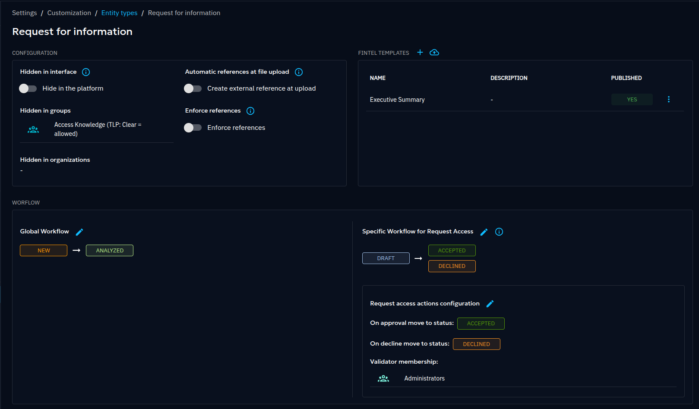
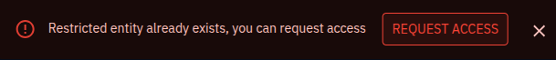
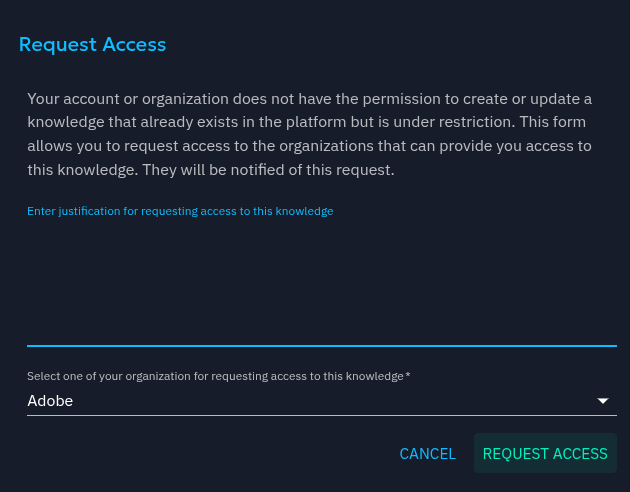
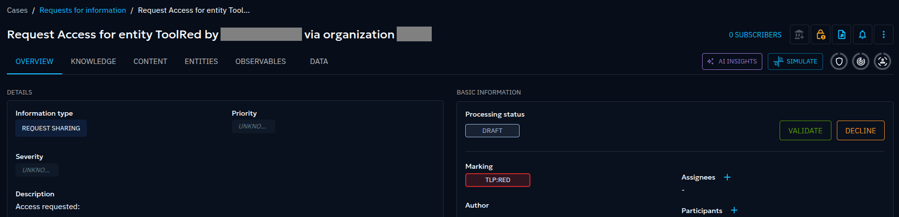
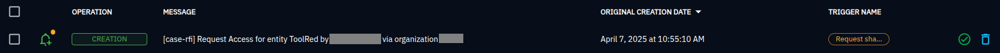

# Requesting knowledge sharing within Organization segregation

!!! tip "Enterprise edition"

    Platform segregation by organization is available under the "OpenCTI Enterprise Edition" license. Please read the [dedicated page](enterprise.md) to have all the information.

Knowledge that exist in the platform can be shared to one organization but not another: some time existing knowledge is hidden to users because it's restricted to another organization than the user's one. See [organization segregation](organization-segregation.md) to learn about organization sharing.

When users creates knowledge that already exists in the platform but is not visible for any restrictions reasons, a generic error message `Restricted entity already exists` is displayed.

Platform administrator can configure a request access workflow to allows users to request access to a knowledge that already exists but is not visible because of organization restriction. This workflow will create a specific Request For Information.

## Configuration to allows users to request access to restricted knowledge

### Configuration of the Request For Information settings

Open the configuration of request for information entity.

Configure the "Specific workflow for request access:

1. Configure all status that can be used for request access use case. Note that the `Request for Information` will be created with the first status in this list.

2. Configure the status that will be used when the request is accepted

3. Configure the status that will be used when the request is declined

4. Configure the group that will be allowed to see the `Request for Information` created automatically by the platform.

## Requesting an access

Once the configuration is complete, user that attempt to create an existing knowledge will have a new button "Request Access" proposed.

Then users will be able to give more detail on reason that lead to this request, select one of their organization and request access.

### Accepting or declining a request to access to knowledge

Users who are both:

- in the organization where the knowledge actually belong
- in the group that has been configured in Request for information entity settings

Will receive a dedicated Request for information for example:

> Note that this specific Request for Information is automatically under [authorized member restricted access](authorized-members.md) for confidentiality reason.

The knowledge that is requested to be shared, can be found in related entities.
There is two dedicated button "Validate" and "Decline": with one click on Validate, the knowledge will be shared as requested.

User that are allowed to see the dedicated Request for Information and allowed to share the knowledge, will also be notified on dedicated Request for Information creation.

## Disabling request access feature

If you have attempted to use the functionality but need to remove it due to policy:

- In entity setting, delete all status in "Specific Workflow for Request Access" section. 
- You can alternatively remove the group in `Validator membership`. 

This will restore the default behavior, and the button will not appear in the error message `Restricted entity already exists`.

## With entity workflows

Instead of the fixed list of statuses described above, the request access process can run on an entity workflow. Admins then design the process themselves (extra steps such as "Under review" or "Escalated", required comments, restrictions per step, actions), and approving or declining a request becomes a regular workflow transition, with history, comments and permission checks.

!!! tip "Prerequisites"

    - Enterprise Edition.
    - The entity workflows feature is enabled.
    - In **Settings > Customization > Request for Information > Workflow**, the **Request access** scope is available.

Nothing changes for your users until a request access workflow is published. As long as the feature is off, or no request access workflow is published, the process described in the previous sections keeps running unchanged.

### Migrating the existing request access statuses

If you already configured a "Specific workflow for request access", you can convert it into a request access workflow without redoing it by hand.

1. In the **Request access** scope of the Request for Information workflow, choose **Migrate request access statuses**.
2. Review the preview. Problems that would make the conversion impossible are listed as blocking problems and must be fixed first.
3. Confirm the migration. The existing statuses are reused, so requests already in progress keep their current status.

The migration creates a draft workflow. The first legacy status becomes the initial state, the statuses configured for accepted and declined requests become the Approved and Declined states (reached through transitions named "Accept" and "Reject"), and the validator group is kept. Select **Publish immediately** to publish the workflow right away; otherwise review and publish it later. Nothing changes until a request access workflow is published.

### Designing the request access workflow

Design the workflow in the **Request access** scope of the editor, like any other entity workflow. A request access workflow must have:

- exactly one state marked **Approved** and exactly one state marked **Declined** (field **Request outcome** of the state);
- both of them reachable from the initial state;
- no transition leaving the Approved or Declined state: a decision is final.

The Approved state must carry the **Share requested entities** action in its "On enter" actions. When the state is entered, this action shares every requested entity with the configured organizations. By default, the organization is the requesting organization, which is the author of the Request for Information. A workflow without this action cannot be published, because approving a request would grant nothing.

The **validator group** is configured in the header of the editor. As before, only members of this group, belonging to the organization that owns the knowledge, see the Request for Information and can decide on it.

### What happens when a request is decided

Entering the Approved or Declined state automatically:

- sets the request status to `APPROVED` or `DECLINED`;
- notifies the applicant of the result.

The Approved state also runs its actions, so the requested knowledge is shared. If the sharing fails, the Request for Information does not move to Approved and the error is displayed, so the approver can retry.

### Deciding on a request

Approvers decide from the processing status banner of the Request for Information. The banner displays the current status and one button per transition allowed from this status, named after the transition ("Accept", "Reject", or any intermediate step). Comments and inputs required by the transition are asked in a dialog, which also states the effect of a decision (sharing and notification).

To fire a transition into the Approved or Declined state, a user needs edit access on the Request for Information and the capability to restrict organization access (_Restrict organization access_). Other transitions follow the usual workflow rules.

### Bypass

Users with the bypass capability can move a Request for Information to any status of the request access workflow, in the same two modes as for other entities:

- **With actions**: the actions of the states run. Entering Approved shares the requested knowledge and notifies the applicant, entering Declined notifies the applicant.
- **Without actions**: only the status changes. Nothing is shared and nobody is notified.

Leaving the Approved state never removes the sharing that was done.

### Changing the status by other means

The status of a workflow-driven Request for Information cannot be set directly into or out of Approved or Declined. Such changes are refused whatever their origin (API, synchronization, playbooks), and the **Status** field is not editable in the edition form of these requests. Use the workflow transitions or the bypass.

### Editing a published workflow

When you republish a request access workflow, the Approved and Declined markers cannot be moved or removed from a state that still holds requests, and no transition can be added out of such a state. The publication is refused otherwise.
