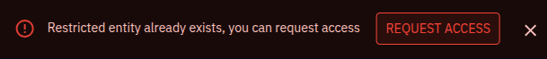
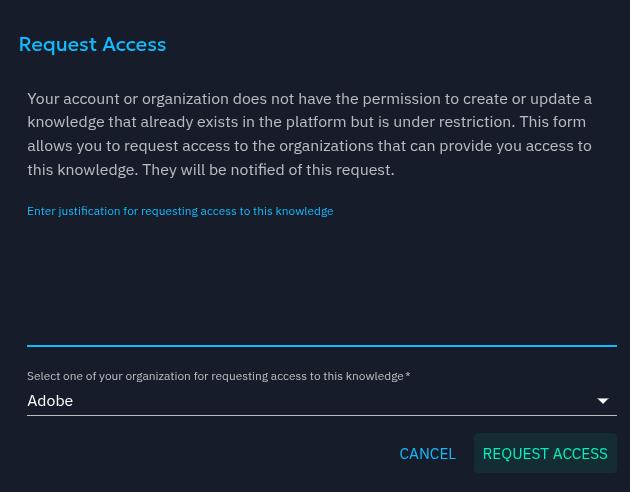

# Requesting knowledge sharing within Organization segregation

!!! tip "Enterprise edition"

    Platform segregation by organization is available under the "OpenCTI Enterprise Edition" license. Please read the [dedicated page](enterprise.md) to have all the information.

Knowledge that exist in the platform can be shared to one organization but not another: some time existing knowledge is hidden to users because it's restricted to another organization than the user's one. See [organization segregation](organization-segregation.md) to learn about organization sharing.

When users creates knowledge that already exists in the platform but is not visible for any restrictions reasons, a generic error message `Restricted entity already exists` is displayed.

Platform administrator can configure a request access workflow to allows users to request access to a knowledge that already exists but is not visible because of organization restriction. This workflow will create a specific Request For Information.

## Requirements

The **Request Access** button is only offered when:

- the **OpenCTI Enterprise Edition** is enabled,
- a [platform organization](organization-segregation.md) is set,
- the request access scope of *Request for information* has an *Approved* and a *Declined* status and a validator group: see [Request access with a workflow](#request-access-with-a-workflow).

!!! note "Upgrading from the legacy configuration"

    Before entities workflow, request access was configured in the *Specific Workflow for Request Access* section of *Request for information*. On upgrade, these statuses become a published request access workflow, and existing requests keep their status. This configuration screen no longer exists.

    If the migration fails, for example because the same status was used for approval and decline, requests keep the legacy configuration. Fix it from the **Migrate request access statuses** button: see [Set up the workflow](#set-up-the-workflow).

## Requesting an access

When users create knowledge that already exists but is hidden from them, the error message `Restricted entity already exists` offers a **Request Access** button.

Then users will be able to give more detail on reason that lead to this request, select one of their organization and request access.

The platform creates a dedicated Request for information, which lists the requested knowledge in its related entities.

> Note that this specific Request for Information is automatically under [authorized member restricted access](authorized-members.md) for confidentiality reason.

The validators are notified when the request is created.

## Request access with a workflow

!!! tip "Enterprise edition"

    The request access workflow requires the **OpenCTI Enterprise Edition**. Until a request access workflow is **published**, requests keep the legacy request access configuration.

With [Entities workflow](../usage/entities-workflow.md), request access gets its own workflow, built in the same editor as other workflows. You choose the statuses and transitions, who can decide, and what happens when a request is approved.

### Two workflows for Request for information

In `Settings > Customization > Entity types > Request for information > Workflow`, the **Global** and **Request access** buttons switch between two separate workflow definitions:

- **Global**: the workflow of the regular requests for information.
- **Request access**: the workflow of the requests created from the **Request Access** button.

Each scope has its own statuses, draft and published version. Changing one never changes the other.

A request for information belongs to one scope for its whole life. A request created by the request access form can only be created on the published request access workflow.

In the **Request access** scope, a **Validator group membership** select sets the group of validators. It saves when you change it. A request cannot be created while no validator group is set.

### Set up the workflow

1. **Migrate the legacy statuses (if the upgrade did not).** Click **Migrate request access statuses**. The preview shows the Approved and Declined statuses and the *Accept* and *Reject* transitions that will be created, and lists any blocking problem. The statuses already in use are reused, so existing requests keep their status. The **Publish immediately** switch is on by default: the migrated workflow is published at once, and new requests follow it. Turn it off to review the result as a draft first. The migration replaces the current draft of the request access workflow, and asks for a confirmation when a draft already exists. The button is only shown until a request access workflow is published: the migration never replaces a published workflow. If the publish fails, the migration is undone and the previous draft is restored, so you can fix the problem and retry. If the legacy outcome statuses are invalid, for example the same status for approval and decline, the dialog shows **Request access outcome statuses**: pick the status for **On approval move to status:** and **On decline move to status:**, click **Update**, and the preview is computed again. Neither outcome can be the first status of the workflow.

    

2. **Edit the workflow.** Add intermediate statuses if you need a review step, for example *Under review* between the first status and the outcomes.
3. **Mark the two outcomes.** On a status, the **Request outcome** select marks it as *Approved* or *Declined*. Exactly one status of each kind is needed.
4. **Share on approval.** When you set a status as *Approved*, the **Share requested entities** action is added on enter, as its last action. It stays there: change the request outcome to remove it.

    

5. **Publish (if not already done).** From then on, new requests follow this workflow.

!!! note "Publishing rules"

    Publishing is refused when:

    - there is not exactly one *Approved* and one *Declined* status,
    - an outcome status cannot be reached from the first status, or has an outgoing transition,
    - the *Approved* status has no **Share requested entities** action on enter, or it is not the last one,
    - the **Share requested entities** action is used anywhere else (another status, an exit action, a transition),
    - an outcome or the share action is used outside a request access workflow,
    - you move an outcome to another status while requests are in the one that holds it, or you mark as outcome a status that holds undecided requests,
    - the common [workflow rules](../usage/entities-workflow.md#rules-required-to-publish-a-workflow) are broken.

    A status used by the request access workflow cannot be deleted. The Global and Request access workflows must also have different names: this is refused when you save, not when you publish.

### What a request looks like

When a user requests access:

- the request for information starts in the first status of the workflow, with the **requesting organization** as author,
- the request is restricted to its [authorized members](authorized-members.md): the members of the validator group, in the organization that owns the requested entities (or in the platform organization),
- each of them is notified by their own notifiers, through the *Request sharing* trigger, except the platform administrator account,
- one request holds at most **500 entities** and a reason of at most **10,000 characters**.

The requested entities are listed in the related entities of the request, as before.

### Accept or decline a request

Open the request. The processing banner shows one button per transition you are allowed to take from the current status, and no button once the request is decided. On *Accept*, the banner states the effect, for example *This will share 3 requested entities with Org A and notify the applicant*.

To decide a request you need edit access to it and the *Restrict organization access* capability, and it cannot be decided from inside a [draft](../usage/draft-workflow.md).

**Approve.** Entering the *Approved* status shares every requested entity with the requesting organization, **with your own rights**: nobody can grant access they could not grant otherwise. The request is then set as approved, the applicant is notified, and the decision is counted.

1. OpenCTI first checks every requested entity: your access, any restriction, and your confidence level.
2. Entities that are not containers are shared right away.
3. Containers (a report, for example) are shared last by a [background task](../usage/background-tasks.md). The request enters *Approved* only when this task succeeds.

If a container cannot be shared, the request is not decided and shows an error. The organizations granted directly are revoked again. You cannot decline or decide the request another way until you retry the same transition, which grants them again, or until a user with *Bypass all capabilities* clears the error, which revokes what is left. What the container task already shared before it failed stays shared.

**Decline.** Entering the *Declined* status sets the request as declined and notifies the applicant. Nothing is shared.

The share needs a real user: it never runs for the system, the workflow manager or a playbook.

### Bypass and direct changes

- A user with *Bypass all capabilities* can move a request to any status. Into *Approved* **with status actions**, the share and the notification run. **Without** them, only the status changes. Leaving *Approved* never removes the sharing.
- The **Status** field is hidden in the edit form of a request driven by the workflow.
- The legacy **Validate** and **Decline** actions of the API run the matching transition from the current status of the request.
- API, synchronization and playbook writes are refused when they move a request in or out of *Approved* or *Declined*, change the request access record of a request driven by the workflow, send a malformed or oversized request access record, or create a request directly at an outcome status. This also applies to a regular request: it cannot land on a request access outcome.
- Merging requests copies neither an outcome status nor a decided request.

## Disabling request access feature

The **Request Access** button is not offered as soon as one of the [requirements](#requirements) is missing. Once the request access workflow is published, its outcome statuses stay and the validator group can be changed but not emptied: to turn the feature off, remove the platform organization or disable the Enterprise Edition.
