# Requesting knowledge sharing within Organization segregation

!!! tip "Enterprise edition"

    Platform segregation by organization is available under the "OpenCTI Enterprise Edition" license. Please read the [dedicated page](enterprise.md) to have all the information.

Knowledge that exist in the platform can be shared to one organization but not another: some time existing knowledge is hidden to users because it's restricted to another organization than the user's one. See [organization segregation](organization-segregation.md) to learn about organization sharing.

When users creates knowledge that already exists in the platform but is not visible for any restrictions reasons, a generic error message `Restricted entity already exists` is displayed.

Platform administrator can configure a request access workflow to allows users to request access to a knowledge that already exists but is not visible because of organization restriction. This workflow will create a specific Request For Information.

## Configuration to allows users to request access to restricted knowledge

### Configuration of the Request For Information settings

Go to `Settings > Customization > Entity types`, select `Request for information`, and open the `Workflow` tab.

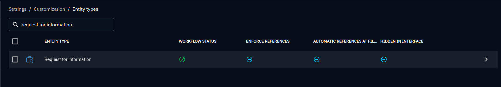

Configure the `Specific Workflow for Request Access` section:

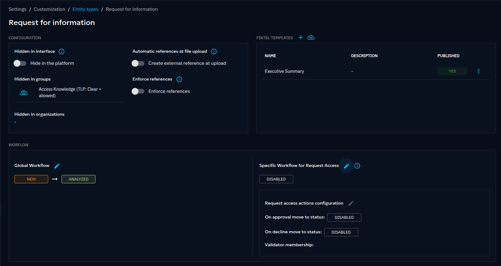

1. Click the edit icon next to `Specific Workflow for Request Access` and configure all status that can be used for request access use case. Note that the `Request for Information` will be created with the first status in this list.

2. Click the edit icon next to `Request access actions configuration`. In `On approval move to status:`, select the status that will be used when the request is accepted.

3. In `On decline move to status:`, select the status that will be used when the request is declined.

4. In `Validator group membership:`, select the group that will be allowed to see the `Request for Information` created automatically by the platform.

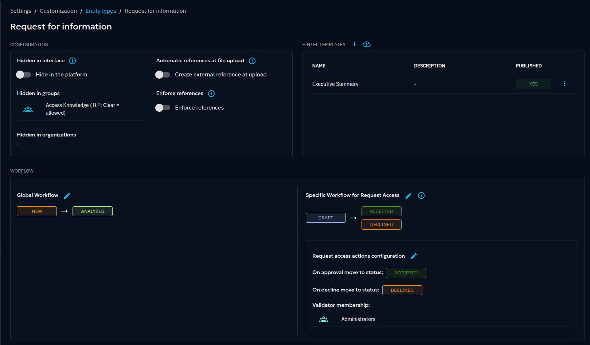

## Requesting an access

Once the configuration is complete, user that attempt to create an existing knowledge will have a new button "Request Access" proposed.

Then users will be able to give more detail on reason that lead to this request, select one of their organization and request access.

### Accepting or declining a request to access to knowledge

Users who are both:

- in the organization where the knowledge actually belong
- in the group that has been configured in Request for information entity settings

Will receive a dedicated Request for information for example:

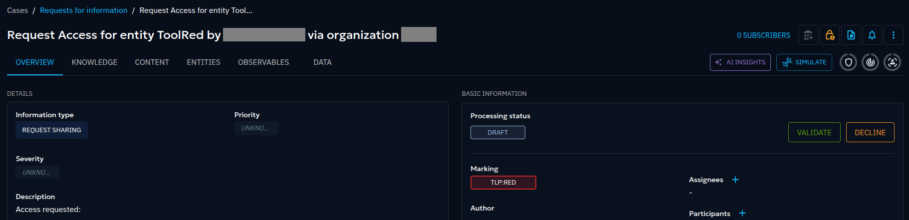

> Note that this specific Request for Information is automatically under [authorized member restricted access](authorized-members.md) for confidentiality reason.

The knowledge that is requested to be shared, can be found in related entities.
There is two dedicated button "Validate" and "Decline": with one click on Validate, the knowledge will be shared as requested.

User that are allowed to see the dedicated Request for Information and allowed to share the knowledge, will also be notified on dedicated Request for Information creation.
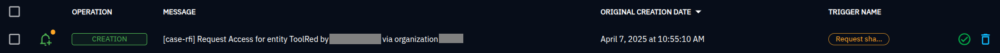

## Request access with a workflow

!!! tip "Enterprise edition, preview"

    The request access workflow requires the **OpenCTI Enterprise Edition** and the `ENTITIES_WORKFLOW` feature flag. Until a request access workflow is **published** for *Request for information*, the configuration described above applies unchanged.

With [Entities workflow](../usage/entities-workflow.md), request access gets its own workflow, built in the same editor as other workflows. You choose the statuses and transitions, who can decide, and what happens when a request is approved.

### Two workflows for Request for information

In `Settings > Customization > Entity types > Request for information > Workflow`, the **Global** and **Request access** buttons switch between two separate workflow definitions:

- **Global**: the workflow of the regular requests for information.
- **Request access**: the workflow of the requests created from the **Request Access** button.

Each scope has its own statuses, draft and published version. Changing one never changes the other.

A request for information belongs to one scope for its whole life. A request created by the request access form can only be created on the published request access workflow.

In the **Request access** scope, a **Validator group** select sets the group of validators. It saves when you change it. A request cannot be created while no validator group is set.

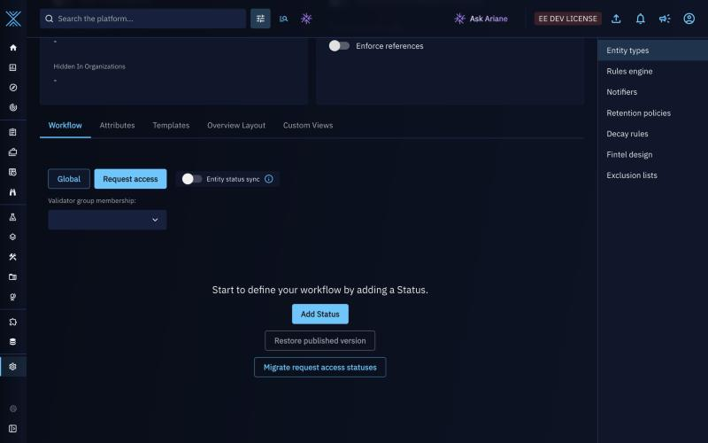

### Set up the workflow

1. **Migrate the legacy statuses (optional).** Click **Migrate request access statuses**. The preview shows the Approved and Declined statuses and the *Accept* and *Reject* transitions that will be created, and lists any blocking problem. The statuses already in use are reused, so existing requests keep their status. The **Publish immediately** switch is on by default: the migrated workflow is published at once, and new requests follow it. Turn it off to review the result as a draft first. The migration replaces the current draft of the request access workflow, and asks for a confirmation when a draft already exists.

    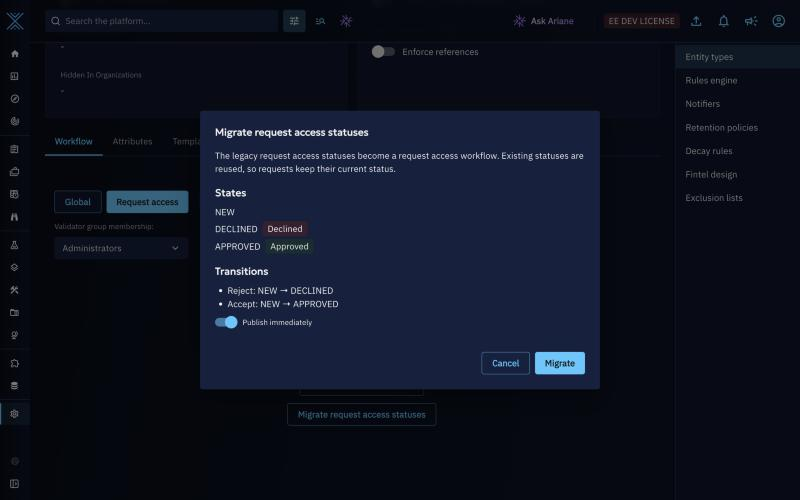

2. **Edit the workflow.** Add intermediate statuses if you need a review step, for example *Under review* between the first status and the outcomes.
3. **Mark the two outcomes.** On a status, the **Request outcome** select marks it as *Approved* or *Declined*. Exactly one status of each kind is needed.
4. **Share on approval.** When you set a status as *Approved*, the **Share requested entities** action is added on enter, as its last action. It stays there: change the request outcome to remove it.

    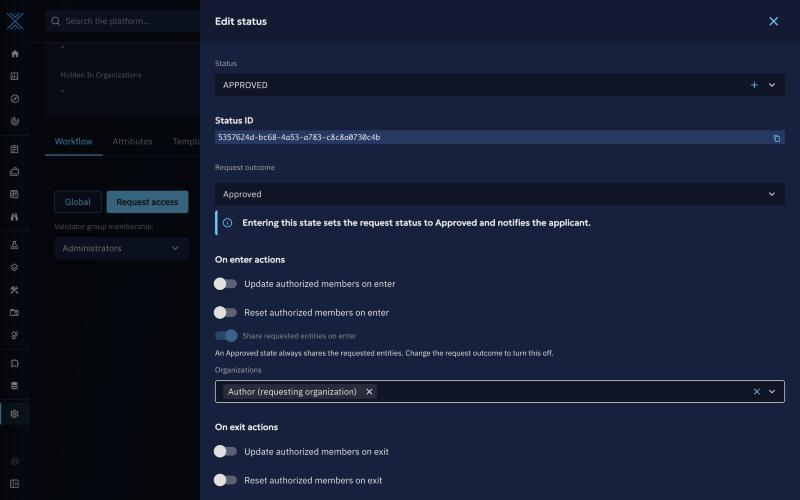

5. **Publish (if not already done).** From then on, new requests follow this workflow.

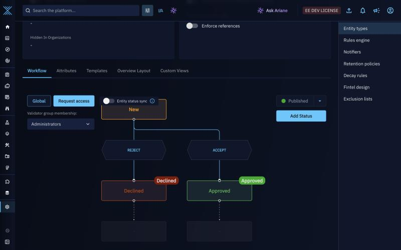

!!! note "Publishing rules"

    Publishing is refused when:

    - there is not exactly one *Approved* and one *Declined* status,
    - an outcome status cannot be reached from the first status, or has an outgoing transition,
    - the *Approved* status has no **Share requested entities** action on enter, or it is not the last one,
    - the **Share requested entities** action is used anywhere else (another status, an exit action, a transition),
    - an outcome or the share action is used outside a request access workflow,
    - you move an outcome to another status while requests are in the one that holds it, or you mark as outcome a status that holds undecided requests,
    - the common [workflow rules](../usage/entities-workflow.md#rules-required-to-publish-a-workflow) are broken.

    A status used by the request access workflow cannot be deleted. The Global and Request access workflows must also have different names: this is refused when you save, not when you publish.

### What a request looks like

When a user requests access:

- the request for information starts in the first status of the workflow, with the **requesting organization** as author,
- the request is restricted to its [authorized members](authorized-members.md): the members of the validator group, in the organization that owns the requested entities (or in the platform organization),
- each of them is notified by their own notifiers, through the *Request sharing* trigger, except the platform administrator account,
- one request holds at most **500 entities** and a reason of at most **10,000 characters**.

The requested entities are listed in the related entities of the request, as before.

### Accept or decline a request

Open the request. The processing banner shows one button per transition you are allowed to take from the current status, and no button once the request is decided. On *Accept*, the banner states the effect, for example *This will share 3 requested entities with Org A and notify the applicant*.

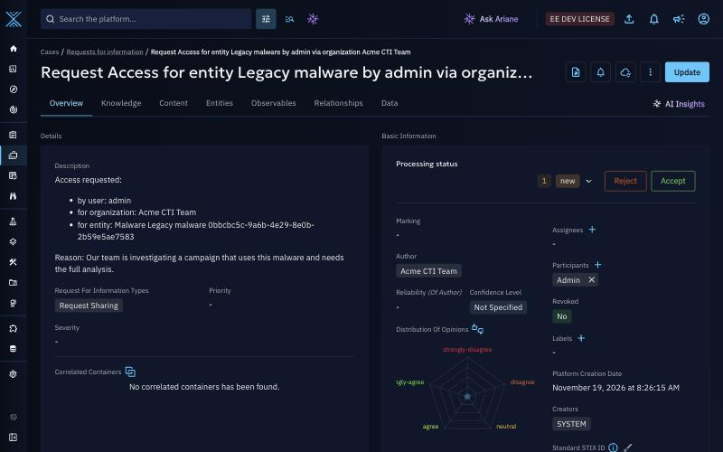

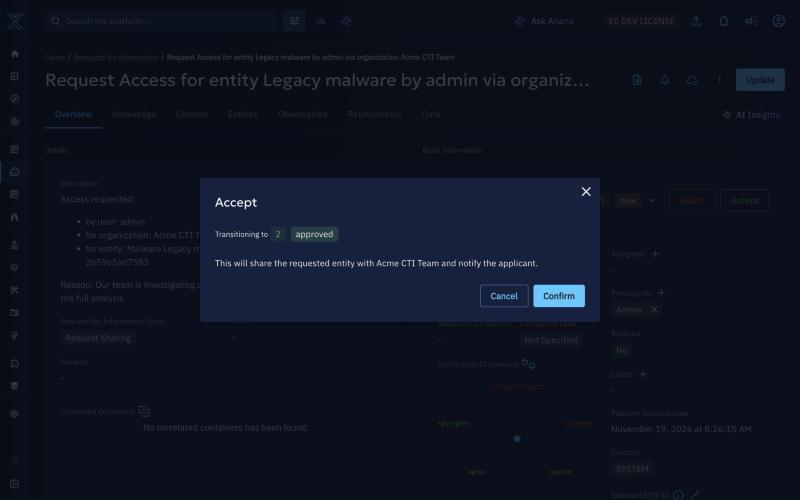

To decide a request you need edit access to it and the *Restrict organization access* capability, and it cannot be decided from inside a [draft](../usage/draft-workflow.md).

**Approve.** Entering the *Approved* status shares every requested entity with the requesting organization, **with your own rights**: nobody can grant access they could not grant otherwise. The request is then set as approved, the applicant is notified, and the decision is counted.

1. OpenCTI first checks every requested entity: your access, any restriction, and your confidence level.
2. Entities that are not containers are shared right away.
3. Containers (a report, for example) are shared last by a [background task](../usage/background-tasks.md). The request enters *Approved* only when this task succeeds.

If a container cannot be shared, the request is not decided and shows an error. The organizations granted directly are revoked again. You cannot decline or decide the request another way until you retry the same transition, which grants them again, or until a user with *Bypass all capabilities* clears the error, which revokes what is left. What the container task already shared before it failed stays shared.

**Decline.** Entering the *Declined* status sets the request as declined and notifies the applicant. Nothing is shared.

The share needs a real user: it never runs for the system, the workflow manager or a playbook.

### Bypass and direct changes

- A user with *Bypass all capabilities* can move a request to any status. Into *Approved* **with status actions**, the share and the notification run. **Without** them, only the status changes. Leaving *Approved* never removes the sharing.
- The **Status** field is hidden in the edit form of a request driven by the workflow.
- The legacy **Validate** and **Decline** actions of the API run the matching transition from the current status of the request.
- API, synchronization and playbook writes are refused when they move a request in or out of *Approved* or *Declined*, change the request access record of a request driven by the workflow, send a malformed or oversized request access record, or create a request directly at an outcome status. This also applies to a regular request: it cannot land on a request access outcome.
- Merging requests copies neither an outcome status nor a decided request.

## Disabling request access feature

If you have attempted to use the functionality but need to remove it due to policy:

- In entity setting, delete all status in "Specific Workflow for Request Access" section. 
- You can alternatively remove the group in `Validator group membership:`.

This will restore the default behavior, and the button will not appear in the error message `Restricted entity already exists`.

