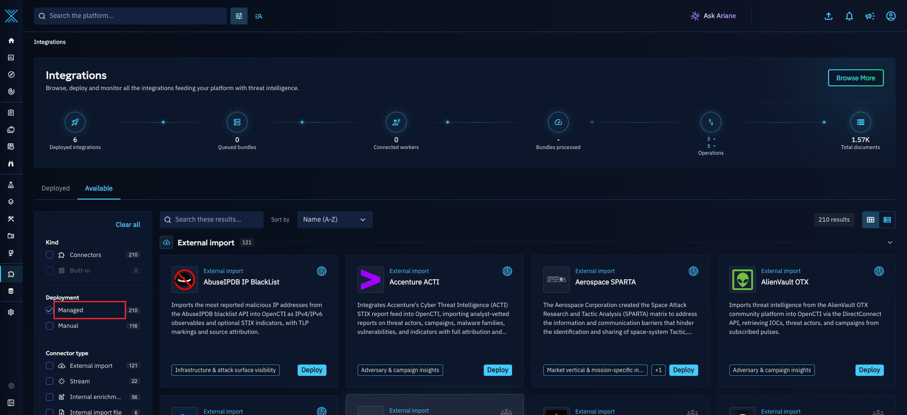
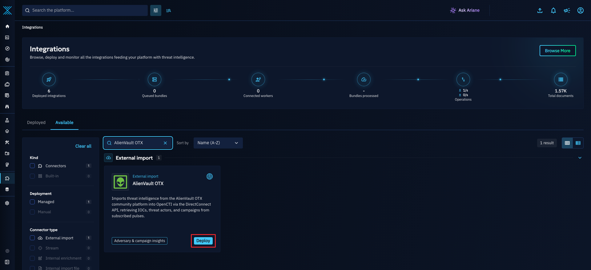
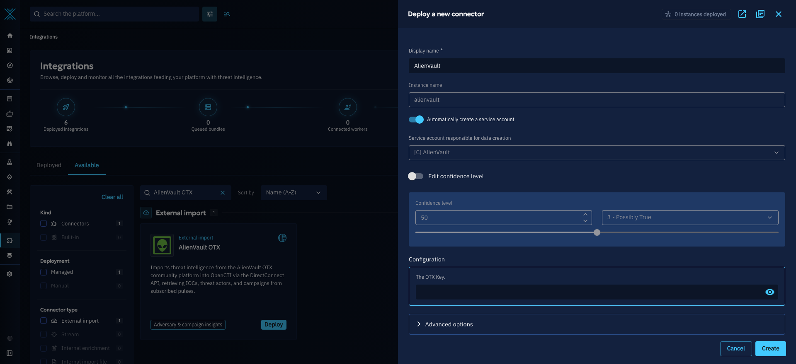
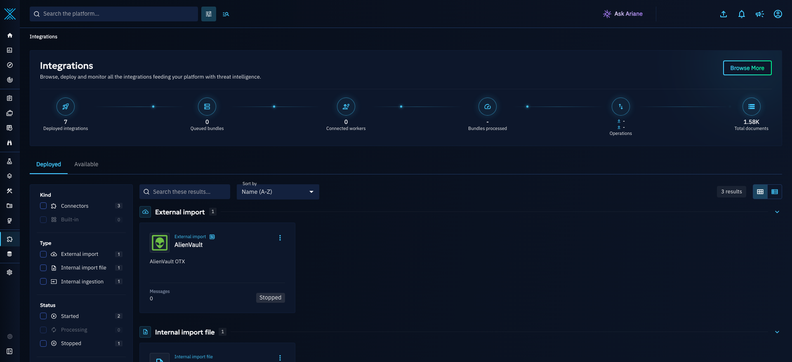
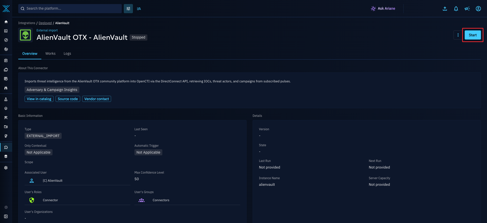

# Migration Guide

This guide will help you migrate your connector instances to their version managed by Integration Manager.

!!! info "Warning"

    By following this guide, you will delete your current instance and replace it with a new one.

    The current state, works in progress, last ingestion dates, and all data intrinsic to the currently deployed instance will not be recovered.

## Prerequisites

Before starting, ensure you have:
- XTM Composer installed (see [Installation Guide](installation.md))
- Access to an OpenCTI instance
- An Enterprise Edition activated (see [Enterprise Edition](../../administration/enterprise.md))
- The Manage ingestion capability (see [Users](../../administration/users.md))

## Step 1 : Verify that the connector is compatible with the integration manager

1. Log into your OpenCTI instance
2. Navigate to **Integrations > Available**
3. Search for the connector in the list
4. Check that the connector card has a **Deploy** button: only these connectors can be deployed by the integration manager. To list them all, select **Managed** under **Deployment** in the filters. Connectors listed under **Manual** must still be deployed by hand

## Step 2 : Get the current configuration of the connector instance

When deploying your instance, you created a configuration file. In this file, you should be able to access the settings required to deploy the connector via the integration manager. Among this information, you will need the credentials in particular.

For more information on the configuration settings for a connector, follow the link (Integration documentation and code) accessible from the connector page in OpenCTI. Once on GitHub, go to the __metadata__ folder, then open the CONNECTOR_CONFIG_DOC.md file.

## Step 3 : Deploy the new instance

1. Navigate to **Integrations > Available**
2. Search for the connector in the list
3. Click **Deploy** to display the form

    

4. Fill out the form with the information you collected earlier
5. Click **Create** to deploy the connector

    

## Step 4 : Start the new instance

1. Navigate to **Integrations > Deployed** and open your connector instance

    

2. Click **Start** to start the connector

    

3. Wait a few seconds for the status to change to Started

## Step 5 : Delete the old instance

You can now delete the old instance. Be sure to remove it from your services (e.g., in the docker-compose file) to prevent automatic redeployment during the next update.