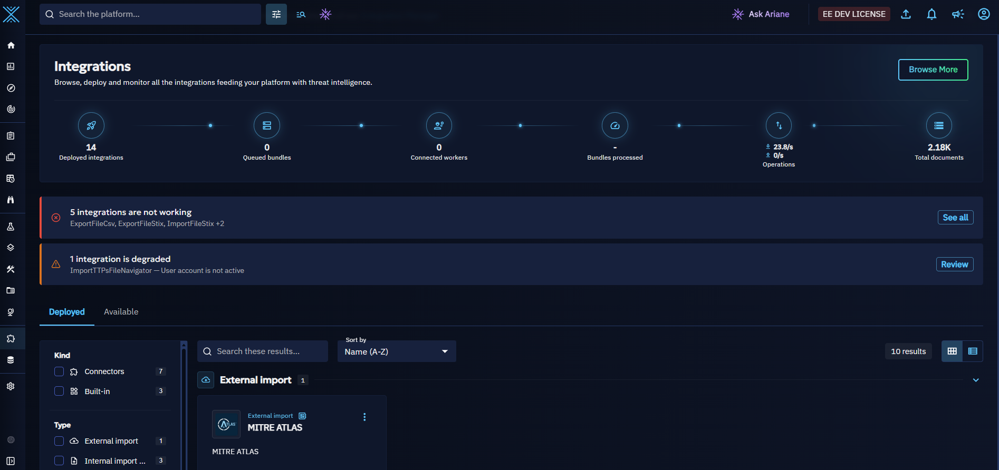
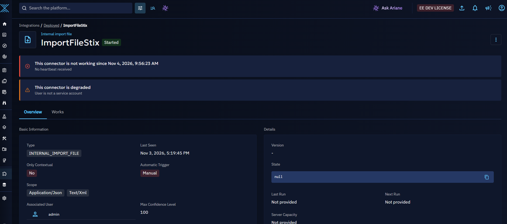
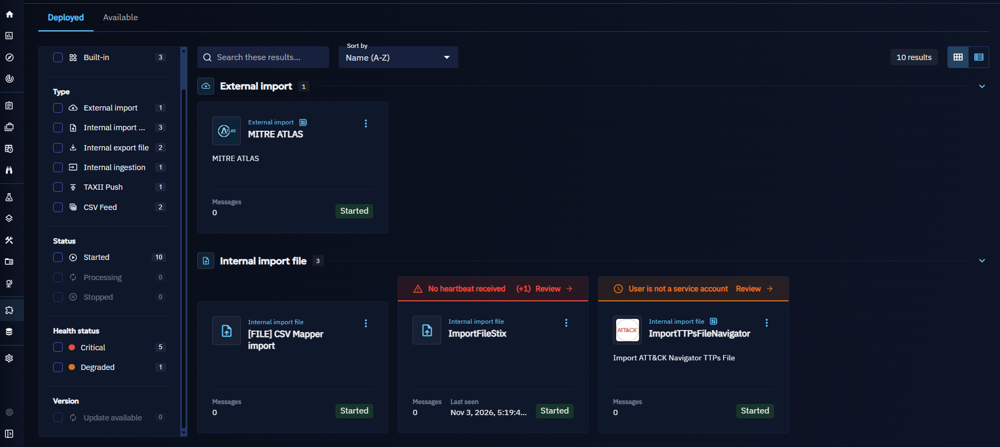
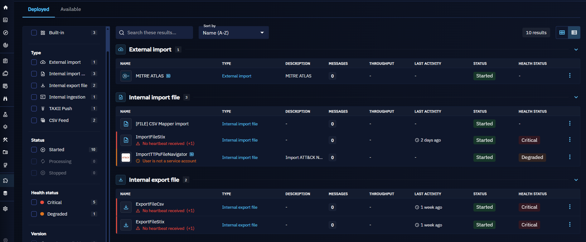
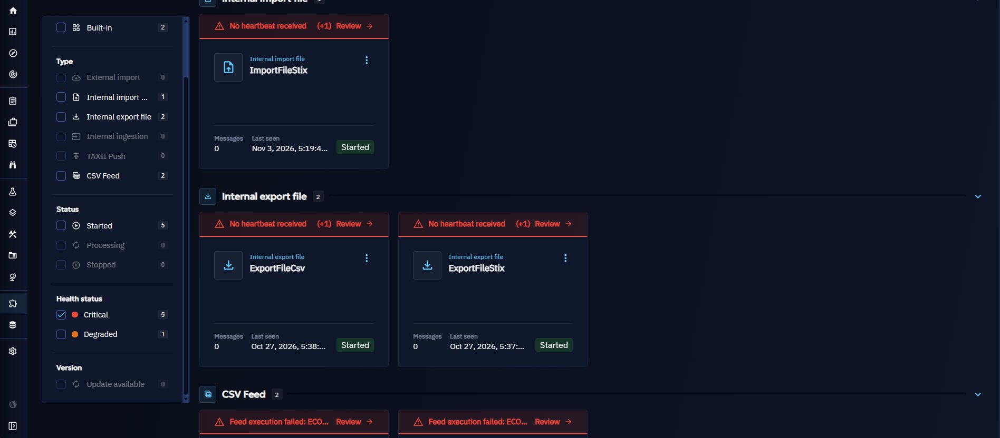
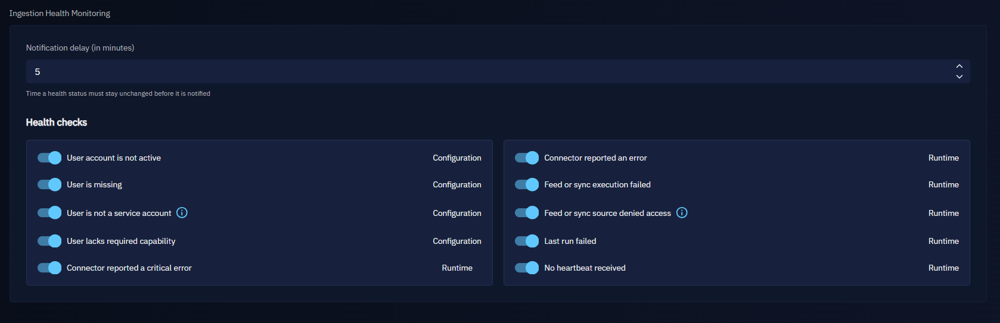
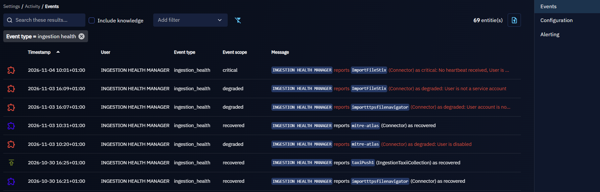
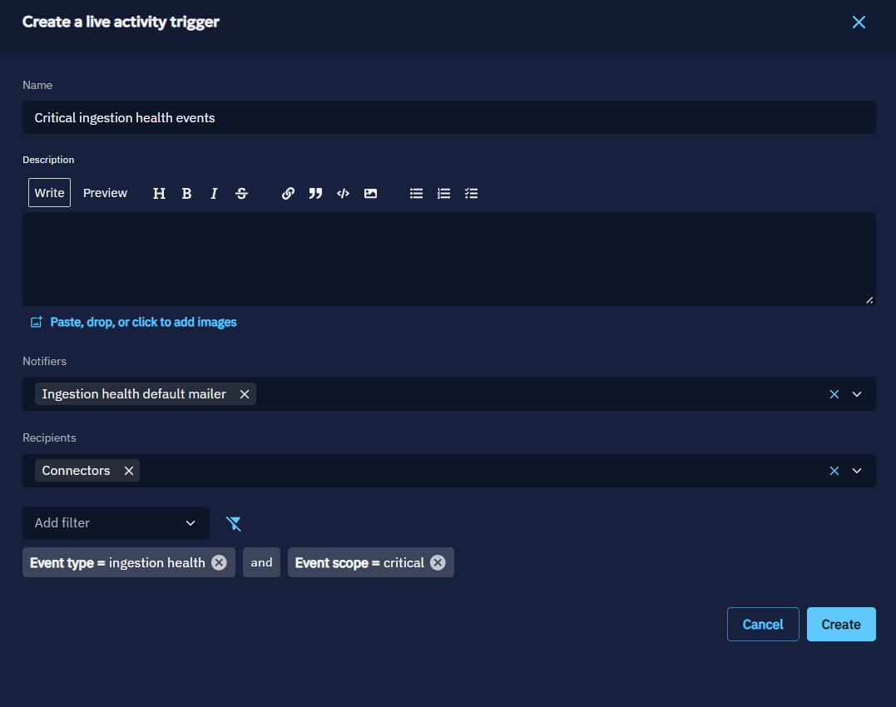
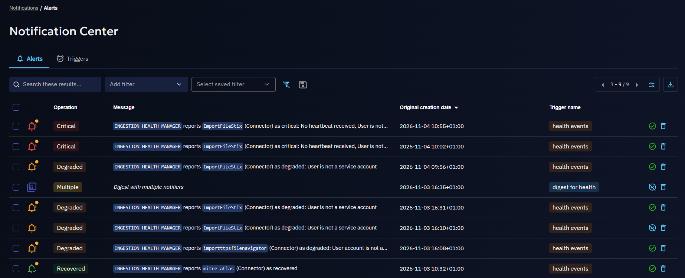
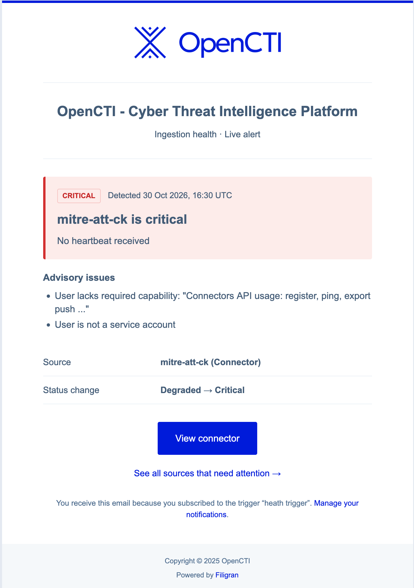

# Ingestion health

!!! warning "Unreleased feature"

    This page documents a feature under development. It is only available when the `INGESTION_HEALTH` feature flag is enabled (`APP__ENABLED_DEV_FEATURES`), and this page is not published.

    When the feature is released: move this page and its `assets/ingestion-health-*.png` images to `administration/`, add it to `nav` in `mkdocs.yml`, and link it from the connector, feed and activity trigger pages.

Ingestion health tells you, for each connector, feed and synchronization, whether it is ingesting data as expected. OpenCTI evaluates every ingestion every minute, gives it a status, explains what is wrong, and can notify you when the status changes.

This page covers the statuses, the checks behind them, where to see them, how to configure them, and how notifications work.

## What is ingestion health?

An ingestion is any process bringing data into OpenCTI:

- an [external import connector](../usage/import/external-connectors.md) (managed by the integration manager or self-hosted), and any other deployed connector (enrichment, stream, import or export of files);
- a feed: [RSS](../usage/import/rss-feed.md), [CSV](../usage/import/csv-feed.md), [JSON](../usage/import/json-feed.md), [TAXII](../usage/import/taxii-feed.md) or [TAXII push](../usage/import/taxii-push.md);
- a synchronization with another OpenCTI platform ([stream](../usage/import/internal-streams.md)).

For each ingestion, OpenCTI runs a set of **health checks**. Each failing check is reported with a message, and the failing checks together give the ingestion its **health status**.

## Why use it?

A broken ingestion is silent: a connector that stopped pinging, a feed whose API key expired, or a synchronization whose user lost its rights simply brings no more data. Without ingestion health, you notice it when the data is missing.

With ingestion health, you:

- see at a glance which ingestions are not working, and why;
- fix the configuration issues before they break an ingestion (a user that is not a service account, a user without the required capability);
- get notified when an ingestion fails, and when it recovers.

## Health statuses

| Status | Meaning |
|---|---|
| **Critical** | The ingestion does not work: at least one runtime check fails with a blocking severity. |
| **Degraded** | The ingestion works, or may work, but something needs attention: at least one check fails with an advisory severity, or a configuration check fails. |
| **Healthy** | No check fails, and the ingestion proved it is alive: a connector that pings continuously sent a heartbeat in the last 5 minutes. |
| **Unknown** | No check fails, but nothing proves the ingestion is alive: feeds, synchronizations and connectors that do not ping continuously (see [Heartbeat](#how-the-checks-work-details)). |

The status follows these rules, in this order:

1. any **blocking runtime** failure makes the ingestion **critical**;
2. otherwise, any **advisory** failure, or any **configuration** failure, makes it **degraded**;
3. otherwise, it is **healthy** when a live heartbeat proves it, and **unknown** when nothing does.

!!! note "Healthy and unknown look the same in the interface"

    The interface does not distinguish a healthy ingestion from an unknown one: neither shows a chip, and the health filter only offers critical and degraded. No chip only means that no check fails. It does not prove that the ingestion works: even a healthy status is not a certain proof, since a heartbeat only shows that the process of the connector is alive, not that it ingests data correctly.

!!! note "Why a blocking configuration check only degrades the status"

    A configuration check describes how the ingestion is set up, not what it is doing. A connector whose user lacks a capability is likely to fail, but only a runtime check can tell that it actually fails. So a configuration failure, even blocking, degrades the status, and only a runtime failure makes it critical.

### When there is no status

An ingestion has no status, and shows no chip, when:

- it was never evaluated yet: it was just created, or the platform just started;
- it is **stopped** on purpose: a stopped feed or synchronization, or a managed connector stopped from the integration manager. A stopped ingestion is not evaluated and its previous health is removed. A self-hosted connector cannot be stopped from OpenCTI: it is always evaluated.

Built-in connectors (the internal connectors behind the feeds and the file imports) are never evaluated.

## Health checks

Each check has a **kind**:

- a **configuration** check judges how the ingestion is set up (its user, its rights);
- a **runtime** check judges what the ingestion reported while running (its heartbeat, its last execution, its errors);

and a **severity**:

- a **blocking** failure prevents the ingestion from working;
- an **advisory** failure deserves attention, but the ingestion may still work.

| Check | Applies to | Kind | Severity | Fails when                                                                                                                                                                                   | What to do |
|---|---|---|---|----------------------------------------------------------------------------------------------------------------------------------------------------------------------------------------------|---|
| User is missing | Connectors, feeds, synchronizations | Configuration | Advisory | A connector has no user, or the user of an ingestion was deleted                                                                                                                             | Set an existing user on the ingestion |
| User lacks required capability | Connectors | Configuration | Advisory | The user of the connector lacks the **Connectors API usage** capability (`CONNECTORAPI`): the connector cannot register nor ping                                                             | Give the capability to a role of the user |
| User account is not active | Connectors, feeds, synchronizations | Configuration | Advisory | The account of the user is expired, locked or disabled: the platform refuses to authenticate it. As a configuration check, it degrades the status, it does not make it critical              | Reactivate the account, or set another user |
| User is not a service account | Connectors, feeds, synchronizations | Configuration | Advisory | The user of the ingestion is a regular user: the ingestion breaks when this person leaves or changes rights. This is not necessarily blocking, but using a service account is recommended | Use a service account |
| No heartbeat received | Connectors pinging continuously | Runtime | Blocking | The connector sent no heartbeat for 5 minutes: its process is down                                                                                                                           | Check the process of the connector (container, logs) |
| Feed or sync execution failed | Feeds (except TAXII push), synchronizations | Runtime | Blocking | The last execution failed: source unreachable, not found, invalid data... The message gives the HTTP status or the error code when known                                                     | Check the source and the configuration of the feed |
| Feed or sync source denied access | Feeds (except TAXII push), synchronizations | Runtime | Blocking | The source refused the last execution with HTTP 401, 402 or 403                                                                                                                              | Renew or fix the credentials of the feed |
| Last run failed | Connectors, except stream connectors | Runtime | Advisory | The last run of the connector ended with an error                                                                                                                                            | Read the error of the last work of the connector |
| Connector reported an error | Connectors | Runtime | Advisory | The connector reported an error on ping, with a low criticity                                                                                                                                | Read the error code and message, see the documentation of the connector |
| Connector reported a critical error | Connectors | Runtime | Blocking | The connector reported an error on ping, with a high criticity                                                                                                                               | Read the error code and message, see the documentation of the connector |

### How the checks work (details)

The following rules explain why a check fails, or does not for complex cases.

**Users**

- A connector always needs its own user: it authenticates with it. A feed or a synchronization without user runs as the system user, a supported setup: **User is missing** only fails for them when the user they were given was deleted.
- The internal users (such as the system user) are never judged by the user checks.
- The user checks only judge an existing user: a missing user is reported by **User is missing** only, not by the other three.

**Heartbeat**

- Only the connectors that ping continuously are checked for a heartbeat: the ones that report their information to the platform and do not run and terminate. A connector that runs once and exits pings only at the start and at the end of a run: it would be missing its heartbeat between two runs.
- The heartbeat is considered alive for 5 minutes, the same window as the active or inactive state of the connector.
- A healthy status needs this proof of life: this is why feeds, synchronizations and connectors that do not ping continuously are **unknown**, never **healthy**, when no check fails.

**Feed and synchronization executions**

- The execution checks only read the ingestions whose last execution is in error. The next successful execution clears them.
- A TAXII push ingestion has no execution: the partner pushes the data to OpenCTI. Only the user checks apply to it.
- The details of the failure (HTTP status, error code, error message) come from the ingestion logs of the feed. When they are missing, the failure is reported without them.
- When the source denied access (HTTP 401, 402 or 403), only **Feed or sync source denied access** is reported: it tells the cause, **Feed or sync execution failed** would only repeat it less precisely.

**Connector runs**

- **Last run failed** judges the last work of the connector, once processed: it fails when the connector itself closed the work with an error. The errors of the workers on single elements of the work do not make a failed run.
- A work that ended more than 5 minutes before the last run of the connector belongs to an earlier run: it is not judged. The check waits for the work of the last run.
- A stream connector has no run: the check does not apply to it.
- The check is advisory: the connector may still ingest, and its next successful run clears it.

**Errors reported by the connector**

- A connector can report errors with each ping, each one with a code, a message and a criticity. Each reported error is a failure of its own: a connector reporting two errors shows two failures.
- The criticity sets the severity: a low criticity gives **Connector reported an error** (advisory); a high criticity gives **Connector reported a critical error** (blocking).
- A reported error expires 10 minutes after the last ping that reported it: a connector that stops reporting it, or stops pinging, clears it.

**Evaluation**

- The ingestion health manager evaluates every ingestion every minute, on one platform node at a time.
- A disabled check is not evaluated, on any ingestion (see [Configure ingestion health](#configure-ingestion-health)).
- When the data of a runtime check cannot be read (for instance, Redis is unreachable), the ingestions needing it keep their previous status until the next evaluation: a read failure is never reported as a failing ingestion.
- For errors reported by a connector (on ping, or as the error of a work), OpenCTI replaces the URLs in these messages and keeps at most 200 characters before storing them. The error messages of feeds and synchronizations are stored as they are. Activity events and notifications never include the error text written by a connector or a source.

## Where to see the health

### On the connector or feed page

A connector or a feed with a critical or degraded status shows a chip next to its name. Hover the chip to see since when the status lasts, and the message of each failing check.

The page also shows an alert listing the failing checks: **This connector is not working** for a critical status, **This connector is degraded** for a degraded one (**This feed is...** for a feed).

### In the deployed integrations

The **Integrations > Deployed** list shows the health chip of each ingestion, on its card and on its line.

When ingestions are critical or degraded, alerts at the top of the list count them, one alert for the critical ones and one for the degraded ones, such as **1 integration is not working**. When a single ingestion is concerned, the alert gives what is wrong with it: click **Review** to open its page. When several are concerned, click **See all** to filter the list on them.

You can also filter the list by health status with the **Critical** and **Degraded** facets.

## Configure ingestion health

### Platform parameters

Go to **Settings > Parameters**, section **Ingestion health monitoring**. You need the **Manage parameters** capability (`SETTINGS_SETPARAMETERS`).

| Parameter | Description | Default |
|---|---|---|
| Notification delay (in minutes) | Time a health status must stay unchanged before it is notified. Only configurable with the [Enterprise Edition](../administration/enterprise.md). See [Notifications](#notifications). | 5 |
| Health checks | Every check, with its kind (runtime or configuration). Turn a check off to stop evaluating it on every ingestion. | All on |

!!! tip "Turn off a check rather than ignore it"

    If a check does not fit your platform (for instance, you knowingly run ingestions with regular users), turn it off: the ingestions it degrades go back to their real status, and their notifications stop.

### Platform configuration

The ingestion health manager is configured like the other managers (see [Configuration](../deployment/configuration.md)):

| Parameter | Environment variable | Default | Description |
|---|---|---|---|
| `ingestion_health_manager:enabled` | `INGESTION_HEALTH_MANAGER__ENABLED` | `true` | Enable or disable the ingestion health manager. Disabled, the statuses are no longer updated. |
| `ingestion_health_manager:interval` | `INGESTION_HEALTH_MANAGER__INTERVAL` | `60000` | Time between two evaluations, in milliseconds |

## Notifications

!!! tip "Enterprise edition"

    The ingestion health events are activity events: logging them and the activity triggers notifying them are available under the "OpenCTI Enterprise Edition" license. See the [dedicated page](../administration/enterprise.md).

### Health events

Each time the status of an ingestion changes and stays stable, OpenCTI logs an activity event:

| Event type | Event scope | Status | Sent when |
|---|---|---|---|
| `ingestion_health` | `critical` | error | The ingestion became critical |
| `ingestion_health` | `degraded` | error | The ingestion became degraded |
| `ingestion_health` | `recovered` | success | The ingestion has no more failing checks after a critical or degraded event |

The rules:

- **The status must stay stable.** An event is only sent once the status has stayed unchanged for the notification delay (5 minutes by default): an ingestion flapping between two statuses does not flood you with events.
- **One event per change.** While the status does not change, no other event is sent.
- **A recovery needs a failure first.** An ingestion is only reported as recovered when its last event reported it critical or degraded. A new ingestion that is healthy from the start sends nothing.
- **A stopped ingestion sends nothing.** Stopping an ingestion removes its health without event.
- **A lost event is retried.** When the event cannot be logged, it is sent again at the next evaluation.

Each event names the ingestion, its new status and the messages of the failing checks, the critical ones apart from the others, with the previous status and how long the status has lasted. See the [Activity events](../administration/audit/events.md) page to browse them.

### Get notified

Create an [activity trigger](../administration/audit/triggers.md) on the health events:

1. Go to **Settings > Activity > Alerting** and create an activity trigger.
2. Choose a **live** trigger to be notified at each event, or a **digest** to receive a summary at a regular interval.
3. Add the filter **Event type** = `ingestion_health`. Optionally add the filter **Event scope** = `critical` to only be notified of the ingestions that stop working.
4. Choose the [notifiers](../administration/notifiers.md) (user interface, ingestion health default mailer) and the recipients.

### The existing notifiers for health events

The **User interface** notifier shows the events in the notifications of the recipients in OpenCTI.

The **Ingestion health default mailer** is a built-in notifier, available when ingestion health is enabled: live-alert emails include the ingestion, its status and all messages of the failing checks; digest emails summarize each event with one representative message and a count of any additional messages.

Here is an example of an email received with the ingestion health default mailer:

## Example

A TAXII feed collects indicators from a partner. On Monday, the partner rotates its API keys, and the key of the feed expires.

1. At the next execution, the partner refuses the request with HTTP 401. The feed turns **critical**, with the failing check **Feed or sync source denied access: HTTP 401**.
2. The status stays critical for 5 minutes: OpenCTI logs an `ingestion_health` event with the scope `critical`.
3. The security team receives the email of their live trigger: "reports `Partner TAXII` (IngestionTaxii) as critical". The email links to the feed; to see the failing-check details, they open it.
4. An administrator opens **Integrations > Deployed**, clicks **Review** on the alert, opens the feed, and updates its API key.
5. The next execution succeeds: the check clears. Five minutes later, OpenCTI logs a `recovered` event, and the team is notified that the feed works again.
