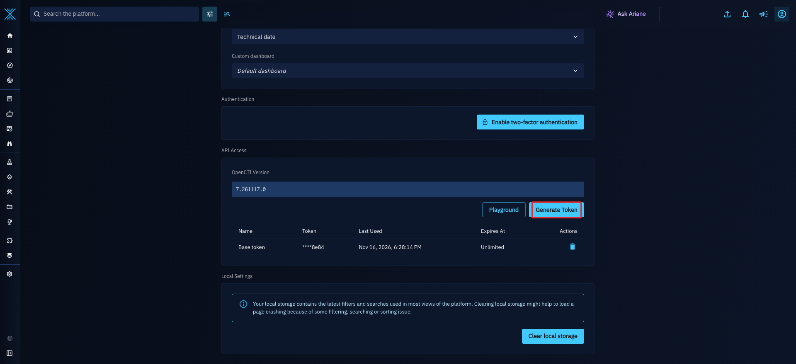
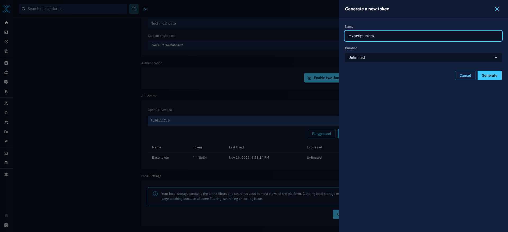
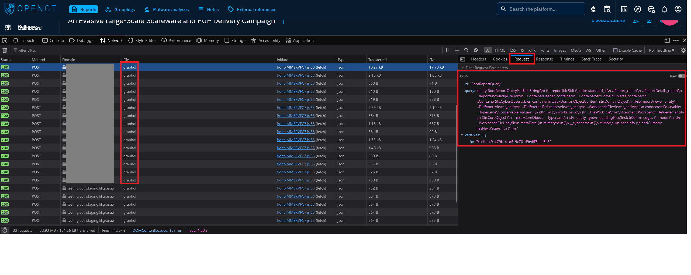

# GraphQL API

OpenCTI provides a comprehensive API based on GraphQL, allowing users to perform various actions programmatically. The API enables users to interact with OpenCTI's functionality and data, offering a powerful tool for automation, integration, and customization. All actions that can be performed through the platform's graphical interface are also achievable via the API.


## Endpoint

The API has a single endpoint for all queries and mutations: `https://<your OpenCTI host>/graphql`. When the platform runs under a base path (`app:base_path`, for example `/opencti`), the base path comes first: `https://<your OpenCTI host>/opencti/graphql`.

Send each request with the `POST` method and a JSON body that holds the `query` and, optionally, its `variables`. The endpoint answers methods other than `POST` (and the `OPTIONS` preflight) with `405 Method Not Allowed`.


## Authentication

The API acts on behalf of a user: what a request can read or change depends on the capabilities, groups, organizations and markings of that user. To authenticate a request, send an API token of that user in the `Authorization` header:

```
Content-Type: application/json
Authorization: Bearer <your API token>
```

To create and use API tokens, the user's role must grant the `Allow token usage` capability, found under `API usage with authorization header` (see [the list of capabilities](../administration/users.md#list-of-capabilities)). A request with an unknown or expired token, or with the token of a user who lacks this capability, is handled as an unauthenticated request: it gets the error `You must be logged in to do this.`

The API can also accept HTTP Basic authentication (`Authorization: Basic ...`) with the email and local password of a user whose role grants the `Allow basic auth usage` capability. Basic authentication sends a password with every request: use API tokens for scripts and integrations. This page uses tokens.

Basic authentication is controlled by the **Allow API Basic authentication** switch of the [local authentication](../administration/authentication-via-ui.md#api-basic-authentication):

- A new platform starts with it disabled. A platform upgraded from a version without this setting starts with it enabled.
- While it is disabled, every Basic request is refused, for every user, administrators and the `Bypass all capabilities` capability included. The request is handled as unauthenticated: a GraphQL request gets the error `You must be logged in to do this.`

### Generate a token

1. Click the profile icon at the top right of the platform, then click **Profile**.
2. In the **API access** card, click **Generate Token**. The button only shows when your role grants `Allow token usage`.

    

3. Enter a **Name** for the token, choose a **Duration** (30 days, 60 days, 90 days, 1 year or Unlimited), then click **Generate**.

    

4. Copy the token right away. The platform shows it only once. It stores a hash of it and a masked form (its last 4 characters), so you cannot display it again: if you lose it, generate a new one.

The same card lists your tokens, with their expiration date.

!!! note "Tokens since OpenCTI 7.260224.0"

    Since OpenCTI 7.260224.0, a user can hold several tokens, each with its own duration, and tokens can no longer be displayed after their creation. See [Tokens management](../deployment/breaking-changes.md#tokens-management) in the breaking changes.

### Test your token

Set `OPENCTI_URL` to the address of your platform (with its base path, if any) and `OPENCTI_TOKEN` to your token, then ask the platform for its version:

```bash
export OPENCTI_URL="https://opencti.example.com"
export OPENCTI_TOKEN="<your API token>"

curl -X POST "$OPENCTI_URL/graphql" \
  -H "Content-Type: application/json" \
  -H "Authorization: Bearer $OPENCTI_TOKEN" \
  -d '{"query": "{ about { version } }"}'
```

The `about` query requires an authenticated user, so a valid token returns the version, for example `{"data":{"about":{"version":"..."}}}`, and an invalid one returns the `You must be logged in to do this.` error.


## Documentation

The API exposes queries to read data and mutations to create, update or delete it, all on the same endpoint. To understand how GraphQL works, see the [Understand GraphQL](api.md#understand-graphql-section) section.

The schema lists every query, mutation, type, field and filter of the API. You can read it in two places:

- In the [GraphQL playground](../development/api-usage.md) of your platform (`https://<your OpenCTI host>/public/graphql`, after the base path if any), when the playground is enabled, with the documentation explorer and autocompletion. Both need introspection, which is disabled by default: an administrator allows it by setting `app:graphql:playground:force_disabled_introspection` to `false` (see the [configuration](../deployment/configuration.md#technical-customization) page).
- In the OpenCTI repository, as a single file. See [GraphQL schema](data-model.md#graphql-schema) in the data model reference.

For filters, see the [filters](filters.md) reference. For more examples, see the [Python client examples](https://github.com/OpenCTI-Platform/opencti/tree/master/client-python/examples) and the source code of the [Python client](../development/python.md).




## Examples

Run these examples in the GraphQL playground, or send them with `curl` as in [Test your token](#test-your-token): the JSON body holds the query in `query` and its variables in `variables`.

### List the latest reports

This query returns the five most recently published reports. It needs the `Access knowledge` capability.

```graphql
query LatestReports {
  reports(first: 5, orderBy: published, orderMode: desc) {
    pageInfo {
      globalCount
    }
    edges {
      node {
        id
        standard_id
        name
        published
        report_types
        createdBy {
          name
        }
      }
    }
  }
}
```

To narrow the results, add the `search` or `filters` arguments (see the [filters](filters.md) reference).

### Read one report

This query reads one report from its ID. The `id` variable accepts the OpenCTI ID (`id`) or the STIX ID (`standard_id`) of the report. It needs the `Access knowledge` capability.

```graphql
query OneReport($id: String!) {
  report(id: $id) {
    id
    name
    description
    published
    objectLabel {
      value
    }
  }
}
```

Variables:

```json
{
  "id": "<ID of the report>"
}
```

The answer holds `"report": null` when no report has this ID or when you cannot access it.

### Create a report

This mutation creates a report. `name` and `published` are the only fields the schema requires. If your administrator made other attributes mandatory in the entity customization, provide them too, unless your role grants `Bypass mandatory fields`. Likewise, if external references are enforced for reports, provide `externalReferences`, unless your role grants `Bypass enforced reference`. It needs the `Create / Update knowledge` capability.

```graphql
mutation CreateReport($input: ReportAddInput!) {
  reportAdd(input: $input) {
    id
    standard_id
    name
  }
}
```

Variables:

```json
{
  "input": {
    "name": "My first report",
    "published": "2026-01-15T00:00:00.000Z",
    "report_types": ["threat-report"]
  }
}
```

The platform identifies a report by its name and publication date. If a report with the same name (case-insensitive, ignoring leading and trailing spaces) and the same `published` date already exists, the mutation does not create a second one. It updates the existing report with your input, within the limits of your confidence level, and returns it. If you cannot access that existing report, the mutation fails.


<a id="understand-graphql-section"></a>
## Understand GraphQL

GraphQL is a powerful query language for APIs that enables clients to request exactly the data they need. Unlike traditional REST APIs, which expose fixed endpoints and return predefined data structures, GraphQL APIs allow clients to specify the shape and structure of the data they require.

### Core concepts

#### Schema Definition Language (SDL)

GraphQL APIs are defined by a schema, which describes the types of data that can be queried and the relationships between them. The schema is written using the Schema Definition Language (SDL), which defines types, fields, and their relationships.

#### Query language

GraphQL uses a query language to request data from the server. Clients can specify exactly which fields they need and how they are related, enabling precise data retrieval without over-fetching or under-fetching.

**Example:**

```graphql
query IntrusionSets {
    intrusionSets (
        filters:
        {
            mode: and,
            filters: [
                {
                    key: "name",
                    values: ["Ajax Security Team"],
                    operator: eq,
                    mode: or,
                }
            ],
            filterGroups: [],
        }
    )
    {
        edges{
            node{
                id
                name
                description
                externalReferences{
                    edges{
                        node{
                            url
                            source_name
                        }
                    }
                }
            }
        }
    }
}
```

#### Resolvers

Resolvers are functions responsible for fetching the requested data. Each field in the GraphQL schema corresponds to a resolver function, which determines how to retrieve the data from the underlying data sources.

### How it Works

1. Schema definition: The API provider defines a GraphQL schema using SDL, specifying the types and fields available for querying.
2. Query execution: Clients send GraphQL queries to the server, specifying the data they need. The server processes the query, resolves each field, and constructs a response object with the requested data.
3. Validation and execution: The server validates the query against the schema to ensure it is syntactically and semantically correct. If validation passes, the server executes the query, invoking the appropriate resolver functions to fetch the requested data.
4. Data retrieval: Resolvers fetch data from the relevant data sources, such as databases, APIs, or other services. They transform the raw data into the shape specified in the query and return it to the client.
5. Response formation: Once all resolvers have completed, the server assembles the response object containing the requested data and sends it back to the client.

### External Resources

For a more in-depth understanding of GraphQL and its usage, consider exploring the following external resources:

- [GraphQL Official Documentation](https://graphql.org/learn/)
- [GraphQL query documentation](https://graphql.org/learn/queries/)
- [How to GraphQL](https://www.howtographql.com/)