# Entities workflow

Entities workflow turns the processing status of your entities into an enforced process. Instead of letting anyone pick any status, you draw the statuses an entity can go through, the transitions allowed between them, who may take each transition, and what OpenCTI does automatically when it happens.

A typical use is a SOC process on Incident responses: L1 analysts triage, L2 analysts investigate, and only L3 analysts can close. The same editor powers the [Draft workflow](draft-workflow.md); entities workflow extends it to every customizable entity type.

!!! note "Availability"

    Entities workflow is being rolled out progressively. While in preview it is enabled with the `ENTITIES_WORKFLOW` feature flag. When the flag is off, entity types other than Draft keep the existing status screens and behave exactly as before.

## Key features of entities workflow

For each entity type, a workflow lets administrators control:

- **The order of statuses** (**Community Edition**): an entity can only move along the transitions you draw. An incident cannot jump from *New* to *Closed* if no transition links them.
- **Who can move an entity forward** (**Enterprise Edition**): each transition can be restricted to groups, organizations, roles or users, and to entities matching filters.
- **What happens during a transition** (**Enterprise Edition**): share or unshare with organizations, update authorized members, ask for a comment.
- **What happens when entering or leaving a status** (**Enterprise Edition**): update authorized members automatically.
- **Why an entity was closed** (**Community Edition**): ask for a [closing reason](#closing-reason) on the transition into a final status, such as *true positive* or *false positive*.

The goal is to make your methodology part of the platform: steps cannot be skipped, duties are segregated, and every status change is traced in the entity's workflow history.

## Main concepts

| Concept | Definition |
|---|---|
| **Workflow definition** | The graph of statuses and transitions for one entity type. Each entity type has at most one definition, with a *draft* version you edit and a *published* version the platform applies. |
| **Workflow instance** | The copy of the workflow attached to one entity. It holds the entity's current status and its workflow history (who moved it, when, with which comment). |
| **Status template** | A reusable status name and color, shared across entity types (for example `NEW`, `IN_PROGRESS`, `CLOSED`). Managed in **Settings > Taxonomies > Status templates**. |
| **Status** | A status template used in a workflow for a given entity type. This is what you see as *Processing status* on the entity and in lists. |
| **Transition** | A named, directed link between two statuses (for example `triage`: New → In progress). An entity can change status only through an existing transition. |
| **Condition** (Enterprise Edition) | A filter on a transition that decides who can see and take it. |
| **Action** (Enterprise Edition) | Something OpenCTI does automatically, on a transition or when entering or leaving a status. |

The workflow instance is the reference for an entity's progress. Each time it changes, OpenCTI writes the matching status on the entity, so existing lists, filters and dashboards keep working without any migration.

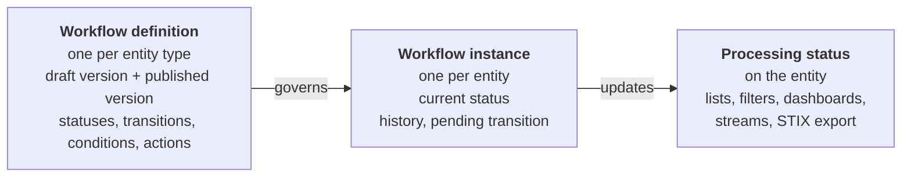

## Supported entity types

A workflow can be defined on every entity type that has a processing status:

- **Containers**: Report, Grouping, Note, Opinion, Incident response, Request for information, Request for takedown, Feedback, Task.
- **Domain objects**: Threat actor, Intrusion set, Campaign, Malware, Vulnerability, Incident and the other STIX domain objects.
- **Relationships and sightings.**
- **Draft**: see [Draft workflow](draft-workflow.md) for the actions specific to drafts.

## Creating a workflow definition

Go to **Settings > Customization > Entity types**, open the entity type, and select the **Workflow** tab. You need the *Manage customization* capability.

Every change you make in the editor is saved automatically as a **draft**. Nothing changes for analysts until you **publish**.

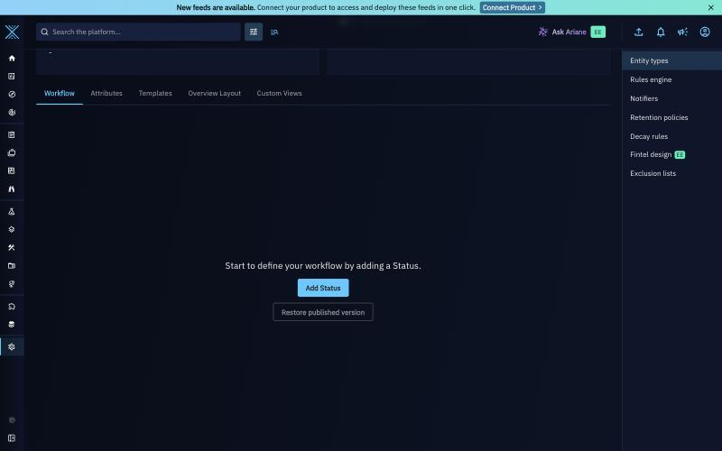

An entity type without a workflow: start with **Add Status**.

### Add statuses

1. Click **Add Status**.
2. In **Status**, pick an existing status template, or create one with **+**.
3. Optionally, configure [actions on enter and on exit](#actions-on-statuses) (Enterprise Edition).
4. Click **Add**. The status appears on the canvas.

The first status you add is the **starting status**: new entities of this type start there. A status with no incoming transition is always the starting status. A workflow can also loop back to its starting status, for example *New* → *In review* → *New*.

To add the next status, click the **+** placeholder under a status: OpenCTI adds the new status and the transition that leads to it. To insert a status between two existing ones, click the link between them.

### Add transitions

Transitions are drawn as their own nodes between statuses, so one transition can start from several statuses. To link statuses that already exist, for example to reopen a closed case, drag a connection on the canvas:

- **Status to status**: creates a new transition between them.
- **Status to transition**: adds the status as another source of that transition.
- **Transition to status**: sets the target of a transition that has none. A transition has a single target.

Click a transition to name it and configure it. To remove a status, a transition or a connection, select it and press ++delete++ or ++backspace++, or use **Delete** in its panel.

!!! tip "Name transitions after the action"

    Name transitions after the action analysts take (`triage`, `escalate`, `close`), not after the target status: the name is the label of the button analysts click.

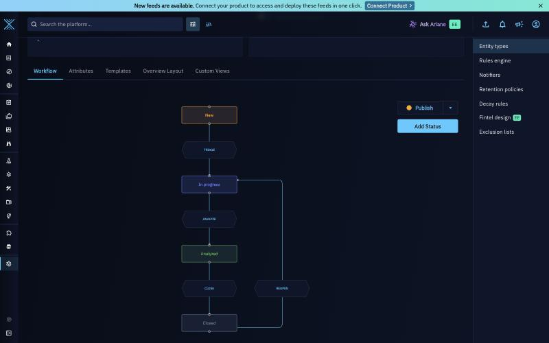

Example: an Incident response workflow with four statuses (*New*, *In progress*, *Analyzed*, *Closed*) and four transitions, before publishing.

- *New* has no incoming transition, so it is the starting status.
- Loops are allowed: `reopen` leads back from *Closed* and is drawn beside its source.
- The orange **Publish** button means the draft has unpublished changes.

### Configure a transition

Click a transition to open the **Edit transition** panel.

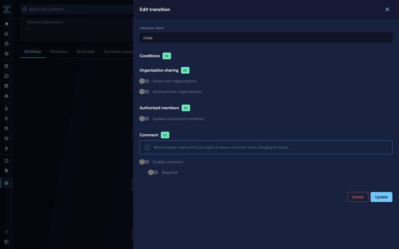

The panel contains, from top to bottom:

- **Transition name**: unique among the transitions leaving the same status.
- **Conditions**: who can see and take the transition. See [Conditions on transitions](#conditions-on-transitions).
- **Organization sharing**: share with or unshare from organizations.
- **Authorized members**: replace the entity's authorized members.
- **Comment**: ask analysts for a comment, optional or required.

On a Community Edition platform, the sections that require Enterprise Edition are shown but disabled. On domain objects, a [Closing reason](#configure-a-closing-reason) section follows **Comment**.

### Configure a status

Click a status to change its template or to add actions that run each time an entity enters or leaves it.

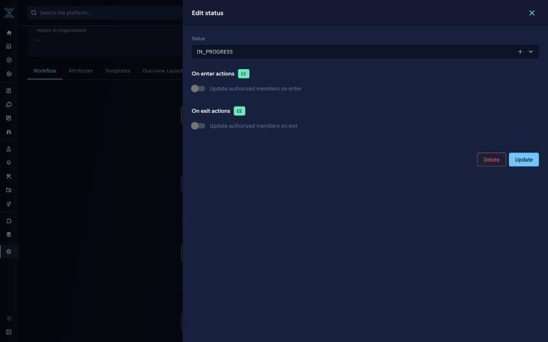

Status actions run whatever transition brought the entity there, which avoids repeating the same action on every incoming transition.

### Publish a workflow definition

Click **Publish** to apply the draft. From that moment, every entity of the type follows the published workflow. The button color tells you the state of the draft:

- Green (**Published**): the draft and the published version are identical. The button is disabled.
- Orange: the draft has valid changes that are not applied yet. Click to publish.
- Red: the draft breaks a [publishing rule](#rules-required-to-publish-a-workflow). Click to see the errors, fix them, and publish again.

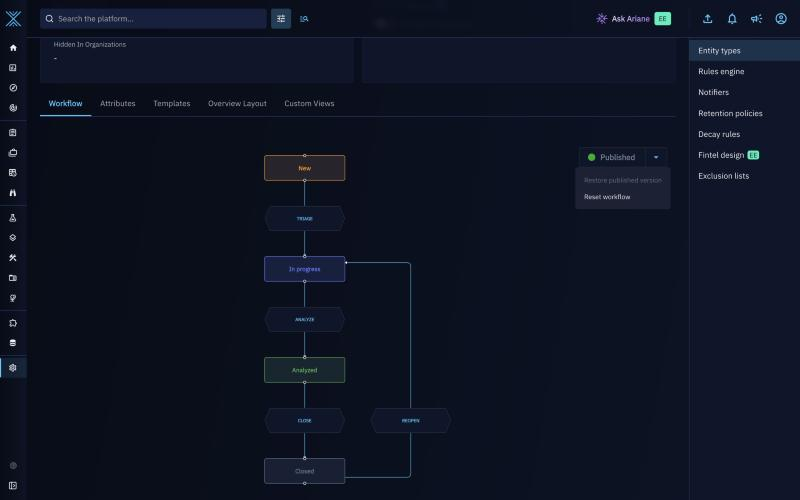

#### Restore and reset

Open the **Publish** menu to find two more actions.

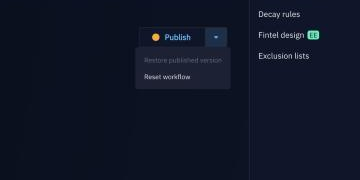

- **Restore published version** discards the draft and reloads the published workflow in the editor. Use it when a draft cannot be published, for example after deleting a status that entities still use.
- **Reset workflow** clears the draft so you can start over. It does not publish anything: analysts keep the published workflow until you publish a new one.

## Rules required to publish a workflow

#### Workflow validation rules

- There is a single starting status: if a status has no incoming transition, it must be the starting status, and no other status may lack an incoming transition. Looping back to the starting status is allowed.
- Every status can be reached from the starting status.
- Every transition has a name, a source and a target.
- Transition names are unique among the transitions leaving the same status.
- Conditions only use supported filters.
- *Update authorized members* is only used on entity types that support authorized members: Organization, Report, Note, Grouping, Incident response, Request for takedown, Request for information, and Draft.
- *Validate draft* is only used in the Draft workflow, which must contain at least one.
- A [closing reason](#closing-reason) is only asked on domain objects, and only on a transition into a final status (a status no transition leaves).

#### Rules related to data

- You cannot remove a status from a published workflow while entities are still in it. Move those entities to another status first; the error lists the statuses still in use.
- A status template used by a workflow, draft or published, cannot be deleted. Remove it from the workflow first.

!!! tip "Status order is computed for you"

    Lists sort entities by status order. With a workflow, you no longer set this order by hand: at publish time OpenCTI orders statuses by their distance from the starting status, ignoring backward transitions. In the example above, *New* is 1, *In progress* 2, *Analyzed* 3 and *Closed* 4, even with the `reopen` loop.

## Conditions and actions

!!! tip "Enterprise edition"

    Conditions, transition comments, organization sharing and authorized members actions are available in the **OpenCTI Enterprise Edition**. Please read the [dedicated page](../administration/enterprise.md) for full details.

### Conditions on transitions

Conditions decide which users can see and take a transition. A user who does not match never sees the transition button. Conditions use the standard OpenCTI filter editor, so you can combine them with *and*/*or* and nested groups.

| Filter on | Checked against | Example |
|---|---|---|
| Group, organization, role, user | The user taking the transition | `close` only for the group *L3 Analysts* |
| Entity attributes | The entity being moved (labels, markings, author, confidence...) | `escalate` only when the label is *critical* |

!!! warning "Authorized members do not grant transitions"

    Being an authorized member of an entity does not let a user take a transition. Conditions are the only way to control who can move an entity forward. Users also need edit access to the entity.

### Actions on transitions

| Action | Effect |
|---|---|
| **Share with organizations** | Shares the entity with the selected organizations. Leave the list empty to let the analyst pick organizations when taking the transition. Runs as a background task. |
| **Unshare from organizations** | Removes organization sharing. Same behavior as above. |
| **Update authorized members** | *Replaces* the authorized members of the entity. Dynamic members are available: author, creators, assignees, participants. Only on the types that support authorized members: Organization, Report, Note, Grouping, Incident response, Request for takedown, Request for information, and Draft. |
| **Comment** | Asks for a comment of up to 1,000 characters, optional or required. The comment is stored in the workflow history and notifies the entity's assignees and participants. |
| **Validate draft** | Draft workflow only. See [Draft workflow](draft-workflow.md). |

### Actions on statuses

- **On enter: update authorized members.** Applied each time an entity enters the status, for example to give edit rights to assignees when an incident goes *In progress*.
- **On exit: update authorized members.** Applied each time an entity leaves the status.

### Order of execution

When an analyst takes a transition, OpenCTI runs each step in this order. If a background action fails, the entity stays in its current status.

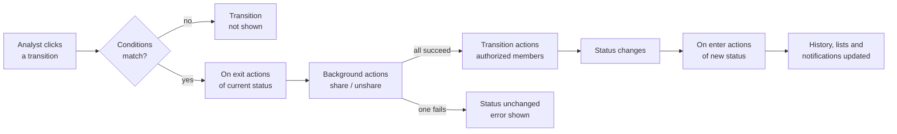

## Using a workflow on an entity

Once a workflow is published, analysts change the status from the **Processing status** block of the entity overview. The manual status field in edition forms is disabled for this entity type.

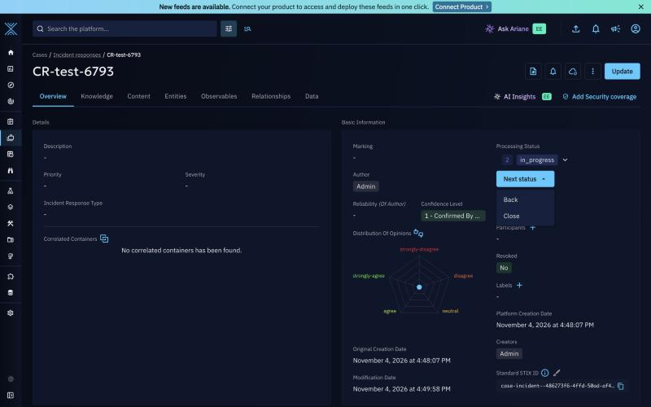

The user only sees the transitions they are allowed to take from the current status. A single transition is shown as one button; two or more are grouped in a **Next status** menu, with one entry per transition, named as in the editor (here *Back* and *Close*). A dialog opens only when the transition needs input, such as a comment, a closing reason or organizations.

### Take a transition

1. Open the entity, for example an Incident response.
2. In **Processing status**, click the transition, for example **analyze**.
3. If the transition asks for input, fill in the dialog: the comment, the closing reason, and the organizations to share with or unshare from.
4. Click **Confirm**. Transitions with no input apply directly.

The last comment is shown next to the status; click the comment icon to read it.

### Transitions that run in the background

Sharing actions run as background tasks. While they run, the status block shows the transition name, a spinner and the progress (*processed / expected*). No other transition can start on the entity until they finish. The status changes only when every background action has succeeded.

If an action fails, the status stays the same and the error is displayed. A user with the *Bypass all capabilities* capability can click **Clear** to unlock the entity.

### Change the status freely (bypass)

Users with the *Bypass all capabilities* capability get a status selector next to the transition buttons. They can move the entity to any status of the published workflow, ignoring transitions and conditions, in two modes:

- **Status only**: no action runs.
- **With status actions**: runs the *on exit* actions of the current status and the *on enter* actions of the target status. Transition actions never run during a bypass.

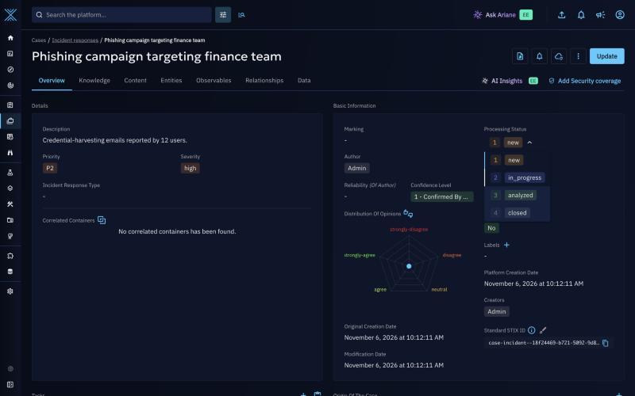

The selector lists the statuses of the published workflow in the computed order. A bypass is recorded as such in the workflow history.

### Change the status of many entities

From a list, select entities (or **select all** on a filtered list), then open the update action of the toolbar and add a step **Replace** on the field **Workflow transition**. The change runs as a [background task](background-tasks.md).

- **Only common transitions are offered.** The list contains the transitions that every selected entity can take, checked entity by entity, conditions included. If there is none, the dialog shows *No transition available for all selected entities*.
- **With a filter (select all)**, transitions are computed from the statuses found under the filter. Entities without a status count as being in the starting status. Conditions are only checked when the transition runs.
- **With a selection of entities**, transitions are computed entity by entity, conditions included. An entity that has no workflow instance yet is treated as being in the starting status when the list is computed.
- **Inputs are asked once.** A transition that needs a comment, a [closing reason](#closing-reason) or organizations gets them from the dialog, the same for every entity. It is only offered when all the selected statuses ask for the same inputs.
- **Entities already in the target status** are normally left untouched by the **Status** bypass field. A **Workflow transition** is different: it is triggered on every selected entity, so a self-loop transition (from a status back to itself) runs its actions again and adds a history entry. An entity moved by someone else before the task reaches it can also make the transition unavailable, and the task reports an error for that entity.
- **One entity type at a time.** The workflow transition is only available when the selected entities are of a single type that has a published workflow.

Users with the *Bypass all capabilities* capability can also use the field **Status** to move all the selected entities to any status. It goes through the workflow engine, and the switch **Apply transition actions** (on by default) runs the *on exit* and *on enter* status actions. The fields **Status** and **Workflow transition** cannot be combined in the same update.

### Lists and filters

Lists show the workflow status in the **Processing status** column. Click a status in a list to filter on it. A status can also be used as a filter and as a sort key, including for entities that do not have a workflow instance yet: they are in the starting status of the published workflow.

## Closing reason

A closing reason records *why* an entity was closed. When an analyst moves an entity into a final status, OpenCTI asks them to pick a value, stores it on the entity, and shows it in the overview. It is a **Community Edition** feature, available on domain objects, including containers such as Incident response, Report and Request for information. It is not available on relationships and sightings.

Default values:

| Value | Meaning |
|---|---|
| `true-positive` | Confirmed and handled |
| `false-positive` | Not a real threat |
| `duplicate` | Duplicate of another entity |
| `indeterminate` | Could not be confirmed or dismissed |
| `other` | Other reason |

The values are the entries of the `closing_reason_ov` vocabulary. Administrators can edit them in **Settings > Taxonomies > Vocabularies**.

### Configure a closing reason

1. In the workflow editor, click the transition that leads to the final status, for example `close`.
2. In the **Closing reason** section, turn on **Enable closing reason**.
3. Turn on **Required** if analysts must always choose a value. Otherwise the choice is optional.
4. Click **Update**, then **Publish**.

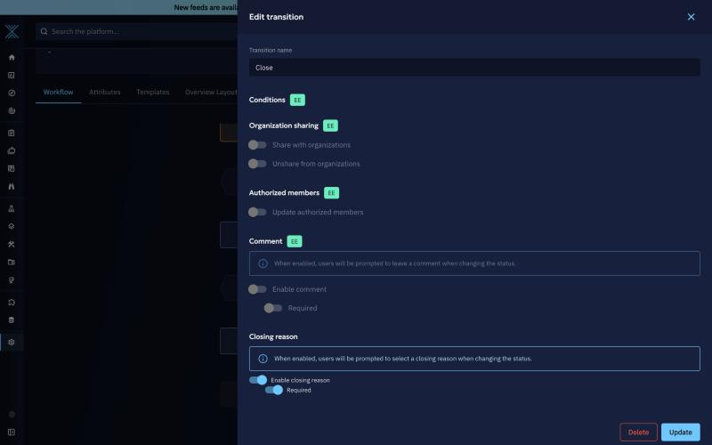

The **Closing reason** section is at the bottom of the **Edit transition** panel, with **Enable closing reason** and **Required** turned on.

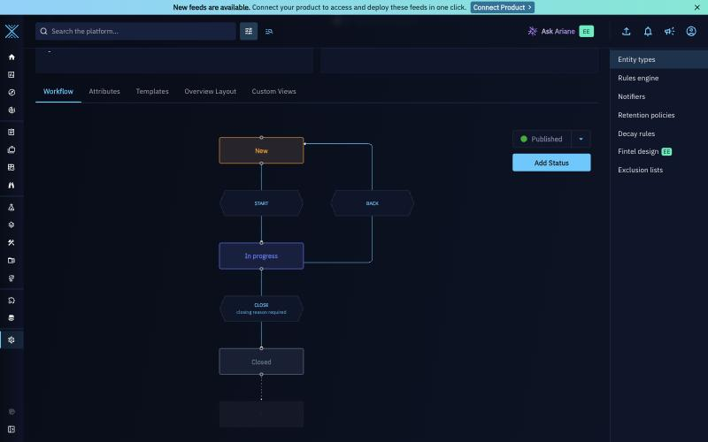

In the editor, the transition is labelled **closing reason required**. *Closed* is a final status: no transition leaves it.

!!! warning "Only into a final status"

    A closing reason can only be asked on a transition whose target is a **final status**: a status that no transition leaves. The switch is disabled otherwise, and the panel names the transitions that leave the status. Publishing is refused when a transition breaks this rule.

    In the example of this page, *Closed* is left by `reopen`, so `close` cannot ask for a closing reason. To use one, remove `reopen`. Users with the *Bypass* capability can still move a closed entity back to another status.

### Choose a closing reason

When the transition asks for a closing reason, the transition dialog contains a **Closing reason** field. If a comment is also configured, both are in the same dialog and are submitted together.

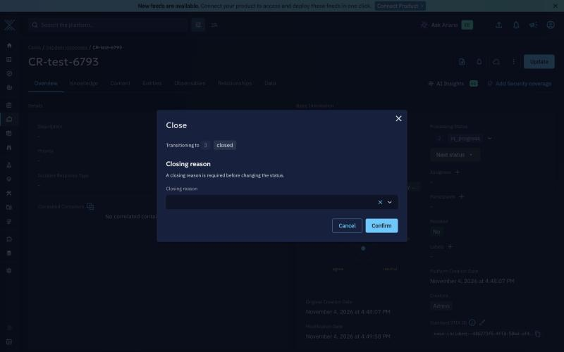

The dialog names the target status and the field is required.

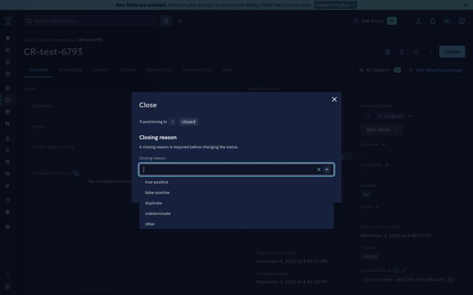

The list shows the entries of the closing reason vocabulary. When the reason is optional, the dialog says that the analyst can select one before changing the status.

- **Required**: **Confirm** stays disabled until a value is chosen. Users with *Bypass mandatory fields* can skip it.
- **Only vocabulary values** are accepted. Values typed in an API call are matched to the vocabulary, ignoring case.
- In a [mass status change](#change-the-status-of-many-entities), the reason is asked once and applied to every selected entity.

### Where it appears

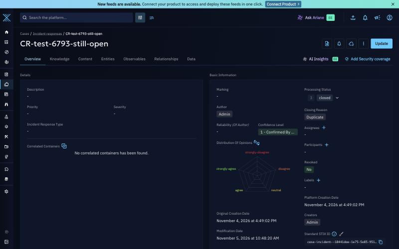

A closed Incident response with the reason *Duplicate*: the **Closing reason** is shown under the processing status.

- **Entity overview**: a **Closing reason** label is shown under the processing status.
- **Filters**: filter lists and dashboards on *Closing reason*, for example to count false positives.
- **STIX export**: exported as `closing_reason`.

### How the value is kept and cleared

- The value is written together with the status change, so the two cannot diverge.
- It stays while the entity remains in a final status.
- It is cleared as soon as the entity moves to a status that can be left again.
- It is never taken from a source entity when entities are merged: it follows the workflow state of the target.
- It cannot be edited directly. Only a workflow transition or a user with the *Bypass* capability can change it.

!!! note "If the reason cannot be saved"

    If the status changes but the closing reason could not be written, the entity shows a workflow error. A user with *Bypass* can clear it with **Clear**.

## How workflows work with the rest of the platform

### Lists, filters and dashboards

The workflow writes its current status in the entity's processing status. Lists, saved filters, dashboards, streams and STIX exports keep working as before. No data migration is needed when you publish a workflow on an entity type that already has entities.

- **New entities** start in the starting status, unless they are created with a status that exists in the workflow, for example by a connector.
- **Existing entities** keep their current status and get their workflow the first time they are opened.

### Status changes made outside the workflow

The API, playbooks, request access, synchronization and connectors can still set a status directly. OpenCTI never rejects these changes, and decides whether the workflow follows them:

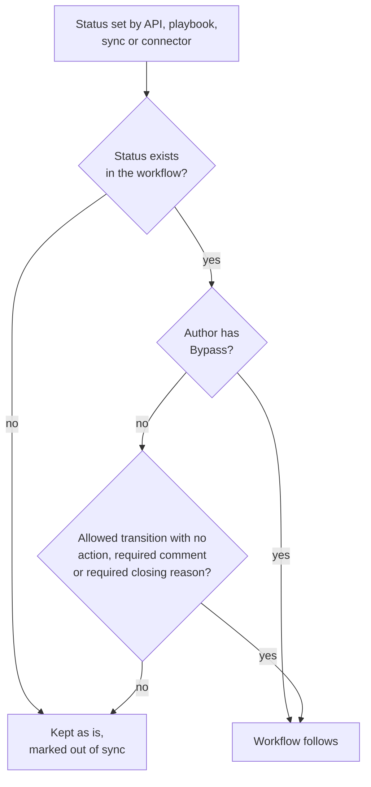

An entity in this situation shows the badge **Status out of sync with the workflow**. Its next transition, or a bypass, puts it back in line.

#### Playbooks

A [playbook](playbook-automation.md) component **Manipulate knowledge** can replace the processing status like any other attribute. By default this is a plain status change, handled as described above. A playbook can instead move the entity through the workflow engine, so that the *on exit* and *on enter* status actions run: in the configuration of the replace action on the processing status, set `apply_transition_actions` to `true`. This option is not shown in the playbook editor and needs the workflow feature enabled. The status is changed as the automation user; if the change cannot be applied, it is logged and the playbook goes on. An entity already in the target status is left unchanged.

### Deleting statuses

- A status still used by an entity cannot be deleted. Move these entities to another status (a [mass status change](#change-the-status-of-many-entities) from the filtered list works), wait for the background task to finish, then delete.
- When you publish a workflow that no longer uses a status, and no entity uses it, the status is deleted after 30 days. Publishing a workflow that uses it again within that period keeps it.

### Permissions

| Task | Required |
|---|---|
| Create, edit, publish, restore a workflow | *Manage customization* |
| Take a transition | *Update knowledge*, edit access to the entity, and matching transition conditions |
| Skip a required comment or closing reason | *Bypass mandatory fields* |
| Bypass, clear a failed transition, edit the closing reason directly | *Bypass all capabilities* |

## Issues and troubleshooting

#### An analyst does not see a transition button

- Check that the workflow is **published**, not only saved as a draft.
- Check the transition **conditions**: the analyst's groups, organizations or roles must match, and so must the entity if entity filters are used.
- Check that the analyst has **edit access** to the entity. Authorized members restrictions apply.
- Check that no transition is **running** on the entity.

#### A transition stays in error

A background action failed, for example sharing with an organization. The entity keeps its status. Fix the cause, then ask a user with *Bypass all capabilities* to click **Clear** and take the transition again.

#### Publishing is refused

The error names the statuses you removed that entities still use. Move those entities first, or use **Restore published version** and edit again.

#### The closing reason switch is disabled

The target status of the transition is not final: another transition leaves it. The panel names these transitions. Remove them, or ask for the closing reason on a transition into another status. The switch is also hidden on relationships and sightings.

#### An analyst cannot confirm a transition

The comment or the closing reason is required. Choose a closing reason from the list, or ask a user with *Bypass mandatory fields*. If the list is empty, check the `closing_reason_ov` vocabulary.

#### Users are stuck in a status

If conditions leave no transition available to some users, add a transition for them, or move the entities with a bypass.

#### No transition is offered for a mass change

The selected entities do not share a transition: they are in different statuses with different transitions, conditions exclude some of them, or the transition asks for different inputs depending on the status. Filter the list on one status and try again, or use a bypass.
