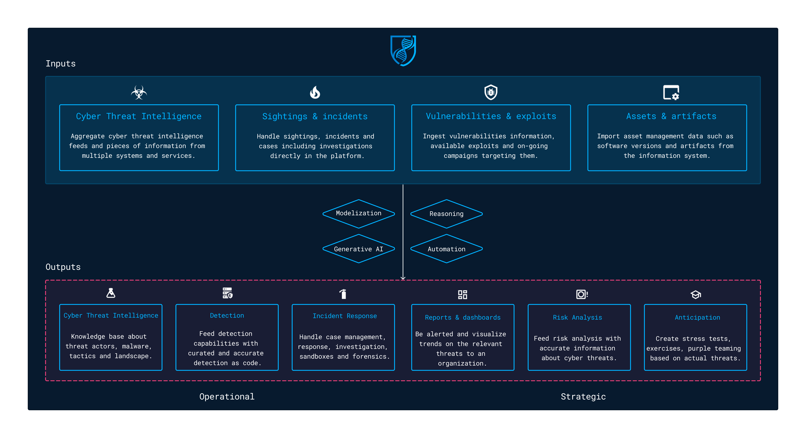
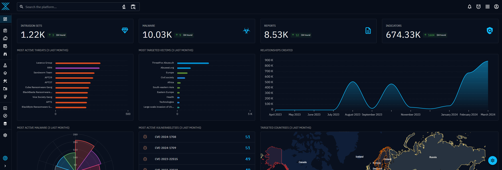

# Getting started

This page introduces the main use cases of OpenCTI and describes the welcome dashboard you see when you log in. The platform can be used in various contexts to handle threats management use cases from a technical to a more strategic level. OpenCTI has been designed as a knowledge graph, taking inputs (threat intelligence feeds, sightings & alerts, vulnerabilities, assets, artifacts, etc.) and generating outputs based on built-in capabilities and / or connectors.

Here are some examples of use cases:

* Cyber Threat Intelligence knowledge base
* Detection as code feeds for XDR, EDR, SIEMs, firewalls, proxies, etc.
* Incident response artifacts & cases management
* Vulnerabilities management
* Reporting, alerting and dashboarding on a subset of data

## Welcome dashboard

The welcome page gives any visitor on the OpenCTI platform an overview of what's happening on the platform. It can be replaced by a [custom dashboard](dashboards.md), created by a user (or the default dashboard set up in a role, a group or an organization).

### Indicators in the dashboard

#### Numbers

| Component      | Description                      |
|:---------------|:---------------------------------|
| Intrusion sets | Number of intrusion sets. |
| Malware        | Number of malware.               |
| Reports        | Number of reports.               |
| Indicators     | Number of indicators.            |

#### Charts & lists

| Component                                   | Description                                                                                                                                                |
|:--------------------------------------------|:-----------------------------------------------------------------------------------------------------------------------------------------------------------|
| Most active threats (3 last months)         | Top active threats (threat actor, intrusion set and campaign) during the last 3 months.                                                                    |
| Most targeted victims (3 last months)       | Intensity of the targeting tied to the number of relations `targets` for a given entities (organization, sector, location, etc.) during the last 3 months. |
| Relationships created                       | Volume of relationships created over the past 12 months.                                                                                                   |
| Most active malware (3 last months)         | Top active malware during the last 3 months.                                                                                                               |
| Most active vulnerabilities (3 last months) | List of the vulnerabilities with the greatest number of relations over the last 3 months.                                                                  |
| Targeted countries (3 last months)          | Intensity of the targeting tied to the number of relations `targets` for a given country over the past 3 months.                                           |
| Latest reports                              | Last reports ingested in the platform.                                                                                                                     |
| Most active labels (3 last months)          | Top labels given to entities during the last 3 months.                                                                                                     |

!!! info "Explore the platform"

    To start exploring the platform and understand how information is structured, we recommend starting with the [overview documentation page](overview.md).

## What's next

- [Overview](overview.md): understand how knowledge is structured and what a typical entity page contains.
- [Data model](data-model.md): learn the entities and relationships OpenCTI uses to represent threat intelligence.
- [Automated import](import/getting-started.md), [Import from files](import-files.md) and [Manual creations](manual-creation.md): bring knowledge into the platform.
- [Search for knowledge](search.md) and the "Explore by entity types" pages, starting with [Analysis](exploring-analysis.md): find and explore knowledge.
- [Case management](case-management.md): handle incidents and requests with all their context.
- [Custom dashboards](dashboards.md): build your own dashboards on a subset of data.
- [Manual export](export.md): export knowledge and generate finished intelligence.
