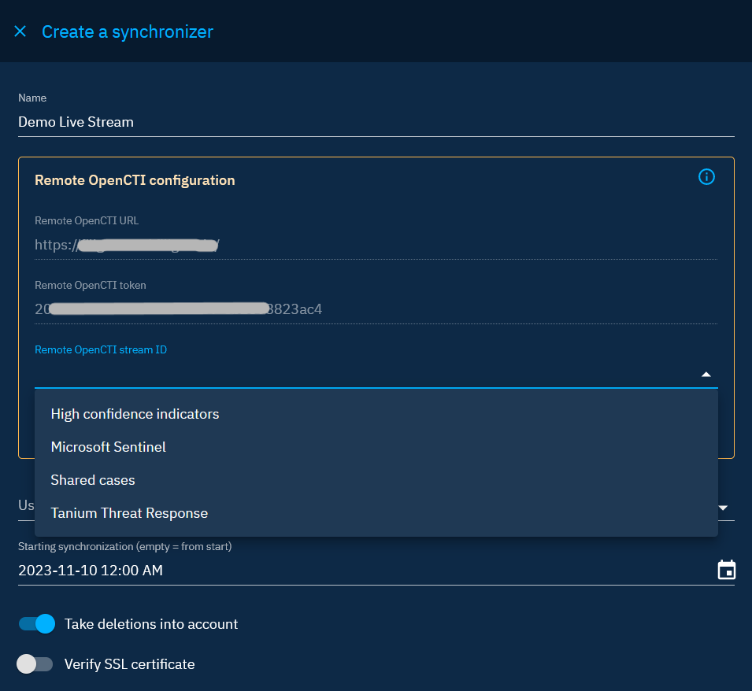
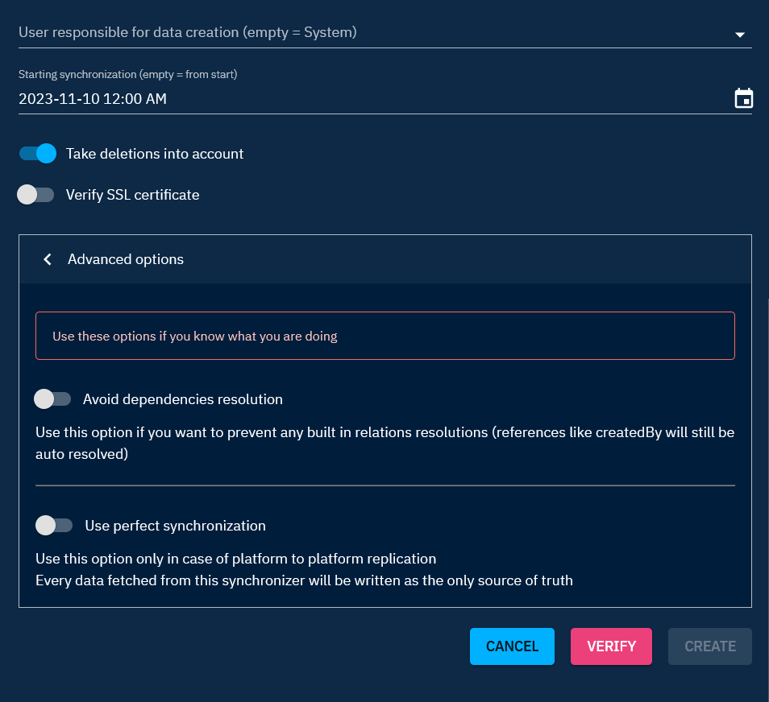
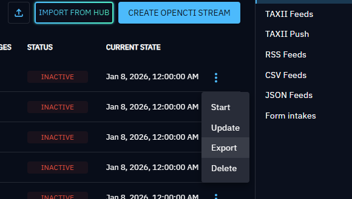
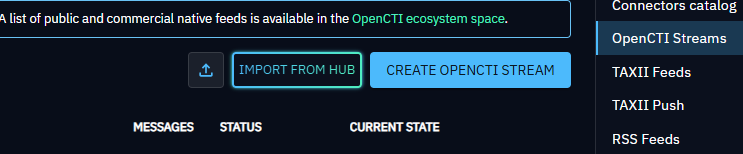

# Internal streams

Live Streams enable users to consume data from another OpenCTI platform, fostering collaborative intelligence sharing.

<a id="best-practices-section"></a>
## Best practices

In OpenCTI, the **Integrations** section — accessible from the main navigation bar on the left — provides users with built-in functions for automated data import. These functions are designed for specific purposes and can be configured to seamlessly ingest data into the platform. Feeds and connectors are managed from the **Integrations** page, which is split into a **Deployed** tab (the feeds and connectors running on your platform) and an **Available** tab (the catalog of connectors and built-in feeds you can deploy). To create a new feed, open the **Available** tab and use the creation button on the corresponding built-in card. For a detailed description of these two tabs and their filters, see [Getting started](getting-started.md#the-integrations-menu). This page covers the configuration of Live Streams. For the other built-in import methods, see [Automated import](getting-started.md).

Ensuring a secure and well-organized environment is paramount in OpenCTI. Here are two recommended best practices to enhance security, traceability, and overall organizational clarity:

1. Create a dedicated [Service account](../../administration/users.md#service-account) for each source: Generate a technical user (or Service account) specifically for feed import, following the convention `[F] Source name` for clear identification. Assign the Service account to the "Connectors" group to streamline user management and permission related to data creation. Please [see here](../../deployment/connectors.md#connector-token-section) for more information on this good practice.
2. Establish a dedicated Organization for the source: Create an organization named after the data source for clear identification. Assign the newly created organization to the "Default author" field in feed import configuration if available.

By adhering to these best practices, you ensure independence in managing rights for each import source through dedicated service account and organization structures. In addition, you enable clear traceability to the entity's creator, facilitating source evaluation, dashboard creation, data filtering and other administrative tasks.

## Configuration

Live Streams enable users to consume data from another OpenCTI platform, fostering collaborative intelligence sharing. Here's a step-by-step guide to configure Live streams synchroniser:

1. Remote OpenCTI URL: Provide the URL of the remote OpenCTI platform (e.g., `https://[domain]`; don't include the path).
2. Remote OpenCTI token: Provide the user token. An administrator from the remote platform must supply this token, and the associated user must have the "Access data sharing" privilege.
3. After filling in the URL and user token, validate the configuration.
4. Once validated, select a live stream to which you have access.



Additional configuration options:

- User responsible for data creation: Define the user responsible for creating data received from this stream. Best practice is to dedicate one user per source for organizational clarity. Please [see the section "Best practices" above](#best-practices) for more information.
- Starting synchronization: Specify the date of the oldest data to retrieve. Leave the field empty to import everything.
- Take deletions into account: Enable this option to delete data from your platform if it was deleted on the providing stream. (Note: Data won't be deleted if another source has imported it previously.)
- Verify SSL certificate: Check the validity of the certificate of the domain hosting the remote platform.
- Avoid dependencies resolution: Import only entities without their relationships. For instance, if the stream shares malware, all the malware's relationships will be retrieved by default. This option enables you to choose not to recover them.
- Use perfect synchronization: This option is specifically for synchronizing two platforms. If an imported entity already exists on the platform, the one from the stream will overwrite it.



!!! note
    By default, entities imported through this synchronizer keep no recognizable processing status, since the remote platform's status reference isn't valid locally. To keep processing statuses consistent across both platforms instead, enable [Entity status sync](../../administration/entities.md#workflow-section) on the entity types you want to synchronize.

### Large files

By default, the receiving platform downloads each file of a synchronized entity and sends it base64 encoded through RabbitMQ to the worker. For large files, set `sync_manager:file_reference_mode_enabled` on the receiving platform. Files above `sync_manager:file_reference_mode_size_threshold_kb` are then streamed into the platform S3 storage, the worker only receives a reference, and the platform copies the file to the entity on the S3 side. Smaller files stay inline. See the [configuration](../../deployment/configuration.md#engines-schedules-managers).

!!! warning "Requirements and limits"

    - Workers must run the same version as the platform. Older workers do not import staged files.
    - Files above `sync_manager:file_reference_mode_max_size_mb` (5120 MB by default, the AWS S3 single copy limit) are skipped, like a file that cannot be downloaded. The sending platform does not send the file size, so such a file is uploaded up to the limit before it is skipped. Raise it only if your S3 server copies larger objects.
    - If the S3 storage of the receiving platform rejects a staged file, the file is downloaded again from the sending platform and uploaded again, up to 3 times with a growing wait (1, 2 and 4 seconds), then the file is skipped and a warning is logged.
    - Only files of created or updated entities are staged. Files of external references, and files of other events, are still sent inline as before.
    - Each staged file is attached by its own update after the entity is created or updated, so consumers of the receiving platform stream see one more update event per staged file.
    - When [Automatic references at file upload](../../administration/entities.md#automatic-references-at-file-upload) is enabled on the entity type, the external reference of a staged file is created after the entity instead of before it, so its events arrive in a different order.

Staged files that are never consumed are deleted after `sync_inflight_cleanup_manager:ttl` (one week by default). A staged file that is not imported within this delay, for example behind a worker backlog, is deleted and the entity stays without it. The cleanup follows `sync_manager:file_reference_mode_enabled`. To delete what is left after turning the mode off, set `sync_inflight_cleanup_manager:enabled` to `true` explicitly.

## Export an OpenCTI Stream

You can export your existing OpenCTI Stream from the platform, making it easy to share your configuration with others.

To export your OpenCTI Stream, click on "Export", in the burger menu.


## Import an OpenCTI Stream

If you have a JSON OpenCTI Stream file you can import it by clicking on the icon next to "Import from hub"


When you click, you can select the desired file. After that, a drawer will open with the form pre-filled with the relevant information.
Add your desired platform's token. 
By default, a user is already provided.

You can select an OpenCTI Stream from the XTM Hub by clicking the ```Import from Hub``` button

