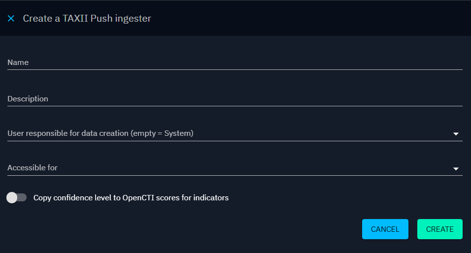
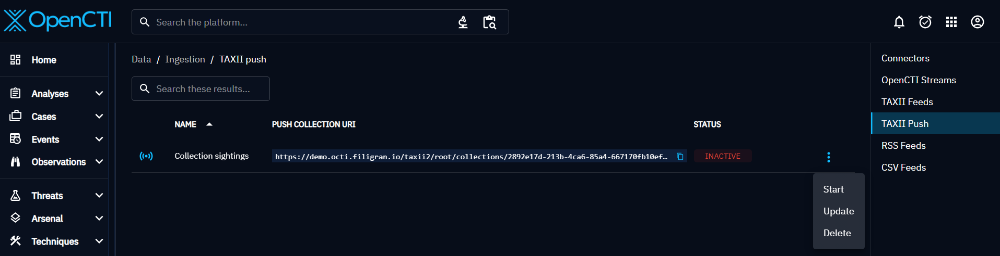

# TAXII Push

TAXII Push ingester enables users to import STIX 2.1 objects in OpenCTI through an exposed TAXII collection.

<a id="best-practices-section"></a>
## Best practices

In OpenCTI, the **Integrations** section — accessible from the main navigation bar on the left — provides users with built-in functions for automated data import. These functions are designed for specific purposes and can be configured to seamlessly ingest data into the platform. Feeds and connectors are managed from the **Integrations** page, which is split into a **Deployed** tab (the feeds and connectors running on your platform) and an **Available** tab (the catalog of connectors and built-in feeds you can deploy). To create a new feed, open the **Available** tab and use the creation button on the corresponding built-in card. For a detailed description of these two tabs and their filters, see [Getting started](getting-started.md#the-integrations-menu). This page covers the configuration of TAXII Push. For the other built-in import methods, see [Automated import](getting-started.md).

Ensuring a secure and well-organized environment is paramount in OpenCTI. Here are two recommended best practices to enhance security, traceability, and overall organizational clarity:

1. Create a dedicated [Service account](../../administration/users.md#service-account) for each source: Generate a technical user (or Service account) specifically for feed import, following the convention `[F] Source name` for clear identification. Assign the Service account to the "Connectors" group to streamline user management and permission related to data creation. Please [see here](../../deployment/connectors.md#connector-token-section) for more information on this good practice.
2. Establish a dedicated Organization for the source: Create an organization named after the data source for clear identification. Assign the newly created organization to the "Default author" field in feed import configuration if available.

By adhering to these best practices, you ensure independence in managing rights for each import source through dedicated service account and organization structures. In addition, you enable clear traceability to the entity's creator, facilitating source evaluation, dashboard creation, data filtering and other administrative tasks.

## Configuration

TAXII Push ingester enables users to import STIX 2.1 objects in OpenCTI through an exposed TAXII collection, in compliance with the [“Add objects” part of the TAXII 2.1 specification](https://docs.oasis-open.org/cti/taxii/v2.1/os/taxii-v2.1-os.html#_Toc31107540).
Here's a step-by-step guide to configure TAXII Push ingesters:

1. Name: Enter a name for the TAXII Push ingester.
2. Description (optional): Enter a description for the TAXII Push ingester.
3. User responsible for data creation: Define the user responsible for creating data received from this TAXII Push ingester. Best practice is to dedicate one user per source for organizational clarity. See [Best practices](#best-practices) for more information.
4. Accessible for: Enter the user, group or organization authorized to push data in the TAXII collection.
5. Copy confidence level to OpenCTI scores for indicators: Enable this option to map the confidence level associate to STIX indicators to the OpenCTI scoring system.



After creating a new TAXII Push ingester, a TAXII endpoint is generated, which can be used to publish data in STIX 2.1 format.
To start your new ingester, click on "Start", in the burger menu. The endpoint accepts data only while the ingester is started.



### Push data to the endpoint

The endpoint follows this pattern, where `[domain]` is the host name of your platform, followed by its port and base path if any, without `https://` or a trailing slash (for example `opencti.example.com` or `opencti.example.com:8080/cti`), and `[ingester-id]` is the ID of the TAXII Push ingester:

```
https://[domain]/taxii2/root/collections/[ingester-id]/objects/
```

To find the ID of the ingester, open it from **Integrations** > **Deployed**: the ID is the last part of the page URL (`/dashboard/integrations/feeds/taxii-push/[ingester-id]`).

To push data, send a `POST` request to this endpoint:

1. Authenticate with the API token of a user allowed in **Accessible for**, as a Bearer token (`Authorization: Bearer [token]`). This user also needs the "Access data sharing" capability.
2. Set the `Content-Type` header to `application/taxii+json;version=2.1` (or `application/vnd.oasis.stix+json;version=2.1`).
3. Put the STIX 2.1 objects in the `objects` array of the request body.

```bash
curl -X POST "https://[domain]/taxii2/root/collections/[ingester-id]/objects/" \
  -H "Authorization: Bearer [token]" \
  -H "Content-Type: application/taxii+json;version=2.1" \
  -d '{
    "objects": [
      {
        "type": "malware",
        "spec_version": "2.1",
        "id": "malware--8e2e2d2b-17d4-4cbf-938f-98ee46b3cd3f",
        "created": "2026-01-01T00:00:00.000Z",
        "modified": "2026-01-01T00:00:00.000Z",
        "name": "Example malware",
        "is_family": true
      }
    ]
  }'
```

The platform answers with a TAXII status resource whose `status` is `pending`. To follow the import, send a `GET` request, with the same token, to `https://[domain]/taxii2/root/status/[status-id]/`, where `[status-id]` is the `id` of that response.

