# Pivot and investigate

In OpenCTI, all data are structured as an extensive knowledge graph, where every element is interconnected. The investigation functionality provides a powerful tool for pivoting on any entity or relationship within the platform. Pivoting enables users to explore and analyze connections between entities and relationships, facilitating a comprehensive understanding of the data.

To access investigations, navigate to the top right corner of the toolbar:

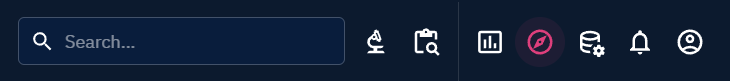

!!! note "Access restriction"

    When an investigation is created, it is initially visible only to the creator, allowing them to work on the investigation before deciding to share it. The sharing mechanism is akin to that of dashboards. For further details, refer to the [Access control section](dashboards.md#access-control-section) in the dashboard documentation page.

## Perform investigation

### Select / search entity 
When selecting (or searching) an entity, the entities you have selected (or those matching your search) and their direct neighbours stay at full strength, while the rest of the graph fades, to emphasise your selection (or search).
Selected entities are circled with a halo and their names are written on a coloured pill; the entity you are currently seeing in the right panel has the strongest halo.
In addition, the right panel will have now a counter of the amount of selected entities to help you understand the amount of selected (or matching your search). 

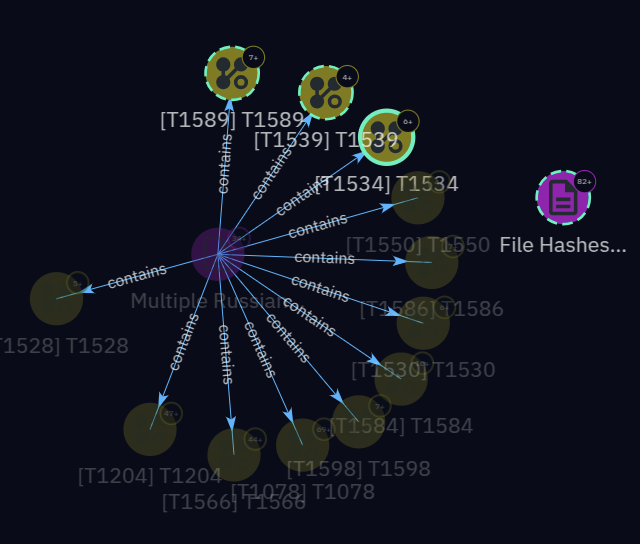

### Add entities

You can add any existing entity of the platform to your investigation with **Add an entity to this investigation**, the + of the graph toolbar. While the investigation is still empty, the middle of the graph also offers an **Add entities** button, which opens the same panel.

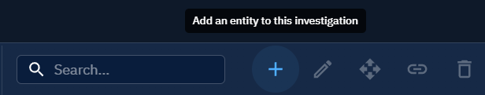

After adding an entity, we can choose the entity and view its details in the panel that appears on the right of the screen.

On each node, we'll notice a bullet with a number inside, serving as a visual indication of how many entities are linked to it but not currently displayed in the graph. Keep in mind that this number is an approximation, which is why there's a "+" next to it. If there's no bullet displayed, it means there's nothing to expand from this node.

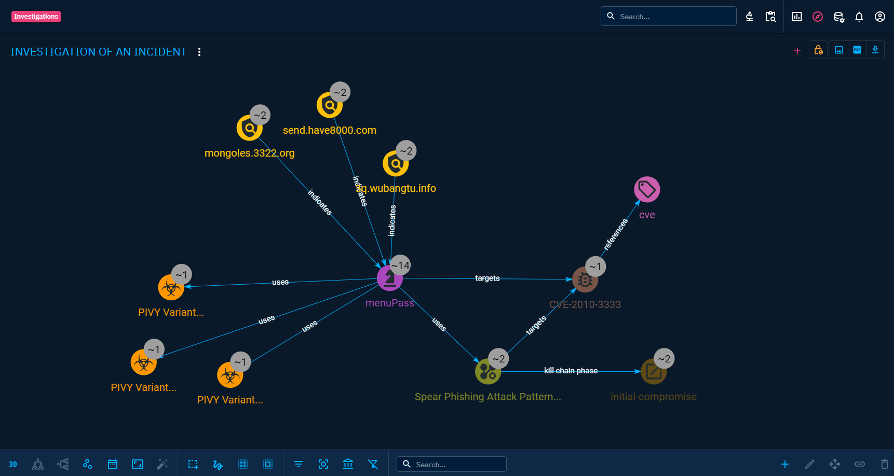

### Expansion
To incorporate these linked entities into the graph, we just have to expand the nodes. Utilize the button with a 4-arrows logo in the mentioned menu, double-click on the entity directly, or right-click the entity and choose **Expand this entity** in its context menu. This action opens a new window where we can choose the types of entities and relationships we wish to expand.

The investigation graph shares the layouts, legend, hover cards, keyboard shortcuts and exports of every graph of the platform: see [Work with graphs](graphs.md).

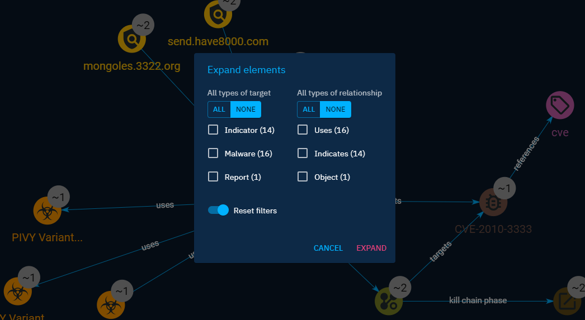

For instance, in the image above, selecting the target _Malware_ and the relationship _Uses_ implies expanding in my investigation graph all _Malware_ linked to this node with a relationship of type _Uses_.

### Roll back expansion

Expanding a graph can add a lot of entities and relations, making it not only difficult to read but sometimes counterproductive since it brings entities and relations that are not useful to your investigations.
To solve this problem, there is a button to undo the last expansion.

When clicking on this button, we will retrieve the state in which your graph was before your expansion. As a result, please note that all add or remove actions made since the last expansion will be lost: in other words, if you have expanded your graph, and then have added some entities in your graph, when clicking on rollback button, the entities that you have added will not be in your graph.

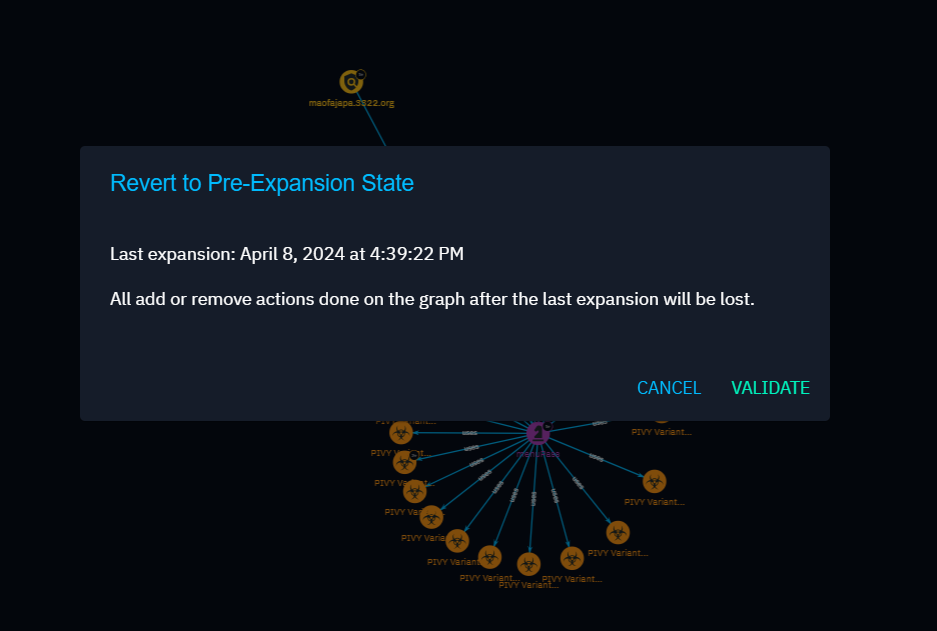

You can roll back your investigation graph up to the last 10 expand actions.

### Manipulate relationship

We can create a relationship between entities directly within our investigation. To achieve this, select multiple entities by clicking on them while holding down the shift key. Subsequently, a button appears at the bottom right to create one (or more, depending on the number of entities selected) relationships.

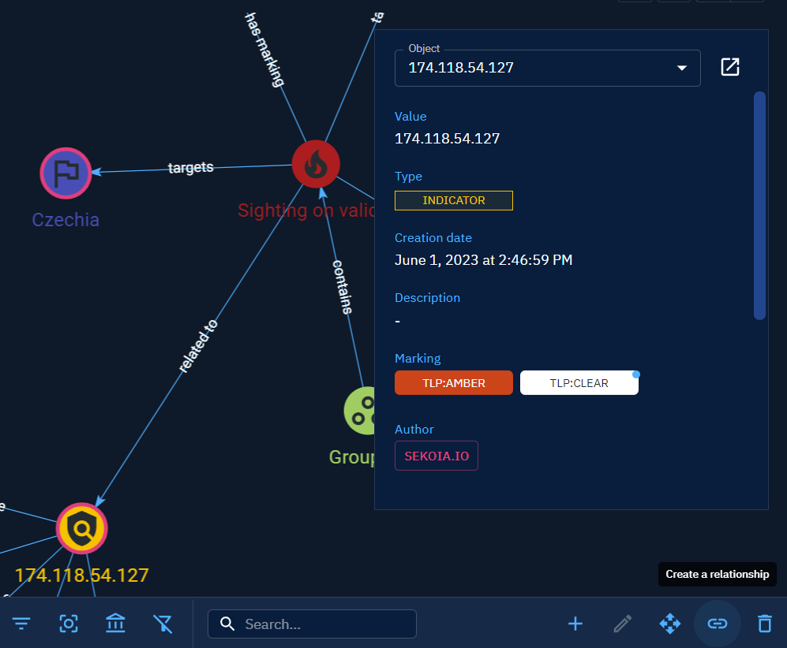

!!! note "Relationship creation"

    Creating a relationship in the investigation graph will generate the relationship in your knowledge base.

## Enrich from the graph

You can run [enrichment connectors](enrichment.md) on the entities of an investigation without leaving the graph. The results are not drawn straight away: you review them first and choose what to add, so that an enrichment bringing back many objects does not flood the investigation.

### Launch an enrichment

Select one or more entities or relationships of the same type, then either:

- open the **Enrichment** panel with the cloud button of the graph toolbar, pick one or more connectors under **Start an enrichment** and click **Enrich**;
- or right-click the selection and pick a connector under **Enrichment** (see [Context menu](graphs.md#context-menu)).

A confirmation lists the selected elements, then the enrichment runs as a [background task](background-tasks.md) and the panel opens on its **To review** tab. Only the connectors that can enrich the selected type are offered. When the selection mixes types, or no connector can enrich it, the panel says **No connector available for the selected entities.** and the menu entry cannot be chosen.

### Follow enrichments

The **Enrichment** panel lists the enrichments launched from this investigation, grouped by enriched entity, then by connector. While elements are selected, it lists only their enrichments. Three tabs sort them:

- **To review**: the connector has finished and its results wait for your review.
- **In progress**: the connector is still running.
- **Done**: the enrichment has finished and nothing waits for review.

The cloud button of the toolbar carries a badge: the number of enrichments with results waiting, or, when none are waiting, the number in progress. Otherwise, a red dot means that an enrichment failed. The tooltip of the button spells the count out. The button is disabled while the investigation has no enrichment yet and you have nothing selected that you can enrich.

Next to each connector, **Refresh the knowledge using this connector** runs that connector again on the entity.

### Review the results

Each enrichment of the **To review** tab offers:

- **Review results**: lists only the data that the enrichment created or updated, counted by entity type and relationship type. Tick the types to add and click **Expand**: the entities of those types are added with their relationships to the enriched entity, and the enrichment is marked as reviewed. When the enrichment brought nothing that is not already on the graph, the dialog says **Nothing to add to the graph** and offers **Expand with data in the platform**, which opens the usual [expansion](#expansion) on the enriched entity.
- **Add all to graph**: adds every result, without choosing types, after a confirmation, and marks the enrichment as reviewed.
- **Mark as reviewed**: moves the enrichment to **Done** without adding anything.
- **Delete**: removes the enrichment from the list. The data it brought into the platform stays.

**Review all** opens the results of every enrichment of the tab that has some, in one dialog. An enrichment that failed has no results to review; only **Mark as reviewed** and **Delete** apply to it.

### Who can enrich

| To | You need |
|:---|:---|
| See the **Enrichment** panel and the enrichments of the investigation | The `Access knowledge` capability. |
| Launch an enrichment, from the panel or the context menu | Edit or manage access to the investigation, and the `Create / Update investigations`, `Ask for knowledge enrichment` and `Create / Update knowledge` capabilities. |
| Run a connector again on an entity | Edit or manage access to the investigation, and the `Create / Update investigations` and `Ask for knowledge enrichment` capabilities. |
| Add results to the graph or mark them as reviewed | Edit or manage access to the investigation. |

With view access to the investigation, you can open the results of an enrichment but not add them or mark them as reviewed; the dialog says so. See [Access control](dashboards.md#access-control) for the levels of access and [Users and roles](../administration/users.md) for the capabilities.

## Capitalize on an investigation

### Export investigation

Users have the capability to export investigations, providing a way to share, document, or archive their findings.

- PDF and image formats: the header of the investigation exports it as a PDF, and the toolbar of its graph as a high-resolution image (see [Work with graphs](graphs.md#export)).
- STIX bundle: The platform allows the export of the entire content of an investigation graph as a STIX bundle. In the STIX format, all objects within the investigation graph are automatically aggregated into a Report object.

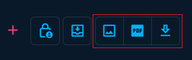

### Turn investigation into a container

Users can efficiently collect and consolidate the findings of an investigation by adding the content into dedicated [containers](containers.md). The contents of an investigation can be imported into various types of containers, including:

- Grouping
- Incident Response
- Report
- Request for Information
- Request for Takedown

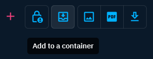

We have the flexibility to choose between creating a new container on the fly or adding investigation content to an existing container. 

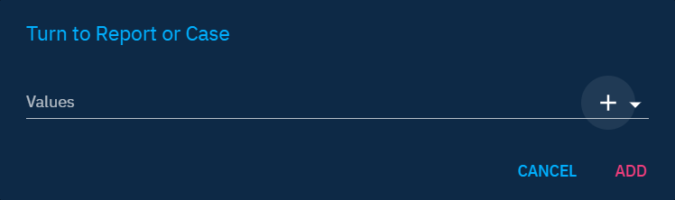

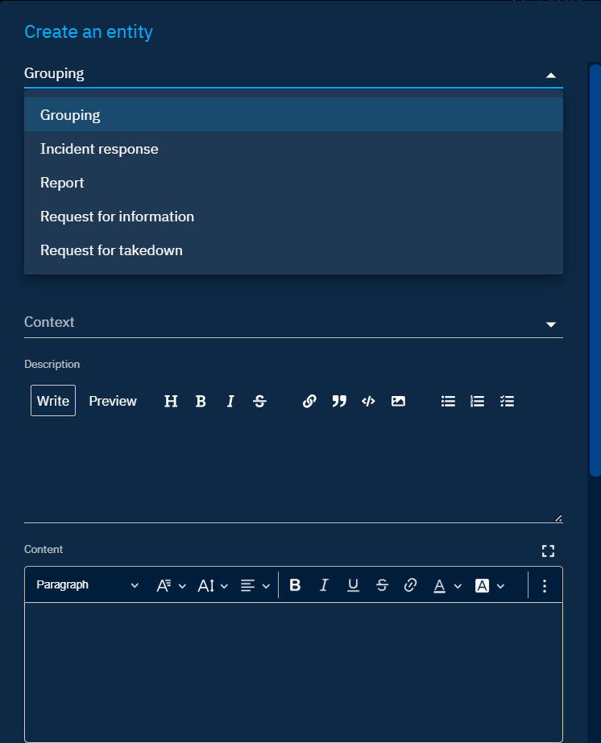

After clicking on the `ADD` button, the browser will redirect to the Knowledge tab of the container where we added the content of our investigation. If we added it to multiple containers, the redirection will be to the first of the list.

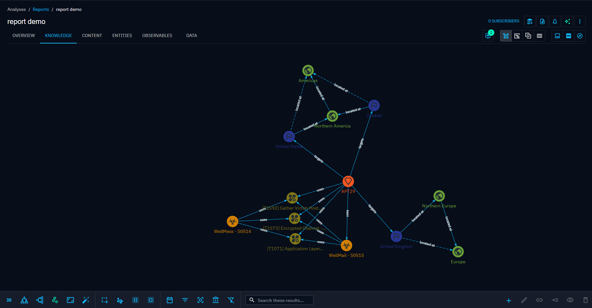
