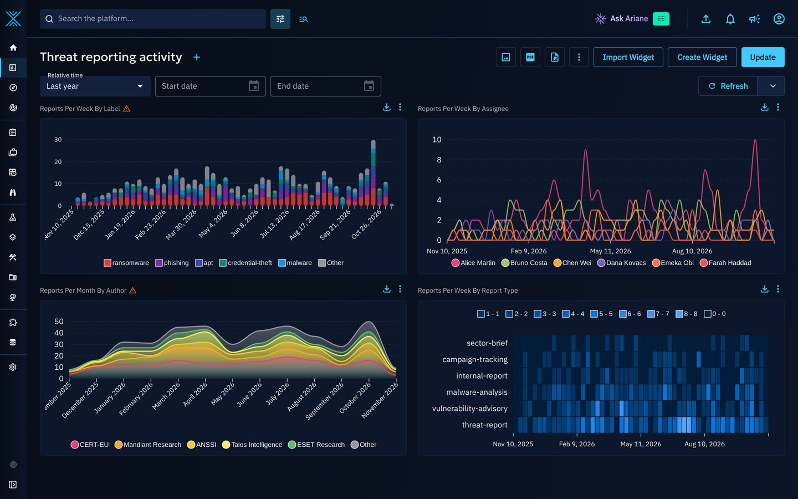
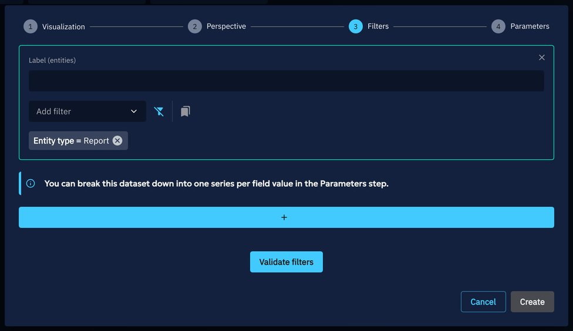
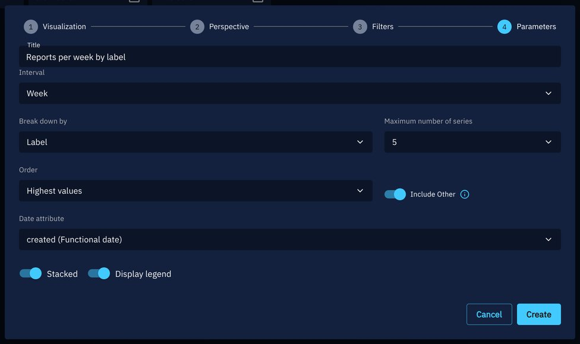
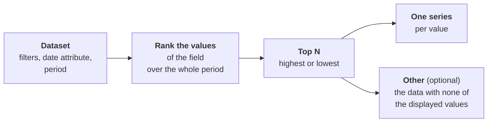
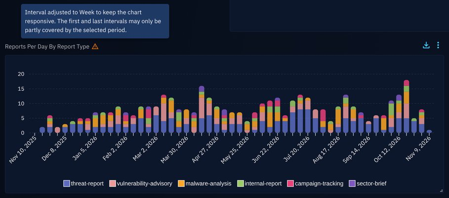
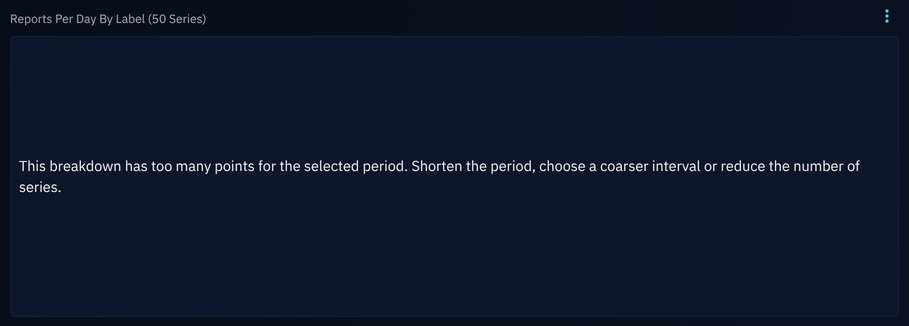
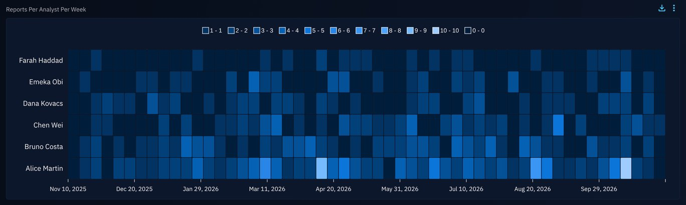

# Time series breakdown

A time series widget can be broken down by the values of a field: instead of one series per dataset, OpenCTI draws one series per value of the field you pick, such as one series per label, per analyst or per author. The values are found in the data each time the widget is displayed, so you never list them by hand.

A typical use is to follow the reports handled by each analyst, week by week, without knowing the analysts in advance.

A dashboard with four broken down widgets: reports per week by label, per week by assignee, per month by author, and per week by report type.

## Why use it?

Without a breakdown, comparing values means adding one dataset per value, as described in [Tips for widget creation](tips-widget-creation.md#use-case-2-break-down-your-chart). This is limited to 5 datasets, and every new value (a new analyst, a new label) needs a new dataset.

With a breakdown:

- **One dataset is enough.** Its filters and its date attribute apply to every series.
- **Values are discovered automatically.** The widget stores the field, never the list of values: a new analyst shows up in the widget without any change.
- **Up to 50 series.** You choose how many, and whether to keep the highest or the lowest values.
- **The rest is not lost.** An optional **Other** series counts the data that has none of the displayed values.

## Where you can use it

| Applies to | Supported |
|---|---|
| **Visualizations** | Vertical bars, Line, Area and Heatmap |
| **Perspectives** | Entities, Knowledge graph (relationships), Activity & history (audits, see [below](#platform-activity-by-user)) |
| **Containers** | [Custom dashboards](dashboards.md), [custom views](#custom-views) and [public dashboards](#public-dashboards) |

Breakdowns are not available in Fintel templates, nor on widgets that count drafts. On the Activity & history perspective, a Line or an Area that counts distinct values cannot be broken down: a breakdown counts every event.

## Break down a widget

1. In a custom dashboard, click **Create Widget**, or edit an existing widget.
2. **Visualization**: choose Vertical bars, Line, Area or Heatmap.
3. **Perspective**: choose the perspective of the data to count.
4. **Filters**: define a single dataset, for example *Entity type = Report*, then click **Validate filters**.
5. **Parameters**: choose the field in **Break down by**, then set the other breakdown options (see below).
6. Click **Create** (or **Update**).

At the **Filters** step, the message *You can break this dataset down into one series per field value in the Parameters step.* is shown while the widget has a single dataset that can be broken down and no breakdown is chosen yet.

The breakdown options are in the **Parameters** step, next to the interval:

| Option | Description |
|---|---|
| **Break down by** | The field whose values become the series. **None** keeps a regular widget. |
| **Maximum number of series** | 5, 10, 20 or 50. Default: 10. |
| **Order** | **Highest values** keeps the values that count the most over the whole period, **Lowest values** the ones that count the least. Default: **Highest values**. |
| **Include Other** | Adds an **Other** series that counts the data with none of the displayed values, including the data without any value for the field. With a multi-valued field, a report labeled *A* and *B* is not counted in **Other** when *A* is displayed, even if *B* is not. Off by default. |

!!! note "A breakdown uses a single dataset"

    While a breakdown is set, you cannot add a second dataset to the widget: the button that adds one is disabled, with the tooltip *A breakdown uses a single dataset.* If the widget already has several datasets, **Break down by** is disabled with the same tooltip. The other breakdown options are then hidden, or shown disabled when a field was already chosen. Remove the extra datasets to break the widget down.

### Fields you can break down by

The fields offered depend on the perspective and on the types the dataset filters on. With a single concrete type, you get the fields of that type (for example **Report types** for reports). With several types, with an abstract type (such as *Stix-Domain-Object*) or with no type filter at all, you get the fields the types share, plus **Entity type**. The same goes for **Relationship type** on the Knowledge graph perspective: it is not offered when the dataset is limited to one relationship type.

| Perspective | Fields |
|---|---|
| **Entities** | Author, Creators, Label, Markings, Assignees, Participants, the vocabulary and list fields of the entity type (for reports: **Report types**), and **Entity type** as described above |
| **Knowledge graph** | Source type, Target type, the fields the relationship types carry (Author, Creators, Label, Markings...), and **Relationship type** as described above |
| **Activity & history** | Event type, Event scope, User, Group, Organization, Type, Type of related entity |

For example, a dataset on reports offers **Assignees**, **Author**, **Creators**, **Label**, **Markings**, **Participants** and **Report types**.

Some fields are never offered, and the server refuses them too:

- the fields pointing to other knowledge entities (*Contains*, *External references*, *Kill chain phases*);
- free text fields, dates and numbers (score, confidence...);
- [custom fields](../administration/custom-fields.md).

## How the series are computed

OpenCTI computes the breakdown on the server, whatever the number of series: it first ranks the values of the field, then counts each displayed value over time. It only counts the data you are allowed to see: your markings and organizations apply.

Keep in mind the following behaviors when you read a broken down widget:

| Case | Behavior |
|---|---|
| **Multi-valued fields** (labels, assignees, markings...) | An entity counts in every series of its values: a report with two labels counts twice. The sum of the series is not a number of entities. |
| **Data without a value** (unassigned, unlabeled) | It is not in any series, but it is counted in **Other** when **Include Other** is on. |
| **Current value of the field** | The breakdown uses the current value of the field, placed at the date of the dataset. Reassigning a report moves it to its new assignee for the whole period. |
| **Top N** | The highest or lowest values are ranked over the whole period, so the series stay the same from the start to the end of the chart. |
| **Filter on the broken down field** | A filter narrows the data, not the series: with *Label = ransomware*, the other labels of these reports show up too. |
| **Values you cannot access** | They are shown as *Restricted*. When several series share a name, they are numbered. |
| **Values that cannot be resolved** (a deleted user) | They are ignored, without taking a place in the top N. |
| **Date attribute** | The series use the date attribute of the dataset. The default technical date groups imported data at its import date: prefer a business date (publication date, creation date) for reports. |

### Colors

A label keeps its color, a marking its color, and an entity type the color the platform gives it, unless another value of the widget already has that color, or the color is too close to the grey of **Other**. The value then gets a color derived from the value itself, like the values that have no color of their own. No two series of a widget share a color. So two widgets that show the same values give them the same colors, but a value can get another color in a widget that shows other values: check the legend before comparing widgets by color. **Other** is always grey.

### Default period

Without a start date on the dashboard, a daily breakdown covers the 30 days before the end date (today when there is no end date), and the other intervals cover the 12 months before it. A period set on the dashboard is respected; on [public dashboards](#public-dashboards), a very long period can be shortened.

## Warnings and limits

A broken down widget can hold many series and many points. OpenCTI warns you instead of drawing a misleading chart: a warning icon next to the title, with its message in a tooltip.

| Situation | Warning |
|---|---|
| More values than the maximum number of series | *Only the 5 highest values are displayed.* (or *lowest*) |
| Too many bars, points or cells for the width of the widget: the chart counts by a coarser interval (days, then weeks, months...) | *Interval adjusted to Week to keep the chart responsive. The first and last intervals may only be partly covered by the selected period.* |
| A weekly widget counted by months, quarters or years | *Each week is counted in full in the interval that contains its Monday.* |

When a breakdown cannot be computed, the widget shows the reason in place of the chart. Users who can edit the widget also get the advice on what to change, shown here after the reason.

| Situation | Message |
|---|---|
| More than about 50,000 points (series × intervals), for example 50 daily series over 3 years | *This breakdown has too many points for the selected period. Shorten the period, choose a coarser interval or reduce the number of series.* |
| More than 5,000 distinct values with **Lowest values** | *There are too many values to find the lowest ones. Choose the highest values or narrow the filters of this widget.* |
| A field the dataset does not offer, checked in the browser | *This breakdown field is not available for the dataset of this widget.* |
| A field the server refuses for the data of the widget | *The breakdown field of this widget does not apply to its data. Edit the widget to choose another field.* |
| A date attribute that does not apply to the data | *The date attribute of this widget does not apply to its data. Edit the widget to choose another date attribute.* |
| A number of series outside 1 to 50, for example in an imported widget | *The number of series of this widget must be between 1 and 50. Edit the widget to change it.* |
| Any other setting the server refuses | *This breakdown cannot be computed with the settings of this widget. Edit the widget to change them.* |

A widget breaking reports down by 50 labels, day by day since 2023: the breakdown has too many points, and the widget says how to fix it.

In the widget editor, when the dataset uses a saved filter that cannot be read, the **Parameters** step warns *The saved filter could not be read: the breakdown field cannot be checked.*

!!! tip "Keep breakdowns readable"

    Beyond 15 to 20 series, a chart gets hard to read. Prefer 5 or 10 series with **Include Other**, a weekly or monthly interval over long periods, and a heatmap when you want to compare many values.

## Examples

### Reports per analyst

The original use case: count the reports of each analyst, week by week. Choose a Heatmap, the Entities perspective, a dataset on Reports, then **Break down by** **Assignees** with a **Week** interval.

### Relationships by type

On the Knowledge graph perspective, break down relationships by **Relationship type** to see which kinds of knowledge grow over time.

### Platform activity by user

On the Activity & history perspective, break down the events by **User** or by **Event type** to follow the activity on the platform.

!!! tip "Enterprise edition"

    Widgets of the Activity & history perspective, broken down or not, are available in the **OpenCTI Enterprise Edition**. Please read the [dedicated page](../administration/enterprise.md) for full details. The other perspectives can be broken down in every edition.

## Custom views

Widgets of a [custom view](custom-views.md) are broken down the same way: edit the view, then create or edit a widget and set **Break down by** at the **Parameters** step. The widget comes with the filter that scopes it to the entity the view is displayed on (see [the pre-configured widget filters](custom-views.md#key-difference-the-pre-configured-widget-filters)), so the series only count the data of that entity: for example, in a custom view of an intrusion set, the reports in regards of that intrusion set, broken down by label.

## Public dashboards

A broken down widget keeps its breakdown in the [public dashboard](dashboards-share.md): the same field, maximum number of series, order and **Other** series, drawn the same way as in the custom dashboard. The series themselves can differ, because they are computed on the data the public dashboard can show: the top values, the counts, the interval and the warnings can change.

- The breakdown settings are read from the widget stored in the dashboard, never from the visitor's request.
- The data follows the restrictions of the public dashboard: the access of its creator, limited to the markings chosen at publication.
- Visitors can pick any period: a long period is counted in coarser intervals, so that the widget draws at most 5,000 points, and the widget says so. When even yearly intervals do not fit, the start of the period is moved forward.
- Widgets of the Activity & history perspective are not available in public dashboards, broken down or not.

## Export, import and visualization changes

- A broken down widget is exported and imported with its breakdown. An older version of OpenCTI ignores the breakdown and shows a single total series.
- Switching the widget to a visualization that cannot be broken down (a donut, a list...) removes the breakdown when you save the widget.

## Related pages

- [Widget creation](widgets.md): the four steps of the widget editor.
- [Tips for widget creation](tips-widget-creation.md): choosing a visualization and adding datasets.
- [Custom views](custom-views.md) and [public dashboards](dashboards-share.md): the other places where broken down widgets are displayed.
